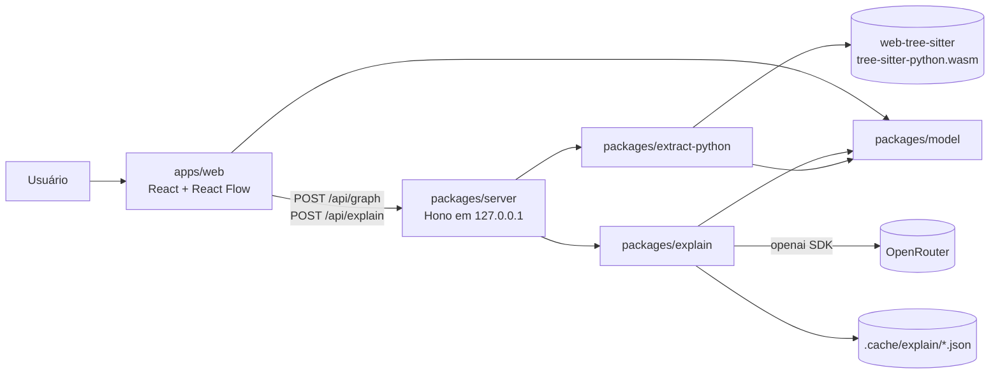
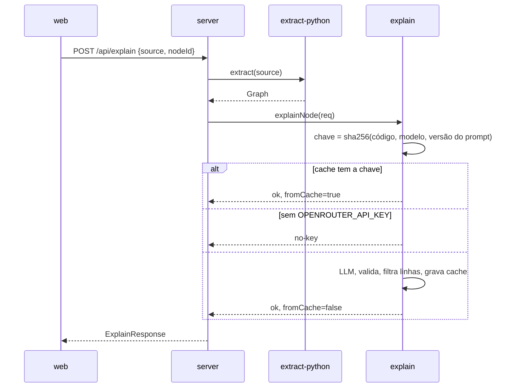

# Fatia Central Design

**Spec**: `.specs\features\01-fatia-central\spec.md`
**Status**: Draft

---

## Exploração de abordagens

Todas as abordagens entregam as mesmas 24 ACs. A diferença é onde o parsing e a chamada ao LLM rodam.

**Recomendada: A. Servidor faz parsing e explicação, web só desenha.**
O servidor Node recebe o trecho e roda o extrator Tree-sitter. Ele devolve o grafo inteiro em JSON. Para explicar um nó, o servidor extrai o grafo de novo, acha o nó pelo ID e chama o LLM. A web não carrega wasm e nunca vê a chave.
- Prós: um só runtime para o parser (Node), já testado nesta fase. A chave fica no servidor. O servidor monta o pedido ao LLM a partir do próprio grafo, então a CORE-17 é garantida no servidor. A feature 02-pasta-local lê arquivos do disco, o que já exige o servidor.
- Contras: cada "Gerar mapa" faz uma ida e volta HTTP. Num app local isso custa milissegundos.

**B. Parsing no navegador e servidor só como proxy do LLM.** Rejeitada. O wasm teria dois caminhos de carga (Vite e Vitest/Node). O servidor teria de confiar no código e nos vizinhos enviados pela web. A feature 02 traria o parser de volta ao servidor.

**C. `ast` do CPython num subprocesso.** Rejeitada. Contraria a AD-004 (Tree-sitter) e exige Python instalado. O `ast` falha no arquivo inteiro diante de um erro de sintaxe, então a CORE-06 não passa.

---

## Architecture Overview

O monorepo tem cinco pacotes. As dependências apontam só para baixo: `model` é a base, e `server` é a raiz de composição. A web conversa com o servidor só por HTTP.





### Fronteiras e como o build as garante (AD-005)

1. Cada `package.json` exporta só `"."` → `./src/index.ts`. Um import como `@8n8/model/src/ids` falha na resolução.
2. O pnpm cria um `node_modules` estrito. Um pacote só resolve as dependências que declara.
3. O `.dependency-cruiser.cjs` roda em `pnpm check` e bloqueia:
   - ciclos;
   - import fora das setas do diagrama, por exemplo `web` → `explain`;
   - import de `node:*` em `model` e em `apps/web`;
   - caminho relativo que sai da pasta do pacote (`../../packages/...`).

Não usamos project references do TypeScript. Os pacotes exportam o código-fonte, como no roadmap, e cada um roda `tsc --noEmit`.

---

## Code Reuse Analysis

O 8n8 ainda não tem código. O reuso vem do roadmap.

| Componente | Local | Como usar |
| --- | --- | --- |
| Padrão do cliente OpenRouter | `roadmap\packages\agents\src\llm.ts` | Copiar e reduzir: `baseURL` do OpenRouter, `maxRetries: 0`, `response_format: json_object` para DeepSeek, instrução de JSON no sistema para `google/*`, remoção de cercas ```` ``` ````, `safeParse` do zod, `reasoning: { enabled: false }` no DeepSeek. Sem pRetry, sem re-prompt de schema, sem streaming e sem tracer: novas tentativas estão em Deferred. |
| Monorepo | `roadmap\pnpm-workspace.yaml`, `tsconfig.base.json` | Mesmo layout `apps/*` + `packages/*`. Mesmas opções do TS (`strict`, `noUncheckedIndexedAccess`, `exactOptionalPropertyTypes`, `moduleResolution: bundler`). |
| Pacote com exports de fonte | `roadmap\packages\core\package.json` | `"type": "module"`, `exports: { ".": "./src/index.ts" }`, `build: tsc --noEmit`. |
| Config do Vitest | `roadmap\packages\agents\vitest.unit.config.ts` | Mesma forma: `environment: node`, testes em `src/__tests__/`. A web usa `jsdom`. |
| Biome | `roadmap\biome.json` | Mesmas regras. O formato muda no Biome 2 (ver Riscos). |

### Integration Points

| Sistema | Integração |
| --- | --- |
| OpenRouter | `openai` SDK com `baseURL: https://openrouter.ai/api/v1` e `OPENROUTER_API_KEY` (AD-002). |
| `.env` | O servidor chama `process.loadEnvFile()` dentro de `try`. Sem dependência `dotenv`. |
| `docs\portugues-tecnico-simplificado.md` | O servidor lê o arquivo na partida e passa o texto para `buildSystemPrompt`. |

---

## Components

### model: `packages/model` (`@8n8/model`)

- **Purpose**: Tipos do grafo e da explicação, regras de ID e o contrato `Extractor`. Não faz I/O.
- **Interfaces**:
  - tipos `Graph`, `FlowNode`, `FlowEdge`, `Explanation`, `ExplainResponse` (ver Data Models);
  - `interface Extractor { language: string; extract(source: string): Graph }`: contrato que outras linguagens implementam;
  - `topLevelId(kind: 'function' | 'class', name: string, occurrence: number): NodeId`;
  - `childId(parentId: NodeId, segment: string): NodeId`;
  - `sliceLines(source: string, range: LineRange): string`: linhas exatas do nó, com a indentação original;
  - `syntaxErrorLabel(line: number): string`: retorna `"Erro de sintaxe na linha N"`.
- **Dependencies**: nenhuma.
- **ACs**: CORE-04 (regras de ID), CORE-06 (texto do erro), CORE-14 (`sliceLines`).

### extract-python: `packages/extract-python` (`@8n8/extract-python`)

- **Purpose**: Converte código Python num `Graph` de forma determinística, sem LLM.
- **Interfaces**:
  - `createPythonExtractor(): Promise<Extractor>`: chama `Parser.init()` e `Language.load(wasm)` uma vez. Acha o wasm com `createRequire(import.meta.url).resolve('tree-sitter-python/tree-sitter-python.wasm')`. O pacote não tem campo `exports`, então o subcaminho resolve.
  - Módulos internos, não exportados: `build-graph.ts` (nível superior), `steps.ts` (passos do corpo), `calls.ts` (resolução de chamadas), `classify.ts` (tabela de prefixos), `imports.ts` (mapa de aliases), `errors.ts` (nós ERROR/MISSING).
- **Regras de extração**:
  1. Nível superior: um nó por `def` e `class` (CORE-01). O resto vira passos de um nó `module` com rótulo "Módulo" (CORE-03). Os `import` não contam: eles alimentam o mapa de aliases, mas sozinhos não criam o nó `module`. Sem passos que não sejam `import`, o nó `module` não existe.
  2. Uma `class` abre para os métodos (nós `function`) e para as instruções do corpo.
  3. Cada instrução de um corpo vira um passo, na ordem do código (CORE-08):
     - `if/elif/else` → `condition`, com o texto do `if` como rótulo. Os ramos ficam no mesmo nível, ligados por fios `branch` (CORE-09). Os rótulos são `"sim"`, o texto de cada `elif` e `"não"`. Sem `else`, o fio `"não"` vai ao passo seguinte ao `if`. Se não há passo seguinte, o fio `"não"` não existe.
     - `for`/`while` → `loop`, que abre para o corpo (CORE-10).
     - `try`, `with`, `match` → `block`, que abre para o corpo. A expressão de um `with` é classificada como uma chamada comum.
     - Instrução com chamada a uma função ou classe do trecho → `call`, com `target` (CORE-11).
     - Instrução com chamada externa → `external`, com `category` (CORE-12).
     - Instruções seguidas sem chamada que conte e sem controle de fluxo → um só nó `code` com o intervalo de linhas (CORE-13). Um `return` sem chamada entra no grupo.
  4. Uma chamada conta quando:
     - o nome resolve para um `def` ou `class` do nível superior;
     - ou `self.m()` resolve para um método da mesma classe;
     - ou o nome, depois de trocar os aliases de `import`, casa um prefixo da tabela;
     - ou a raiz do nome é um nome importado.

     Builtins (`len`, `print`, `int`...) e métodos de variáveis locais não contam, exceto `open`, `.execute(` e `.commit(`. Se uma instrução tem várias chamadas, a chamada do trecho vence. Senão, vale a primeira externa na ordem do código.
  5. Tabela, testada nesta ordem: HTTP (`requests`, `httpx`, `urllib`, `aiohttp`); BANCO (`sqlite3`, `psycopg`, `sqlalchemy`, `.execute`, `.commit`); ARQUIVO (`open`, `pathlib`); EMAIL (`smtplib`). O resto é EXTERNO.
  6. Fios `calls` ligam funções, métodos, classes e o `module` às funções e classes que eles chamam (CORE-02). Há um fio por par, sem repetição.
  7. Erros de sintaxe: cada nó `ERROR` ou `MISSING` marca `syntaxError.line` no nó mais interno do grafo que contém a linha. Fora de qualquer função, a marca vai para o `module`, que é criado se faltar (CORE-06). Grafo sem nós → `empty: true` (CORE-07).
- **Dependencies**: `@8n8/model`, `web-tree-sitter`, `tree-sitter-python`.
- **Reuses**: nada. É código novo.
- **ACs**: CORE-01..13 e CORE-06/07.

### explain: `packages/explain` (`@8n8/explain`)

- **Purpose**: Gera a explicação de um nó com uma única chamada ao LLM, com cache em disco e filtro de linhas.
- **Interfaces**:
  - `interface LlmClient { complete(req: { model: string; messages: ChatMessage[]; json: 'native' | 'prompt' }): Promise<string> }`;
  - `createOpenRouterClient(apiKey: string): LlmClient`: implementação real com o `openai` SDK, timeout de 60 s e `maxRetries: 0`;
  - `resolveModel(env: Record<string, string | undefined>): string`: retorna `APP8N8_MODEL` ou `~deepseek/deepseek-v4-flash-latest` (CORE-21);
  - `buildSystemPrompt(ptsRules: string): { text: string; version: string }`: o texto junta o papel, o formato JSON com exemplo e as regras do PTS. `version` = os primeiros 12 hex do sha256 do texto. Editar o PTS invalida o cache sozinho;
  - `createDiskCache(dir: string): ExplainCache`, com `get(key)` e `set(entry)`. A gravação é atômica: arquivo temporário e depois `rename`;
  - `explainNode(req: ExplainRequest, deps: ExplainDeps): Promise<ExplainResponse>`.
- **Fluxo de `explainNode`**:
  1. Calcula `key = sha256(JSON.stringify([code, model, promptVersion]))` (CORE-18).
  2. Se o cache tem a chave, retorna `ok` com `fromCache: true` e não chama o LLM.
  3. Sem `llm` (sem chave), retorna `no-key` (CORE-19).
  4. Monta a mensagem do usuário com o nome e o tipo do nó, as listas `chama` e `chamado por` (só nomes) e o código numerado de 1 a n. Só isso (CORE-17).
  5. Faz uma chamada (CORE-16). Remove cercas, faz `JSON.parse` e valida com zod.
  6. Descarta as sugestões com `line` fora de 1..n (CORE-22) e mantém as 5 primeiras.
  7. Grava o resultado no cache com linhas relativas. Converte para linhas absolutas (`line + range.start - 1`) e retorna.
- **Por que linhas relativas**: a chave usa só o código. Se a mesma função muda de posição no trecho, o cache acerta e as linhas absolutas continuam corretas.
- **Modo JSON**: `native` (`response_format: json_object`) para todo modelo que não começa com `google/`, e `prompt` para `google/*`. A regra copia o roadmap. O prompt de sistema sempre pede "responda só com JSON", porque o DeepSeek exige a palavra "JSON" no prompt.
- **Dependencies**: `@8n8/model`, `openai`, `zod`, `node:crypto`, `node:fs`.
- **Reuses**: o padrão do `llm.ts` do roadmap, reduzido.
- **ACs**: CORE-16..18, CORE-19 (status), CORE-20 (status), CORE-21, CORE-22.

### server: `packages/server` (`@8n8/server`)

- **Purpose**: Raiz de composição. Lê o ambiente, liga o extrator ao explain e expõe a API em `127.0.0.1`.
- **Interfaces**:
  - `createApp(deps: { extractor: Extractor; explain: (req: ExplainRequest) => Promise<ExplainResponse>; port: number }): Hono`: os testes chamam `app.request()` sem rede;
  - `POST /api/graph` `{ source: string }` → `200 { graph }`;
  - `POST /api/explain` `{ source: string; nodeId: string }` → `200 ExplainResponse`, `502` com `{ status: 'error' }`, `404` para nó desconhecido e `400` para um tipo de nó que não é `function` nem `class`;
  - `main.ts`: carrega o `.env`, lê o PTS, cria o extrator, cria o cliente só se `OPENROUTER_API_KEY` existe e chama `serve({ fetch, port: 4317, hostname: '127.0.0.1' })`. Em modo `start`, serve `apps/web/dist` como arquivos estáticos.
- **Regras**:
  - o corpo de cada requisição é validado com zod;
  - um middleware recusa todo `Host` diferente de `127.0.0.1:4317` ou `localhost:4317`, contra DNS rebinding;
  - os vizinhos de um nó saem dos fios `calls` do grafo extraído pelo próprio servidor, nunca da web.
- **Dependencies**: `@8n8/model`, `@8n8/extract-python`, `@8n8/explain`, `hono`, `@hono/node-server`, `zod`.
- **ACs**: CORE-05 (o grafo não passa pelo explain), CORE-17 (o servidor monta o pedido), CORE-19 (cliente opcional), CORE-20 (502).

### web: `apps/web` (`@8n8/web`)

- **Purpose**: Cola o trecho, desenha um nível do grafo por vez, navega pelos níveis e mostra o painel do nó.
- **Interfaces e módulos**:
  - `api.ts`: `fetchGraph(source)` e `fetchExplanation(source, nodeId)`;
  - `nav/navigation.ts`: um reducer puro sobre `{ path: NodeId[]; selected: NodeId | null }`, com as ações `open(id)`, `goTo(index)` e `select(id)`. Abrir um `call` empilha o `target` (CORE-11). Abrir `function`, `class`, `module`, `loop` ou `block` empilha o próprio nó;
  - `flow/project-level.ts`: `projectLevel(graph, containerId | null): { nodes; edges }` é puro. No nível superior, ele sobe as pontas dos fios `calls` até o ancestral visível e remove laços e repetições;
  - `flow/layout.ts`: `layoutLR(nodes, edges)` com `@dagrejs/dagre`, `rankdir: 'LR'`;
  - `flow/FlowCanvas.tsx`: `<ReactFlow>` com o tipo de nó `StepNode`. `StepNode` mostra o ícone do tipo, a categoria externa, o selo de erro de sintaxe e o selo com o número de sugestões (CORE-23);
  - `nav/Breadcrumb.tsx`: mostra "Trecho › calcular_frete › for item in itens". Um clique em qualquer item volta a esse nível (CORE-15);
  - `panel/DetailPanel.tsx`: mostra o intervalo de linhas e o `CodeView` do nó (CORE-14). Para `function` e `class`, busca a explicação ao abrir. Mostra o resumo, as entradas, as saídas e as sugestões. Para `no-key`, mostra "Configure OPENROUTER_API_KEY para ver resumos". Para `error`, mostra "Resumo indisponível" com o botão "Tentar de novo" (CORE-16, 19, 20);
  - `panel/CodeView.tsx`: um `<pre>` com o número de cada linha. Um clique numa sugestão marca a linha dela (CORE-24).
- **Estado**: as explicações ficam num `Map<NodeId, Explanation>` na memória da sessão. O selo aparece depois que o nó tem explicação, seja do LLM ou do cache.
- **Dependencies**: `@8n8/model` (só tipos), `react`, `react-dom`, `@xyflow/react`, `@dagrejs/dagre`. O Vite faz proxy de `/api` para `127.0.0.1:4317`.
- **ACs**: CORE-01..03 e CORE-07 (desenho), CORE-08..15, CORE-19, 20, 23, 24 (interface).

---

## Data Models

### Grafo (`@8n8/model`)

```typescript
type NodeId = string
type NodeKind =
  | 'module' | 'function' | 'class'                   // nível superior (CORE-01, 03)
  | 'code' | 'call' | 'external' | 'condition' | 'loop' | 'block' // passos (CORE-08..13)
type ExternalCategory = 'HTTP' | 'BANCO' | 'ARQUIVO' | 'EMAIL' | 'EXTERNO'

interface LineRange { start: number; end: number }   // 1-based, inclusivo

interface FlowNode {
  id: NodeId
  kind: NodeKind
  label: string               // nome, condição, cabeçalho do laço ou "Código"
  parentId: NodeId | null     // null = nível superior
  range: LineRange
  openable: boolean           // function, class, module, loop, block e call
  target?: NodeId             // só em 'call': a função que abre no drill-down
  callee?: string             // 'call' e 'external': nome completo, sem aliases
  category?: ExternalCategory // só em 'external'
  syntaxError?: { line: number }
}

type EdgeKind = 'calls' | 'next' | 'branch'
interface FlowEdge {
  id: string                  // `${kind}:${source}->${target}`
  kind: EdgeKind
  source: NodeId
  target: NodeId
  label?: string              // só em 'branch': "sim", "não" ou o texto do elif
}

interface Graph {
  language: 'python'
  empty: boolean              // CORE-07
  nodes: FlowNode[]           // pré-ordem, na ordem do código
  edges: FlowEdge[]           // na ordem em que o percurso os cria
}
```

**Regras de ID (CORE-04, AD-006)**: os IDs saem do caminho na estrutura, nunca de contadores globais ou de dados aleatórios.
- Nível superior: `fn:calcular_frete`, `cls:Pedido` e `mod`. Um nome repetido recebe `#2`, `#3`... na ordem do código.
- Método: `cls:Pedido/fn:validar`.
- Passo: `<pai>/s<i>`, onde `i` é a posição no corpo do pai.
- Passo dentro de um ramo: `<condição>/b<j>/s<i>`, onde `j` é a posição do ramo.

A mesma entrada produz o mesmo JSON, byte a byte. O teste da CORE-04 extrai duas vezes com dois extratores novos, compara com `toEqual` e confere um snapshot.

### Explicação

```typescript
type Severity = 'alta' | 'media' | 'baixa'
interface Suggestion { command: string; reason: string; line: number; severity: Severity }
interface Explanation { summary: string; inputs: string[]; outputs: string[]; suggestions: Suggestion[] }

// Pedido interno do explain. O servidor monta a partir do grafo (CORE-17).
interface ExplainRequest {
  nodeName: string
  nodeKind: 'function' | 'class'
  code: string                // sliceLines(source, node.range)
  range: LineRange
  calls: string[]             // nomes dos nós que o nó chama
  calledBy: string[]          // nomes dos nós que chamam o nó
}

type ExplainResponse =
  | { status: 'ok'; explanation: Explanation; fromCache: boolean }  // linhas absolutas
  | { status: 'no-key' }
  | { status: 'error'; message: string }
```

Schema zod da resposta do LLM: `{ summary: string; inputs: string[]; outputs: string[]; suggestions: { command, reason, line: int ≥ 1 (relativa), severity } [] }`. O schema não limita o tamanho da lista. O código mantém as 5 primeiras sugestões válidas.

### Entrada do cache

```typescript
// Arquivo: <repo>/.cache/explain/<key>.json  (fora do git, sem expiração)
interface CacheEntry {
  schemaVersion: 1
  key: string                 // sha256 hex de [code, model, promptVersion]
  model: string
  promptVersion: string
  createdAt: string           // ISO; só informativo
  result: Explanation         // linhas RELATIVAS ao nó, já filtradas
}
```

---

## Error Handling Strategy

| Cenário | Tratamento | O que o usuário vê |
| --- | --- | --- |
| Erro de sintaxe no trecho | O extrator marca `syntaxError` no nó mais interno e monta o resto (CORE-06). | Mapa parcial. O nó afetado mostra "Erro de sintaxe na linha N". |
| Trecho vazio ou só com comentários | `empty: true`. | "Nenhuma função ou instrução encontrada." |
| Corpo da requisição inválido | zod → `400`. | Aviso genérico de erro na área do mapa. |
| `nodeId` desconhecido (trecho mudou) | `404`. | O painel pede "Gerar mapa" de novo. |
| Sem `OPENROUTER_API_KEY` | O servidor não cria o cliente. O explain retorna `no-key` quando o cache não tem a chave. | O mapa funciona. O painel mostra "Configure OPENROUTER_API_KEY para ver resumos". |
| LLM: rede, timeout, HTTP 4xx/5xx | Captura o erro, retorna `502` com `error` e não grava no cache. | "Resumo indisponível" e o botão "Tentar de novo". O mapa continua utilizável. |
| LLM: JSON inválido ou fora do schema | Mesmo caminho do anterior. Sem re-prompt (Deferred). | O mesmo. |
| Sugestão com linha fora do nó | Descartada antes do cache (CORE-22). | A sugestão não aparece. |
| Arquivo de cache corrompido | `get` trata como ausente e o novo resultado sobrescreve o arquivo. | Nada. |
| Falha ao gravar o cache | Registra no console e retorna o resultado. | Nada. A próxima abertura chama o LLM de novo. |
| Wasm da gramática ausente | `createPythonExtractor` rejeita, e o `main` termina com uma mensagem clara. | O servidor não sobe. |
| Porta 4317 ocupada | `EADDRINUSE` → termina com uma mensagem. | O servidor não sobe. |
| `Host` estranho | `403`. | Nada (é proteção). |

---

## Matriz de testes (tudo sem rede)

| ACs | Onde | Como |
| --- | --- | --- |
| 01–04, 06–13 | `extract-python` (Vitest, Node) | Fixtures `.py` em `src/__tests__/fixtures/`. A principal é o exemplo do vídeo. |
| 05 | `server` | O `createApp` recebe um explain espião. `POST /api/graph` não chama o espião. |
| 14, 15 | `web` (`navigation.ts`, `projectLevel`, `CodeView` com jsdom) | O reducer e a projeção são puros. O `CodeView` passa pela Testing Library. |
| 16–18, 21, 22 | `explain` | `LlmClient` falso que conta as chamadas e guarda as mensagens. O cache usa um diretório temporário. |
| 19, 20 | `explain`, `server` e `DetailPanel` (jsdom) | Sem cliente → `no-key`. Cliente que lança → `502`. O painel mostra os textos da spec. |
| 23, 24 | `StepNode` e `DetailPanel` (jsdom, dentro de `ReactFlowProvider`) | Selo com a contagem. Clique na sugestão → a linha recebe a marca. |

A fixture do vídeo precisa ter:
- `processar_pedido` chamando `calcular_frete`;
- dentro de `calcular_frete`, nesta ordem: `requests.get(...)`, depois atribuições sem chamada e depois `if peso > 30: ... else: ...`.

---

## Risks & Concerns

| Concern | Location | Impact | Mitigation |
| --- | --- | --- | --- |
| O local e a forma dos nós `ERROR` do Tree-sitter variam com o tipo de erro. | `extract-python/src/errors.ts` | A CORE-06 pode marcar o nó errado. | Uma fixture por classe de erro: parêntese aberto, `def` sem `:` e indentação. Um teste nesta fase confirmou que `def b(:` mantém as duas funções. |
| `tree-sitter-python` tem um script de instalação `node-gyp-build`. | `package.json` raiz | Uma build nativa no Windows pode falhar. | O pnpm ≥ 10 não roda scripts de dependências sem aprovação. Não aprovar esse script: o projeto usa só o `.wasm`. |
| O React Flow no jsdom precisa de `ResizeObserver` e de medidas. | testes de `apps/web` | Testes de componente quebradiços. | A lógica fica em funções puras (`projectLevel`, `navigation`, `layoutLR`). Componentes rodam sem `<ReactFlow>`, só dentro de `ReactFlowProvider`. O canvas tem uma checagem manual no Independent Test. |
| A chave do cache não inclui os nomes dos vizinhos (a spec fixa código + modelo + prompt). | `explain/src/explain.ts` | Um resumo que cita um vizinho fica velho quando só os vizinhos mudam. | Seguir a spec. Ver a pergunta no relatório. |
| DNS rebinding contra o servidor local gastaria a chave. | `server/src/app.ts` | Custo no OpenRouter. | Bind em `127.0.0.1`, checagem de `Host` e nenhum CORS. |
| A resolução de nomes é estática e simples (sem tipos e sem `import *`). | `extract-python/src/calls.ts` | Algumas chamadas viram `code` ou `EXTERNO` em vez de `call`. | O determinismo continua. O limite fica documentado. A tabela e a resolução ficam isoladas para crescer depois. |
| Biome 2 mudou o formato da config (`organizeImports` → `assist`, `files.ignore` → `files.includes`). | `biome.json` | Copiar o arquivo do roadmap falha. | Gerar com `biome init` e portar as regras. |
| `response_format: json_object` e `reasoning.enabled=false` são extensões do OpenRouter que esta fase não testou com uma chamada real. | `explain/src/openrouter.ts` | Uma resposta fora de JSON vira "Resumo indisponível". | O roadmap usa as duas em produção com o mesmo modelo. Um smoke test manual com a chave fica na fase Execute. |

---

## Tech Decisions

| Decisão | Escolha | Motivo |
| --- | --- | --- |
| Runtime | Node 24 (local v24.14.0), `engines >=22.12` | Exigência do Vitest 5, do Vite 8 e do openai 7. |
| Gerenciador | pnpm 12.6.0 (`packageManager`) | Versão instalada na máquina. A última é 12.11.2. |
| Parser | `web-tree-sitter` 0.27.1 + `tree-sitter-python` 0.25.0 (`.wasm` dentro do pacote) | **Verificado**: carga e parse em Node 24 com ABI 15. `Parser.init()` acha o próprio wasm sem `locateFile`. |
| Servidor | `hono` 4.13.13 + `@hono/node-server` 2.1.5 | O mais leve com roteamento e `app.request()` para testes. **Verificado**: `serve` aceita `hostname`. Fastify é mais pesado. `node:http` puro exigiria roteamento e parsing feitos à mão. |
| Layout | `@dagrejs/dagre` 3.1.1 | Síncrono e pequeno. **Verificado**: `layout()` com `rankdir`. Cada nível é um grafo plano, então os nós compostos do `elkjs` (0.12.0) não fazem falta. |
| Fluxo | `@xyflow/react` 12.12.0 | Peer `react >=17`. |
| UI | `react`/`react-dom` 19.3.0, `vite` 8.3.4, `@vitejs/plugin-react` 6.1.2 | Versões atuais. O React 19.3.0 saiu em 2026-10-12, então o lockfile fixa a versão. |
| LLM | `openai` 7.32.0 | **Verificado** no `.d.ts`: `chat.completions.create`, `response_format`, `baseURL`, `maxRetries`. Aceita zod 4 como peer. |
| Validação | `zod` 4.6.7 | O roadmap usa o 3. O 4 é a versão atual e o openai 7 aceita. |
| Testes | `vitest` 5.0.4, `jsdom` 30.1.2, `@testing-library/react` 16.3.3 | O Vitest 5 tem peer `vite ^8`. |
| TypeScript | 6.0.3 | O 7.0.2 (compilador nativo) é o `latest`, mas é novo. O 6 só faz typecheck aqui e não trava nada. |
| Lint e fronteiras | `@biomejs/biome` 2.5.15 + `dependency-cruiser` 18.6.0 | O Biome cobre o estilo. O dependency-cruiser cobre a direção dos pacotes (AD-005). |
| Execução do TS | `tsx` 4.23.15 | Os pacotes exportam o fonte, igual ao roadmap. |
| Versão do prompt | hash do prompt de sistema montado | Mudar o PTS ou o template invalida o cache sem trabalho manual. |
| Porta | fixa em 4317 | Nenhuma configuração foi pedida. |

**Incertos**: as regras do `dependency-cruiser` 18 (sintaxe vista em versões anteriores, não checada nesta) e o peer do `@testing-library/react` 16.3.3 com React 19.3. As duas checagens ficam para a primeira task.

---

## Layout do monorepo

```
8n8/
├── package.json                # scripts: dev, start, test, check (biome + depcruise), typecheck
├── pnpm-workspace.yaml         # apps/*, packages/*
├── tsconfig.base.json
├── biome.json
├── .dependency-cruiser.cjs
├── .env                        # OPENROUTER_API_KEY, APP8N8_MODEL (fora do git)
├── .gitignore                  # .env, .cache/, node_modules, dist
├── .cache/explain/             # criado em tempo de execução
├── docs/portugues-tecnico-simplificado.md
├── packages/
│   ├── model/src/              index.ts graph.ts explanation.ts ids.ts lines.ts
│   ├── extract-python/src/     index.ts build-graph.ts steps.ts calls.ts classify.ts imports.ts errors.ts
│   │                           __tests__/fixtures/*.py
│   ├── explain/src/            index.ts explain.ts prompt.ts schema.ts cache.ts openrouter.ts model-env.ts
│   └── server/src/             index.ts app.ts main.ts
└── apps/
    └── web/                    index.html vite.config.ts
        └── src/                main.tsx App.tsx api.ts
                                flow/  project-level.ts layout.ts FlowCanvas.tsx StepNode.tsx
                                nav/   navigation.ts Breadcrumb.tsx
                                panel/ DetailPanel.tsx CodeView.tsx
```

Cada pacote tem `package.json`, `tsconfig.json` (que estende a base) e `vitest.config.ts`. Os testes ficam em `src/__tests__/`. O responsável "entrada" da AD-003 ainda não vira pacote, porque nesta feature a entrada é uma string colada. A feature 02-pasta-local cria `packages/input`.
