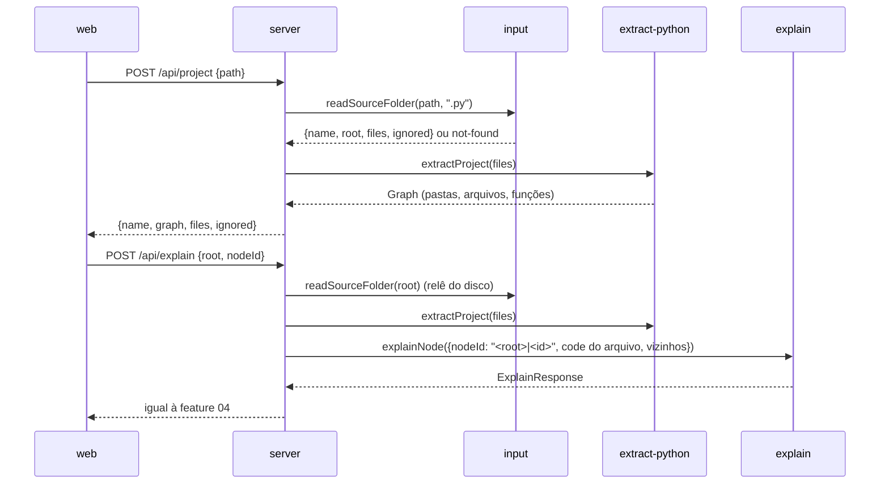

# Pasta Local Design

**Spec**: `.specs/features/02-pasta-local/spec.md`
**Status**: Draft

---

## Abordagens

Todas entregam o mesmo escopo (PROJ-01..09).

| | Abordagem | Veredito |
| - | --------- | -------- |
| **A** | **Leitura no pacote novo `input`, ligação no `extract-python`.** O `input` lê a pasta e devolve `SourceFile[]` e a lista de ignorados. O `extract-python` ganha `extractProject(files)`: em duas passadas, monta o índice de módulos e depois constrói cada arquivo com um prefixo de ID e um resolvedor de imports. O servidor compõe os dois. A explicação relê a pasta a cada pedido, sem estado. | **Recomendada.** Segue AD-003/005/007. A regra de "chamada vence externo" do `resolveCall` continua num lugar só. O modo trecho não muda. |
| B | Ligação depois da extração: extrair cada arquivo com o extrator atual e um "linker" que reescreve IDs e troca nós `external` por `call` olhando o `callee`. | Rejeitada. O grafo já perdeu a informação: `resolveCall` escolhe o primeiro externo e descarta a chamada de projeto que vem depois. Nomes sem import viram `null` e somem, o que impede PROJ-09. Os imports relativos chegam errados (`from . import x` vira `..x`). A semântica de Python vazaria para fora do `extract-python`. |
| C | Sessão no servidor: `/api/project` guarda o projeto extraído em memória e devolve um ID de sessão; `/api/explain` usa a sessão. | Rejeitada agora. Cria estado, invalidação e o risco de explicar código velho. A releitura sem estado é igual à feature 01. Vira mitigação se a medição mostrar lentidão (ver Riscos). |

---

## Architecture Overview



Setas de pacote: `model` ← `input`; `model` ← `extract-python`; `model` ← `explain`; `input`, `extract-python`, `explain` ← `server`. A web importa só `model`.

---

## Code Reuse Analysis

| Componente | Local | Uso |
| ---------- | ----- | --- |
| `buildGraph` | `packages/extract-python/src/build-graph.ts` | Ganha `options.prefix` e `options.resolveImport`. Sem opções, a saída é idêntica (snapshots da feature 01). |
| `resolveCall`/`resolveOne` | `packages/extract-python/src/calls.ts` | Consulta o resolvedor de projeto antes de classificar como externo. |
| `importAliases` | `packages/extract-python/src/imports.ts` | Base dos aliases. Corrige a junção relativa (`from . import x` hoje gera `..x`). |
| `markSyntaxErrors` | `errors.ts` | Por arquivo, sem mudança. |
| `childId`, `topLevelId` | `packages/model/src/ids.ts` | Os IDs internos continuam saindo do pai: basta trocar a raiz. |
| `projectLevel`/`liftedCalls` | `apps/ui/src/flow/project-level.ts` | A elevação vira genérica por tipo de aresta. |
| Guarda de `Host` e `hostname: "127.0.0.1"` | `server/src/app.ts`, `main.ts` | PROJ-08 já existe; a rota nova fica atrás da mesma guarda. |
| Pipeline e cache de explicação | `packages/explain` | Sem mudança. O servidor passa a identidade com escopo em `nodeId`. |

---

## Components

### C1. Contrato em `model` (`graph.ts`, `ids.ts`, `project.ts` novo) (PROJ-02, 03)

- `NodeKind` ganha `"folder"` e `"file"`. `EdgeKind` ganha `"imports"`.
- `FlowNode.path?: string`: caminho POSIX relativo à raiz, só em nós `folder` e `file` (só em pastas e arquivos; não há nó "raiz").
- `Graph.project?: { name: string }`: presente só no grafo de projeto. `name` é o nome da pasta raiz.
- `ids.ts`: `folderId(rel)` → `dir:<rel>` (raiz: `dir:.`); `fileId(rel)` → `file:<rel>`. Os nós internos usam `childId(fileId, <id do trecho>)`, por exemplo `file:pedidos/pedidos.py/fn:processar_pedido/s2`.
- `project.ts`:
  ```ts
  interface SourceFile { path: string; source: string }          // path POSIX relativo
  type IgnoreReason = "too-large" | "not-utf8" | "unreadable" | "symlink";
  interface IgnoredFile { path: string; reason: IgnoreReason }
  interface ProjectResponse { name: string; graph: Graph; files: SourceFile[]; ignored: IgnoredFile[] }
  interface ProjectExtractor { extractProject(files: SourceFile[]): Graph }
  function fileNodeOf(graph: Graph, id: NodeId): FlowNode | undefined   // sobe por parentId até kind "file"
  ```
- `Extractor` não muda (o stub de `host-guard.test.ts` continua válido).

### C2. Leitura da pasta: pacote novo `packages/input` (PROJ-01, 05, 06, 07)

- **Interface**: `readSourceFolder(path: string, extension: string): Promise<FolderRead>`, com `FolderRead = { kind: "ok"; name; root; files: SourceFile[]; ignored: IgnoredFile[] } | { kind: "not-found" }`.
- **Raiz**: `path.resolve(path)` e `fs.realpath.native`. Se não existe ou não é pasta, devolve `not-found` (PROJ-05). `root` é o caminho real absoluto. `name` é `basename(root)`, ou o próprio `root` quando ele é a raiz do disco.
- **Caminhada**: recursiva com `readdir(withFileTypes)`. As entradas são ordenadas por comparação de código (`a < b`), nunca `localeCompare`, para a ordem não depender do sistema.
- **Pastas ignoradas** (`IGNORED_DIRS`): `.git`, `.venv`, `venv`, `node_modules`, `__pycache__`, `site-packages`, `build`, `dist`. A comparação é pelo nome exato em qualquer profundidade. Elas não aparecem em "Arquivos ignorados", porque não são arquivos.
- **Arquivo**: só entra se termina em `extension`. Antes de ler, o `lstat` checa o tamanho: acima de 1 048 576 bytes, `too-large`. A leitura usa `TextDecoder("utf-8", { fatal: true })`: bytes inválidos dão `not-utf8`. Erro de leitura (`EACCES`, `EBUSY`...) dá `unreadable` (PROJ-06). O BOM UTF-8 é removido.
- **Links simbólicos** (adiado na spec): não são seguidos. Uma pasta-link é pulada. Um arquivo `.py`-link entra nos ignorados com `symlink`.
- **Só leitura (PROJ-07)**: o pacote usa só `realpath`, `stat`, `lstat`, `readdir` e `readFile`, todos num arquivo `fs-read.ts`. Um teste lê os fontes do pacote e falha se aparecer `writeFile`, `appendFile`, `mkdir`, `rm`, `rename`, `unlink`, `copyFile`, `chmod`, `open(` ou `child_process`.
- **Dependências**: `model` (tipos) e `node:fs`/`node:path`. Nada de `extract-*`.

### C3. Extração de projeto: `packages/extract-python/src/project.ts` e `modules.ts` (PROJ-02, 03, 04, 09)

**Passada 1, índice.** Cada arquivo é analisado uma vez (as árvores ficam vivas até o fim e são liberadas no `finally`).

- Nome de módulo: `a/b/c.py` → `a.b.c`; `a/b/__init__.py` → `a.b`; `__init__.py` na raiz não tem nome de módulo.
- Por arquivo: as definições de topo (`nome → id local`, com a mesma alocação `#n` do `buildGraph`, extraída para uma função comum `allocateTopLevel`; o último `def` com o nome vence, como no Python) e os aliases absolutos.
- Import relativo: com nível `k`, a base é o pacote do arquivo (`a.b` para `a/b/c.py`; `a.b` para `a/b/__init__.py`) subindo `k − 1` níveis. Acima da raiz fica sem resolução.

**Resolução de um nome com pontos `m1.m2…mn`.** Ordem fixa, primeiro acerto vence:

1. A partir da raiz: o maior prefixo que é módulo do índice, com exatamente 1 segmento sobrando.
2. A partir da pasta do arquivo chamador (estilo script), se ela não for a raiz.
3. O segmento sobrando é uma definição de topo do módulo → `childId(fileId, idLocal)`. Se não for, mas o módulo tiver um alias com esse nome (reexportação em `__init__.py`), resolve o alias de novo. Um conjunto de visitados impede ciclo.
4. Sem acerto, o nome continua externo, como hoje. `mod.Classe.metodo` (2 segmentos sobrando) fica externo.

**Passada 2, grafo.** Para cada arquivo, `buildGraph(tree, { prefix: fileId, resolveImport, projectNames })`:

- `prefix`: os IDs de topo viram `childId(prefix, topLevelId(...))`, `mod` vira `childId(prefix, "mod")` e o `parentId` de topo vira `prefix`. O resto já deriva do pai.
- `resolveImport(fullName)`: em `resolveOne`, quando o nome veio de um import, o resolvedor é consultado antes de `classify`. Um acerto vira `{ kind: "call", target, label }`. O rótulo do passo é o nome como está escrito no código (`calcular_frete`), porque `names` só conhece nomes locais (PROJ-04).
- `projectNames` (PROJ-09): um nome sem definição local e sem import, que existe como definição de topo em outro arquivo, vira passo `external` com `category: "EXTERNO"`. Hoje ele não vira passo. Chamadas a nomes fora do projeto (`print`, `len`) continuam sem passo.
- `from x import *` não é resolvido: os nomes caem na regra acima.

**Nós de pasta e arquivo.** Pré-ordem: as pastas do topo em ordem, depois os arquivos da raiz, com `parentId` nulo (não existe nó "raiz"). Dentro de uma pasta: subpastas, depois arquivos, cada arquivo seguido dos seus nós internos. Só entra pasta que tem `.py` em algum nível abaixo. O nó de arquivo tem `range` de 1 até a última linha. O nó de pasta tem `range {1, 1}` e o painel não mostra linhas para ele.

**Arestas de importação (PROJ-03).** Uma aresta `imports` por par (arquivo, arquivo), id `imports:<origem>-><destino>`. `import a.b` liga ao módulo mais profundo resolvido (`a.b`). `from a import b` liga a `a.b` quando `b` é submódulo, senão a `a`. Import do próprio arquivo e de fora da raiz não geram aresta. As arestas `calls` saem de `callsEdges` como hoje, agora entre arquivos.

- **Interface pública** (`index.ts`): `createPythonExtractor(): Promise<Extractor & ProjectExtractor>`.

### C4. Servidor: `packages/server/src/app.ts` e `main.ts` (PROJ-05, 06, 07, 08)

- **`AppDeps`** ganha `readProject: (path: string) => Promise<ProjectRead>`, com `ProjectRead = { kind: "ok"; root: string; response: ProjectResponse } | { kind: "not-found" }`. O `main.ts` compõe `readSourceFolder(path, ".py")` + `extractor.extractProject(files)`. O `app.ts` não toca o disco.
- **`POST /api/project`**, corpo `{ path: string }` (zod, `min(1)`):
  - `200 { name, graph, files, ignored }`. `ignored` vem ordenado por `path`.
  - `404 { error: "not-found", path }`, com o `path` como o usuário digitou. A web monta "Pasta não encontrada: <caminho>" (PROJ-05).
  - `400 { error: "invalid body" }` e `415` quando o `content-type` não é `application/json` (ver Riscos).
- **`POST /api/explain`** aceita `{ source, nodeId }` (trecho, igual à feature 04) ou `{ root, nodeId }` (projeto). No projeto:
  1. `readProject(root)` relê a pasta e extrai de novo. O servidor não usa código vindo do cliente. Pasta ausente ou nó ausente → `404` (a web já mostra o estado `stale`).
  2. O nó precisa ser `function` ou `class`. `fileNodeOf` dá o arquivo; `code = sliceLines(files[path], node.range)`, com linhas absolutas no arquivo.
  3. Vizinhos: mesmo arquivo → rótulo; outro arquivo → `<path>:<rótulo>` (por exemplo `frete/calculo.py:calcular_frete`), para distinguir nomes iguais (PROJ-09).
  4. `nodeId` enviado ao `explain` = `<root real POSIX>|<id do nó>`. É só a identidade de cache (AD-009); o `explain` não muda.
- **PROJ-08**: o `serve` já usa `hostname: "127.0.0.1"`. Extrair `listenOptions(port)` para testar o `hostname` em unidade. A guarda de `Host` vale para a rota nova.
- `package.json` do servidor declara `@8n8/input`.

### C5. Web (`apps/ui`) (PROJ-02, 03, 04, 05, 06, 09)

- **Entrada**: ao lado do textarea, um campo `aria-label="Caminho da pasta"` e o botão "Abrir pasta". Gerar um trecho ou uma pasta troca o mapa inteiro. Estado: `Mapped = { kind: "snippet"; source; graph } | { kind: "project"; root; response }`.
- **`api.ts`**: `fetchProject(path): Promise<ProjectResponse | { error: "not-found"; path }>`. `fetchExplanation(origin, nodeId)` com `origin = { source } | { root }`.
- **Erros**: `not-found` → `<p role="alert">Pasta não encontrada: <caminho></p>`. Pasta sem `.py` (`graph.empty`) → "Nenhum arquivo .py encontrado na pasta.".
- **Níveis (`projectLevel`)**:
  - nível de topo ou de pasta num grafo de projeto: filhos diretos + arestas `imports` elevados aos nós visíveis;
  - nível de arquivo: filhos diretos + arestas `calls` elevados (o mesmo comportamento do topo do trecho);
  - demais níveis e o trecho: como hoje.
  A elevação vira `lifted(graph, visible, kind)`. Uma aresta cuja ponta não tem ancestral visível no nível some.
- **Aresta de importação**: `className: "edge-imports"` (tracejado em `styles.css`).
- **`StepNode`**: ícones novos para `folder` e `file` (glifos, sem emoji).
- **Navegação**: abrir `folder` ou `file` empilha o ID. Abrir um `call` cujo alvo está em outro arquivo troca o caminho pela ancestralidade do alvo (`ancestry(graph, id)`, pura, em `nav/navigation.ts`), por uma ação nova `{ type: "jump"; path }`. No mesmo arquivo, empilha como na feature 01.
- **Breadcrumb**: o primeiro item é `graph.project?.name ?? "Trecho"`. O resto já são os rótulos do caminho: `loja › pedidos › pedidos.py › processar_pedido`.
- **Painel**: num projeto, mostra o caminho do arquivo acima das linhas. O código vem de `files[fileNodeOf(...).path]`. Nó `folder` mostra só `Pasta: <path>`. Nó `file` mostra o arquivo inteiro, sem resumo. A explicação usa `origin = { root }`.
- **"Arquivos ignorados"** (`panel/IgnoredFiles.tsx`): `<section aria-label="Arquivos ignorados">` só quando a lista não está vazia, com um item `<path> — <motivo>`. Motivos: `too-large` → "maior que 1 MB"; `not-utf8` → "não está em UTF-8"; `unreadable` → "não foi possível ler"; `symlink` → "link simbólico não seguido".
- Funções puras novas (`fileNodeOf` vem do `model`; `ancestry` e `lifted` na web) mantêm AD-010.

### C6. Fronteiras: `.dependency-cruiser.cjs` (AD-005)

- Regra nova `input-only-model`: `^packages/input/` só importa `model`.
- `extract-python-only-model` e `explain-only-model` já impedem `input`. `ui-only-model` já impede `@8n8/input`.
- O comentário de `server-only-core-packages` passa a citar `input`.

---

## Interação com a feature 04

- **Identidade de cache**: `nodeId` do pedido = `<root real>|file:<rel>/fn:x`. Dois projetos com o mesmo caminho relativo não dividem entrada. Os nós de trecho continuam `fn:x`, como a feature 04 definiu. Mover a pasta no disco gera entradas novas (aceito).
- **Vizinhos entre arquivos**: entram em `calls`/`calledBy` com o prefixo do arquivo e, portanto, na impressão digital. Renomear ou mover um vizinho troca o motivo para "os vizinhos mudaram", como CACHE-04 pede.
- **Contrato**: a resposta de `/api/explain` não muda. As linhas continuam absolutas, agora no arquivo do nó.
- **Efeitos externos (FID-14)**: `externalEffects(graph, nodeId)` já percorre descendentes por `parentId` e funciona com os IDs prefixados.

---

## Error Handling Strategy

| Cenário | Tratamento | O que o usuário vê |
| ------- | ---------- | ------------------ |
| Caminho inexistente ou arquivo (PROJ-05) | `404 {error:"not-found", path}` | "Pasta não encontrada: <caminho>" |
| Arquivo > 1 MB, não UTF-8, ilegível, link (PROJ-06) | Fica fora de `files`, entra em `ignored` | Painel "Arquivos ignorados" com o motivo |
| Pasta sem `.py` | `graph.empty: true` | "Nenhum arquivo .py encontrado na pasta." |
| Arquivo com erro de sintaxe | Marcado por arquivo (`markSyntaxErrors`) | O mesmo selo da feature 01 |
| Pasta mudou entre o mapa e a explicação | `404` no explain | Estado `stale` atual |
| Import relativo acima da raiz, `import *`, dinâmico | Sem resolução | Passo `external` ou nenhum, como hoje |

---

## Testes

| Camada | O quê | Onde |
| ------ | ----- | ---- |
| `input` unit | ignorados por nome em qualquer profundidade, 1 MB exato (1 048 576 entra, +1 sai), UTF-8 inválido, `EACCES` (com `vi.mock` de `node:fs/promises`), link, ordem, `not-found` para caminho inexistente e para arquivo, varredura de APIs de escrita (PROJ-07) | `packages/input/src/__tests__/` (árvores em `os.tmpdir()`) |
| `extract-python` unit | nomes de módulo, relativo nível 1 e 2, `__init__.py` e reexportação, fallback da pasta do script, mesmo nome com e sem import (PROJ-09), arestas `imports`, IDs prefixados estáveis em duas execuções, snapshot do trecho sem mudança | `packages/extract-python/src/__tests__/project.test.ts`, `modules.test.ts` |
| `server` unit | `/api/project` 200/404/400/415; explain `{root,nodeId}` monta o pedido com código do disco (arquivo alterado no tmp após o mapa), `nodeId` com escopo, vizinhos qualificados; Host estranho → 403; `listenOptions` | `packages/server/src/__tests__/project-route.test.ts` |
| `web` unit | `lifted`/`projectLevel` por tipo de nível, `ancestry`, `jump`, breadcrumb com nome do projeto, `IgnoredFiles`, mensagem de not-found | `apps/ui/src/**/__tests__/` |
| E2E | ver abaixo | `e2e/pasta-local.e2e.ts` |

**Fixture comprometida**: `packages/extract-python/src/__tests__/fixtures/projeto-loja/` (mesmo padrão do `pedido_frete.py`, usada por unit, servidor e E2E):

```
loja/
  main.py              import pedidos.pedidos; chama pedidos.pedidos.processar_pedido
  relatorio.py         chama calcular_frete() sem import (PROJ-09 → EXTERNO)
  pedidos/__init__.py  vazio
  pedidos/pedidos.py   from frete import calcular_frete; from .itens import somar_itens
  pedidos/itens.py     def somar_itens
  frete/__init__.py    from .calculo import calcular_frete (reexportação)
  frete/calculo.py     def calcular_frete
  legado/frete_antigo.py  def calcular_frete (mesmo nome)
```

**E2E** (`e2e/pasta-local.e2e.ts`, servidor 4317 sem chave). O `beforeAll` copia a fixture para `os.tmpdir()` e acrescenta o que o git não guarda ou não deve guardar: `.venv/lib/x.py`, `dist/y.py`, `grande.py` (1,1 MB) e `latin1.py` (byte `0xE9`). Cada item é um teste:

- PROJ-01/02: o topo tem exatamente `raiz`, `frete`, `legado`, `pedidos`; nenhum nó `.venv` ou `dist` em nenhum nível aberto; abrir `pedidos` mostra `__init__.py`, `itens.py`, `pedidos.py`.
- PROJ-03: aresta `dir:pedidos → dir:frete` e `dir:. → dir:pedidos` no topo; dentro de `pedidos`, aresta `pedidos.py → itens.py`.
- PROJ-04: `pedidos › pedidos.py › processar_pedido` tem o passo `calcular_frete`; o duplo clique leva a `loja › frete › calculo.py › calcular_frete`.
- PROJ-09: em `raiz › relatorio.py › gerar`, `calcular_frete` é externo `EXTERNO`; `legado/frete_antigo.py` não recebe aresta.
- PROJ-05: um caminho inexistente e o caminho de `main.py` mostram "Pasta não encontrada: <caminho>".
- PROJ-06: "Arquivos ignorados" lista `grande.py — maior que 1 MB` e `latin1.py — não está em UTF-8`.
- PROJ-07: a impressão da cópia (caminhos, tamanhos, `mtime` e sha256 de cada arquivo) é igual antes e depois de mapear, navegar e abrir o painel de `calcular_frete`.
- PROJ-08: uma conexão TCP ao primeiro IPv4 não interno da máquina na porta 4317 é recusada.
- Explicação de projeto: o pedido observado (sem mock) para `/api/explain` tem `root` e `nodeId` e não tem `source`; o painel mostra `frete/calculo.py`, as linhas do arquivo e "Configure OPENROUTER_API_KEY para ver resumos".
- Regressão: `e2e/fatia-central.e2e.ts` passa sem mudança (breadcrumb "Trecho").

---

## Risks & Concerns

| Concern | Location | Impact | Mitigation |
| ------- | -------- | ------ | ---------- |
| `from . import x` gera o alias `..x` | `packages/extract-python/src/imports.ts:17` | Import relativo resolveria o nível errado | C3 corrige a junção quando o módulo termina em `.`; teste dedicado |
| Explicação relê e extrai a pasta inteira a cada clique | `server/src/app.ts` (C4) | Lento em pasta grande | Medir na pasta real do usuário. Se passar de ~1 s, adotar a abordagem C só como cache em memória validado pelo sha256 do arquivo |
| POST "simples" de outra página local (`text/plain`) passa pela guarda de `Host` | `server/src/app.ts:26` | Página maliciosa dispara leituras e gasto de LLM | As rotas `/api/project` e `/api/explain` exigem `content-type: application/json` (força preflight, que falha sem CORS) → `415` |
| A guarda não cobre a pasta de cache dentro do repo | `server/src/main.ts` | Analisar o próprio repo do 8n8 escreve em `.cache/` dentro dele | Aceito: o cache é do app, não da pasta analisada, e fica em `.cache/` (fora do git) |
| Colisão teórica de ID: pasta chamada `x.py` com arquivo `fn:y.py` | C1 | Dois nós com o mesmo ID | Impossível no Windows (`:` proibido). Aceito; `extractProject` lança erro se achar ID repetido |
| Feature 04 em andamento edita `App.tsx`, `DetailPanel.tsx`, `api.test.ts` | `apps/ui/src` | Conflito de merge | Agendar a fase web desta feature depois da T22 |

---

## Tech Decisions

| Decisão | Escolha | Motivo |
| ------- | ------- | ------ |
| Hierarquia de pastas | Árvore: cada pasta contém subpastas e arquivos; "raiz" agrupa os `.py` da raiz | Espelha o projeto (CLAUDE.md: repositório → módulo → arquivo) |
| Arestas por nível | Pasta e topo: `imports`. Arquivo: `calls` | Teste independente pede uma aresta de importação entre as pastas, sem aresta de chamada duplicado |
| Ordem de resolução | raiz, depois pasta do script; primeiro acerto vence | Determinística e cobre pacote e script solto. Layout `src/` fica adiado |
| Rótulo do passo de chamada entre arquivos | O nome como está escrito no código | `names` é local; o ID completo seria ilegível |
| Caminho relativo digitado | Resolvido a partir do diretório do servidor | Sem mensagem nova; o uso normal é caminho completo |
