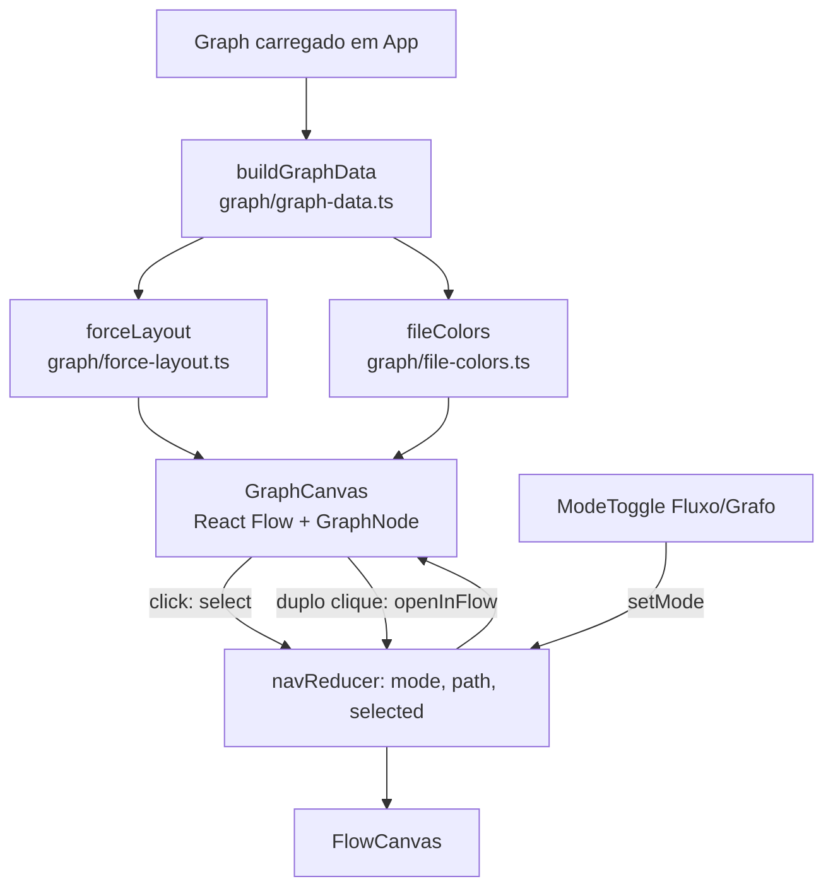

# Modo Grafo Design

**Spec**: `.specs/features/03-modo-grafo/spec.md`
**Status**: Draft

---

## Abordagens

Todas entregam o mesmo escopo (GRAPH-01..07). O layout de forças sai do `Graph` já carregado na web (AD-010).

| | Abordagem | Testabilidade (jsdom / Playwright) | Veredito |
| - | --------- | ---------------------------------- | -------- |
| **A** | **`d3-force` 3.0.0 calcula as posições numa função pura, com número fixo de iterações, e o React Flow 12.12.0 (já instalado) desenha.** Nó próprio `GraphNode` (círculo + rótulo) e fio `straight`. | Layout testável sem DOM. Os nós são DOM com `data-id`, igual ao modo fluxo. Os helpers do E2E da feature 01 servem. | **Recomendada.** Uma dependência nova de ~20 KB. Pan, zoom, `fitView` centrado num nó e duplo clique já existem e já são usados. |
| B | `d3-force` 3.0.0 para as posições e um SVG próprio (`<g role="button">` por nó). | O melhor em jsdom: SVG puro, sem `ResizeObserver`. | Rejeitada. Pan, zoom e centralização ficam por nossa conta. Com a feature 02 (centenas de nós) o zoom passa a ser obrigatório. |
| C | `react-force-graph-2d` 1.29.2 (sobre `force-graph` 1.52.0, canvas). | Canvas: nada no DOM para o E2E. Exige uma lista acessível paralela e um mock de canvas no jsdom. | Rejeitada. A simulação anima no tempo: as posições mudam entre capturas. O pacote puxa d3-zoom, d3-scale, tween.js e lodash-es. Não achei `onNodeDoubleClick` na API (**incerto**); seria preciso emular com dois cliques. |

`cytoscape` 3.34.3 também foi descartado: renderiza em canvas, o layout `cose` é aleatório por padrão e o pacote pesa ~5,7 MB descompactado.

### Fatos verificados sobre `d3-force` 3.0.0 (código-fonte do pacote)

- `random = lcg()` com semente fixa (`s = 1`). Os nós sem `x`/`y` começam numa espiral filotáxica determinística. A mesma entrada na mesma ordem gera as mesmas posições.
- `simulation.tick(n)` roda `n` iterações síncronas sem disparar eventos. `forceSimulation()` inicia um timer, por isso o código chama `.stop()` logo na criação.
- Tipos: `@types/d3-force` 3.0.10.

---

## Architecture Overview



O `App` decide entre `FlowCanvas` e `GraphCanvas` por `nav.mode`. Os dois canvas recebem `centerId` e o passam para `fitViewOptions={{ nodes: [{ id }], maxZoom: 1 }}`: o React Flow centra o nó depois de medi-lo. Sem `centerId`, os dois usam o `fitView` normal.

---

## Code Reuse Analysis

| Componente | Local | Uso |
| ---------- | ----- | --- |
| `ReactFlow`, `fitView`, `onNodeDoubleClick` | `apps/web/src/flow/FlowCanvas.tsx` | O mesmo padrão de canvas, com `zoomOnDoubleClick={false}`. |
| `navReducer` | `apps/web/src/nav/navigation.ts` | Ganha `mode` e duas ações. O `open` e o `goTo` continuam iguais. |
| `StepNode` + teste | `apps/web/src/flow/StepNode.tsx` | Modelo do `GraphNode` e do teste dele. |
| Mock de canvas em `App.test.tsx` | `apps/web/src/__tests__/App.test.tsx` | O `GraphCanvas` é mockado do mesmo jeito que o `FlowCanvas`. |
| Helpers do E2E (`nodes`, `nodeById`, `edge`, `panel`) | `e2e/fatia-central.e2e.ts` | Copiados para o E2E novo, restritos à região do grafo. |
| `DetailPanel` | `apps/web/src/panel/DetailPanel.tsx` | Sem mudança. O nó do grafo é um `FlowNode` real. |

---

## Components

### graph-data (puro): GRAPH-01, 02, 03, 05

- **Location**: `apps/web/src/graph/graph-data.ts`
- **Interface**: `buildGraphData(graph: Graph): GraphData`
- **Regras**:
  - **Nós** (GRAPH-01): todo `FlowNode` com `kind === "function"`, na ordem do `Graph` (pré-ordem, AD-006). São as funções de nível superior (`fn:x`) e os métodos (`cls:X/fn:m`). Uma função aninhada não é nó no modelo e não entra.
  - **Fios** (GRAPH-01): os `calls` em que as duas pontas são nós de função e `source !== target`. Um fio para uma classe (`Pedido()` → `cls:Pedido`) ou vindo de `mod` ou de uma classe não é desenhado.
  - **Grau** (GRAPH-02): número de fios desenhados que tocam o nó (entrada + saída). A recursão não conta. `size = min(72, 24 + 8·√grau)` px de diâmetro.
  - **Arquivo** (GRAPH-03): `fileOf(node)` é o único ponto que conhece o formato do arquivo. Com um trecho colado, todos os nós voltam `""`. A feature 02 define como o arquivo entra no `FlowNode` (prefixo do ID pela AD-006, ou um campo). Quem implementar a 03 liga `fileOf` a esse contrato.
  - **Ponto de entrada** (GRAPH-05): o nó tem `decorators` não vazio (rotas, CLIs, tarefas, `@property`), ou é um método *dunder* (`__init__`, `__call__`...), que o próprio Python chama.
  - **Chamado** (GRAPH-05): existe um `calls` com `target === node.id` e `source !== node.id`, venha de função, classe ou `mod`. O `mod` reúne as instruções de nível de módulo, inclusive o bloco `if __name__ == "__main__":`. Assim, uma função chamada só ali é chamada, mesmo sem fio desenhado.
  - **Possível código morto**: `!chamado && !pontoDeEntrada`.

```ts
interface GraphDatum {
  id: NodeId; label: string; file: string;
  degree: number; size: number;
  entry: boolean; dead: boolean;
}
interface GraphLink { id: string; source: NodeId; target: NodeId }
interface GraphData {
  nodes: GraphDatum[];
  links: GraphLink[];
  neighbors: ReadonlyMap<NodeId, ReadonlySet<NodeId>>; // GRAPH-06
}
```

### force-layout (puro): GRAPH-01

- **Location**: `apps/web/src/graph/force-layout.ts`
- **Interface**: `forceLayout(data: GraphData): Map<NodeId, { x: number; y: number }>`, com o centro do nó em coordenadas do fluxo.
- **Forças**: `forceLink(links).id(d => d.id).distance(90)`, `forceManyBody().strength(-250)`, `forceCollide(d => d.size / 2 + 8)` e `forceX(0)`/`forceY(0)` com `strength(0.05)`, que seguram os nós isolados. A sequência é `.stop()` e depois `.tick(300)`. As posições saem arredondadas para inteiros.
- O `d3-force` muta os objetos que recebe, então a função copia a entrada. O nó do React Flow usa `position = centro − size/2`.

### file-colors (puro): GRAPH-03

- **Location**: `apps/web/src/graph/file-colors.ts`
- **Interface**: `fileColors(files: string[]): Map<string, string>`. Os arquivos distintos são ordenados por nome e cada um recebe `PALETTE[i % PALETTE.length]`, uma paleta fixa de 8 cores (Okabe-Ito).
- **Um arquivo só**: todos os nós ficam com `PALETTE[0]` e a legenda não aparece. Com dois arquivos ou mais, `GraphCanvas` mostra a legenda `<ul aria-label="Arquivos">` com cor e nome.

### GraphNode: GRAPH-02, 03, 05, 06

- **Location**: `apps/web/src/graph/GraphNode.tsx`
- Desenha um círculo de diâmetro `size` com a cor do arquivo, o rótulo embaixo e, se `dead`, o texto visível **"sem chamadas: possível código morto"**. Tem dois `Handle` invisíveis no centro (o React Flow só liga fios a handles).
- **Atributos para teste**: `data-degree`, `data-file`, `data-dead`, `data-entry` e `data-state="focus" | "neighbor" | "dim" | "normal"`. O `aria-label` é o rótulo, mais o aviso de código morto quando houver.

### GraphCanvas: GRAPH-01, 04, 06, 07

- **Location**: `apps/web/src/graph/GraphCanvas.tsx`
- **Props**: `{ graph; selectedId: NodeId | null; centerId: NodeId | null; onSelect(id); onOpen(id) }`
- Envolto em `<section aria-label="Grafo de funções">`, que é o seletor estável do E2E. Usa `useMemo` em `buildGraphData` → `forceLayout` → `fileColors`.
- **Hover** (GRAPH-06): o `hoveredId` é estado local (`onNodeMouseEnter`/`onNodeMouseLeave`). Ele marca o nó como `focus`, os vizinhos como `neighbor` e o resto como `dim`. Os fios ligados ao nó ficam destacados e os outros recebem a classe `dim` (opacidade 0,15).
- **Clique**: chama `onSelect(id)`. O nó selecionado vem de `selected: id === selectedId` no nó do React Flow.
- **Duplo clique** (GRAPH-07): chama `onOpen(id)`, com `zoomOnDoubleClick={false}`.
- `key={centerId ?? "all"}` remonta o canvas para centralizar de novo.

### navigation (reducer + `pathTo`): GRAPH-04, 07

- **Location**: `apps/web/src/nav/navigation.ts`
- `NavState` ganha `mode: "flow" | "graph"`, que começa em `"flow"` e sobrevive a "Gerar mapa". O `goTo` e o `open` preservam o `mode`.
- **Ações novas**:
  - `{ type: "setMode"; mode: "graph" }`: troca só o `mode`. O `path` e o `selected` não mudam, então a volta é sem perda.
  - `{ type: "setMode"; mode: "flow"; graph }`: se o `selected` não é filho do nível atual, `path = pathTo(graph, selected)`. O `selected` se mantém.
  - `{ type: "openInFlow"; id; graph }` (GRAPH-07): `mode = "flow"`, `path = [...pathTo(graph, id), id]` e `selected = null`, igual ao `open` do modo fluxo.
- `pathTo(graph, id): NodeId[]`: os ancestrais de `id`, da raiz até o pai (por `parentId`).
- **Centralização** (função pura `centerIdFor(graph, nav)` em `apps/web/src/nav/center.ts`):
  - **Modo grafo**: o `selected`, se for uma função; senão, o ancestral `function` mais próximo; senão, `null` e `fitView`.
  - **Modo fluxo**: o `selected`, se estiver no nível atual; senão, `null`.
  - O `nav.selected` em si nunca muda. O painel continua mostrando o mesmo nó.

### ModeToggle + App: GRAPH-04

- **Location**: `apps/web/src/App.tsx` (um grupo inline, sem arquivo novo).
- `<div role="group" aria-label="Modo de visualização">` com os botões "Fluxo" e "Grafo" e `aria-pressed`. Aparece quando há mapa não vazio.
- No modo grafo, o breadcrumb fica escondido, porque o grafo mostra todas as funções de uma vez.
- `FlowCanvas` ganha a prop `centerId` (fitView no nó).

### Mudança no contrato: decoradores (GRAPH-05)

- `packages/model/src/graph.ts`: `FlowNode` ganha `decorators?: string[]`, opcional e aditivo. O campo guarda o texto de cada decorador sem o `@` e sem os argumentos, por exemplo `"app.route"`.
- `packages/extract-python/src/build-graph.ts`: o `definitionNode` preenche o campo quando `outer.type === "decorated_definition"`. O campo vale para funções, métodos e classes.
- **Motivo**: o `FlowNode` não diz se a função tem decorador. Ler a linha `range.start` do texto na web quebraria com a feature 02, porque a web não tem o fonte de cada arquivo. Pela AD-001, a estrutura vem do parsing.

---

## Testes

| Nível | O que cobre | IDs |
| ----- | ----------- | --- |
| Vitest puro | `buildGraphData`: só funções e métodos; fios para classe, `mod` e recursão fora; grau; `size` com limite; morto vs. chamado por `mod`, decorado, dunder ou recursivo. | 01, 02, 05 |
| Vitest puro | `forceLayout`: chamado duas vezes, dá `toEqual`; sem nós sobrepostos (distância ≥ soma dos raios); posições inteiras. Fixa um snapshot pequeno de 3 nós. | 01 |
| Vitest puro | `fileColors`: um arquivo dá uma cor; a ordem é estável; a paleta dá a volta. | 03 |
| Vitest puro | Reducer: `setMode` mantém `selected` e `path`; o `setMode` para fluxo com `selected` fora do nível ajusta o `path`; `openInFlow`; `pathTo`; `centerIdFor`. | 04, 07 |
| extract-python | `decorators` em função, método e classe decorados; ausente sem decorador. | 05 |
| jsdom (RTL) | `GraphNode` isolado, como no `StepNode.test`: tamanho, cor, texto de código morto e `data-state`. `App.test` mocka o `GraphCanvas` e confere os botões de modo, as props `selectedId`/`centerId` e o `openInFlow`. O React Flow real não roda no jsdom: não há precedente no projeto e ele exige mocks de `ResizeObserver` e `DOMMatrix`. | 02, 03, 04, 05, 07 |
| Playwright | `e2e/modo-grafo.e2e.ts`, com servidor e parser reais e `/api/explain` mockado como "sem chave". | todos |

**Fixture E2E** (`e2e/fixtures/grafo.py`):

- `hub` é chamado por `a`, `b` e `c`.
- `orfa` não é chamada por ninguém.
- `rota` tem `@app.route("/")`.
- `principal` é chamada só dentro de `if __name__ == "__main__":`.
- A classe `Pedido` tem `__init__` e `total`. O `total` chama `self.validar`.

**Asserções E2E** (seletor raiz: `page.getByRole("region", { name: "Grafo de funções" })`):

1. **GRAPH-01**: os `data-id` dos nós são exatamente as funções e os métodos. Cada fio esperado existe como `Edge from X to Y`.
2. **GRAPH-02**: o `boundingBox` de `hub` é maior que o de `orfa`, e `data-degree` de `hub` vale 3.
3. **GRAPH-03**: todos os nós têm o mesmo `data-file` e a mesma cor de fundo (`getComputedStyle`). A legenda não aparece.
4. **GRAPH-05**: só `orfa` mostra o texto "sem chamadas: possível código morto". `rota`, `principal`, `__init__` e `validar` não mostram.
5. **GRAPH-06**: depois de `hover()` em `hub`, `a`, `b` e `c` têm `data-state="neighbor"`, `orfa` tem `dim` e `hub` tem `focus`.
6. **GRAPH-04**:
   - No fluxo, abrir `Pedido`, selecionar `total` e trocar para o grafo: `total` fica selecionado e o centro do `boundingBox` dele fica a até 2 px do centro do canvas. O painel continua no `total`.
   - Voltar para o fluxo: o breadcrumb mostra `Pedido`, `total` segue selecionado e centrado.
7. **GRAPH-07**: duplo clique em `orfa` deixa o modo Fluxo pressionado, o breadcrumb termina em `orfa` e os nós são os passos de `orfa`.
8. **Determinismo**: duas cargas do mesmo trecho dão o mesmo `style.transform` em cada nó.

As capturas vão para `e2e/__screenshots__/` (`10-grafo.png`, `11-grafo-hover.png`), só como evidência, sem comparação de pixels.

---

## Error Handling Strategy

| Cenário | Tratamento | O usuário vê |
| ------- | ---------- | ------------ |
| Trecho sem nenhuma função (só código de módulo ou só classes vazias) | `GraphCanvas` com 0 nós mostra uma mensagem | "Nenhuma função para mostrar no grafo." |
| `selected` some depois de "Gerar mapa" | O `goTo` já zera o `selected`, e `centerIdFor` devolve `null` | `fitView` normal |
| Nó com erro de sintaxe | Entra normalmente, porque o erro não muda os fios | Igual ao fluxo |

---

## Risks & Concerns

| Concern | Location | Impact | Mitigation |
| ------- | -------- | ------ | ---------- |
| A extração resolve só `f()` e `self.m()`. Uma chamada `obj.metodo()` não vira fio. | `packages/extract-python/src/calls.ts:47-53` | Falso "possível código morto" em métodos chamados por outro objeto. | O texto já diz "possível". O caso fica registrado no teste de `buildGraphData` como limite conhecido. A melhoria é da feature 02 (PROJ-04/09). |
| Uma chamada a classe (`cls:X`) não é fio desenhado. | `calls.ts:47` (`topLevel` inclui classes) | A instanciação não aparece no grafo. | O `__init__` é ponto de entrada (dunder). Ligar `cls:X` → `__init__` fica como melhoria futura, fora da spec. |
| O React Flow exige um handle para desenhar o fio. | `@xyflow/react` 12.12.0 | Fios somem com o aviso 008. | Dois `Handle` invisíveis no centro do `GraphNode`. O E2E 1 confere os fios. |
| `FitViewOptions.nodes` centra um nó só depois da medição. | React Flow, `fitView` inicial | Centralização errada. | O E2E 6 mede o centro com tolerância de 2 px. Se falhar, usar `onInit` + `setCenter(x, y, { zoom: 1 })`. |
| 300 ticks × N nós rodam na thread principal. | `force-layout.ts` | Travamento com milhares de nós. | Fica adiado pela spec (Escala). Para um trecho, o custo é de milissegundos. |
| `App.tsx` e o reducer são tocados por várias features. | `apps/web/src/App.tsx`, `nav/navigation.ts` | Conflito de merge. | A 03 entra depois da 02 (ordem do Handoff). As mudanças no reducer são aditivas. |

---

## Tech Decisions

| Decisão | Escolha | Motivo |
| ------- | ------- | ------ |
| Biblioteca de forças | `d3-force` 3.0.0 + `@types/d3-force` 3.0.10 | Determinística por padrão (LCG com semente fixa), síncrona com `tick(n)` e pequena. |
| Renderizador | React Flow 12.12.0, já instalado | Nós no DOM, pan e zoom prontos, `fitView` num nó e os mesmos seletores do E2E. |
| Decoradores | Campo opcional `decorators` no `FlowNode` | A estrutura vem do parsing (AD-001) e funciona com vários arquivos. |
| Estado de modo | Dentro do `navReducer` | A troca de modo ajusta o `path`. Um estado só evita dessincronia. |
| Hover | Estado local do `GraphCanvas` | É efêmero e não interessa a mais ninguém. |
