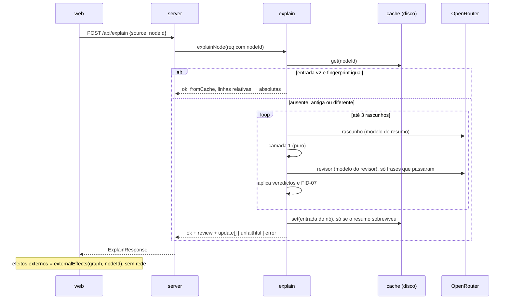

# Fidelidade e Cache Design

**Spec**: `.specs/features/04-fidelidade-e-cache/spec.md`
**Status**: Draft

---

## Abordagens

Todas entregam o mesmo escopo (FID-01..15, CACHE-01..07).

| | Abordagem | Chamadas por abertura (sem cache) | Veredito |
| - | --------- | --------------------------------- | -------- |
| **A** | **Pipeline de revisão dentro do `explain`**: rascunho → camada 1 (funções puras) → revisor LLM com JSON validado → até 2 novos rascunhos → corte. Cache com uma entrada por nó e impressão digital por componentes. A web calcula os efeitos externos a partir do `Graph`. | 2 a 6 | **Recomendada.** Respeita AD-001/003/005/007. A camada 1 é testável regra a regra. O cache diz o motivo da troca. |
| B | Rascunho autocitado: o próprio redator devolve as linhas de evidência, e a camada 1 mais a checagem de intervalo substituem o revisor. | 1 a 3 | Rejeitada. Viola FID-05 e a premissa confirmada das duas camadas. O redator que inventa também inventa a evidência. |
| C | Pacote novo `review` orquestrado pelo servidor e cache endereçado por conteúdo (`hash(fingerprint)`) com um índice por nó. | 2 a 6 | Rejeitada. Divide uma responsabilidade (explicar) em dois pacotes e cria setas novas no dependency-cruiser. O índice duplica a entrada e complica CACHE-06 e CACHE-07. |

Também foi rejeitado regenerar só as frases cortadas: a spec pede "um novo rascunho com a lista de problemas" (FID-08), e um rascunho parcial perde a coesão do resumo.

---

## Architecture Overview



A estrutura não muda: `model` ← `explain` ← `server`, e a web importa só tipos de `model` (AD-003, AD-005). Todo o pipeline vive em `packages/explain`. O servidor só acrescenta `nodeId` ao pedido.

---

## Code Reuse Analysis

| Existente | Local | Uso |
| --------- | ----- | --- |
| `explainNode` | `packages/explain/src/explain.ts` | Vira o orquestrador: cache → pipeline → cache. `userMessage` e `toAbsolute` são estendidos. |
| `parseExplanation` + zod | `packages/explain/src/schema.ts` | Continua validando o rascunho. Mantém linhas como inteiro e filtra depois (L-005). |
| `buildSystemPrompt` | `packages/explain/src/prompt.ts` | Mesmo padrão (`version` = 12 hex do sha256) para o prompt do revisor. |
| `LlmClient` | `packages/explain/src/openrouter.ts` | Mesmo cliente para redator e revisor (AD-002). Ganha o papel `assistant`. |
| `resolveModel` | `packages/explain/src/model-env.ts` | Base de `resolveReviewModel`. |
| `createDiskCache` | `packages/explain/src/cache.ts` | Mantém a gravação atômica (temp + `rename`). Muda a chave e o formato. |
| `sliceLines` | `packages/model/src/lines.ts` | O servidor continua cortando o código do nó. |
| `CodeView` | `apps/web/src/panel/CodeView.tsx` | Passa de uma linha marcada para um conjunto de linhas. |
| Nós `external` com `callee`, `category`, `range` | `packages/extract-python/src/steps.ts:213` | Fonte dos efeitos externos (FID-14). Nenhuma mudança no extrator. |

---

## Components

### C1. Frases e IDs: `packages/explain/src/sentences.ts` (FID-05, FID-09, FID-12)

- **Purpose**: Transforma o rascunho em itens julgáveis com ID estável.
- **Interfaces**:
  - `splitSentences(text: string): string[]` corta depois de `.`, `!` ou `?` seguidos de espaço, fora de crases. Assim `5.5`, `requests.get` e `` `a. b` `` não cortam. Partes vazias somem.
  - `toClaims(draft: Explanation): DraftClaim[]` gera os IDs.
- **Regras de ID**: `s1..sn` para as frases do resumo, `i1..` para as entradas, `o1..` para as saídas e `g1..` para as sugestões. Uma sugestão é um item só, com o texto `command + " " + reason`. Os IDs são posicionais dentro de um rascunho, e cada novo rascunho recebe IDs novos. Na resposta e no cache, os IDs são os do rascunho final; frases cortadas deixam lacunas (por exemplo, `s1, s3`), o que mantém a correspondência com o veredicto.

### C2. Camada 1, checagens determinísticas: `packages/explain/src/checks.ts` (FID-02, FID-03, FID-04)

- **Purpose**: Marca invenções certas e baratas sem LLM.
- **Contexto**: `CheckContext = { code: string; neighbours: string[] }`, com o código normalizado (C5).
- **Interfaces** (cada regra é uma função pura e retorna `string | null`, o problema ou nada):
  - `checkNumbers(text, ctx)`: cada número `\d+([.,]\d+)?` fora de crases deve aparecer no código como token numérico (`(?<![\w.])n(?!\w)`), aceitando `,` ↔ `.`, ou dentro de um nome de vizinho. FID-02.
  - `checkUnits(text, ctx)`: usa a lista `UNITS` da spec. Uma unidade com 2 ou mais caracteres, ou um símbolo (`R$`, `US$`, `€`, `%`), conta em qualquer posição como token. Uma unidade de uma letra (`g`, `t`, `m`, `s`, `h`, `l`) só conta logo depois de um número (`5 g`, `5g`). A presença no código é verificada por token, sem diferenciar maiúsculas, quebrando identificadores em `_` (então `dias_uteis` contém `dias`). Comentários e strings fazem parte do código. FID-03.
  - `checkIdentifiers(text, ctx)`: cada trecho entre crases, sem `(...)` no final, deve aparecer no código com fronteira de identificador ou ser igual a um nome de vizinho. FID-04.
  - `layerOne(claims, ctx): Problem[]` roda as três regras em cada item.
- **`UNITS`** é uma constante exportada. Mudar a lista muda a versão do revisor (C5).

### C3. Revisor, camada 2: `packages/explain/src/reviewer.ts` (FID-05, FID-06, FID-07, FID-15)

- **Purpose**: Um LLM julga frase a frase e dá a evidência.
- **Interfaces**:
  - `buildReviewerPrompt(): { text: string; version: string }`. O texto pede: julgue cada item só pelo código; uma sugestão é suportada quando o problema descrito no motivo está visível no código; responda só em JSON.
  - `reviewerMessage(code, neighbours, claims): string` monta o pedido. Ele contém só o código numerado de 1 a n, os nomes dos vizinhos e os itens com seus IDs (FID-06). Não envia nome do nó, PTS nem o rascunho bruto.
  - `parseVerdicts(raw: string): Verdict[]` usa zod e remove cercas como `parseExplanation`.
  - `applyVerdicts(claims, verdicts, lineCount): { kept: ReviewedClaim[]; problems: Problem[] }`.
- **Contrato zod**:

```ts
const verdictsSchema = z.object({
  verdicts: z.array(z.object({
    id: z.string(),
    supported: z.boolean(),
    evidence: z.array(z.number().int()),   // relativas, 1..n; inteiro puro (L-005)
    problem: z.string().optional(),        // obrigatório na prática quando supported=false
  })),
});
```

- **FID-07**: um item fica "não suportado" se não tem veredicto, se `supported=false`, se `evidence` está vazia ou se alguma linha está fora de `1..lineCount`. Uma linha ruim derruba o item, não a resposta inteira. As linhas guardadas ficam ordenadas e sem repetição.

### C4. Pipeline de revisão: `packages/explain/src/review.ts` (FID-01, FID-08, FID-09, FID-10, FID-11)

- **Interface**: `reviewedDraft(input, deps): Promise<ReviewOutcome>`, com `ReviewOutcome = { kind: "ok"; review: "full" | "cut"; result: StoredExplanation } | { kind: "unfaithful" }`. Os erros de rede e de parse são lançados.
- **Fluxo** (até 3 rodadas, ou seja, o rascunho e no máximo 2 novos):
  1. Rascunho: `system` (prompt do resumo) + `user` (nó). Num novo rascunho, acrescenta `assistant` (o rascunho anterior) + `user` ("Problemas encontrados:" seguido de uma linha `- <id> «texto»: problema` por item, e "Reescreva o JSON inteiro sem essas afirmações.").
  2. `parseExplanation` e `toClaims`.
  3. Camada 1. Os itens reprovados viram problemas.
  4. Revisor, só com os itens aprovados na camada 1. Pula a chamada se nenhum passou.
  5. Se não há problema: `review = "full"` na primeira rodada sem cortes (FID-11). Senão, se ainda há rodadas, volta ao passo 1 com a lista de problemas (FID-08).
  6. Depois da 3ª rodada: remove os itens não suportados (FID-09, `review = "cut"`). Se não sobra nenhuma frase do resumo, retorna `unfaithful` (FID-10). Entradas, saídas e sugestões podem ficar vazias.
- Um rascunho que já passa limpo depois de um novo rascunho também recebe `"full"`: o que o usuário vê não teve corte.
- `summary` é o texto das frases mantidas juntado por um espaço.

### C5. Impressão digital e normalização: `packages/explain/src/fingerprint.ts` (CACHE-01, CACHE-03, CACHE-04)

- `normalizeCode(code)`: troca CRLF e CR por LF e remove espaços e tabs no fim de cada linha. O número de linhas não muda, então as linhas relativas continuam válidas. O código normalizado é o que vai para o LLM, e a chave cobre exatamente o que foi enviado (L-004).
- `neighbourKey(calls, calledBy)`: as duas listas sem repetição, ordenadas por `localeCompare` e mantidas separadas, porque o prompt distingue "Chama" de "Chamado por". O `explain` também ordena as listas antes de montar o prompt (L-004).
- `fingerprintOf(req, deps): Fingerprint`, com estes componentes:

```ts
interface Fingerprint {
  code: string;            // sha256 hex do código normalizado
  neighbours: string;      // sha256 hex de JSON {calls, calledBy} ordenados
  model: string;           // modelo do resumo
  reviewModel: string;     // modelo do revisor (FID-15)
  promptVersion: string;   // buildSystemPrompt().version
  reviewerVersion: string; // sha256(prompt do revisor + template de novo rascunho + JSON(UNITS) + REVIEW_RULES_VERSION)[:12]
}
```

- `diffReasons(old, now): UpdateReason[]` retorna os motivos nesta ordem fixa: `"code"` se `code` difere, `"neighbours"` se `neighbours` difere, e `"model-or-prompt"` se algum dos outros quatro difere.
- O nome e o tipo do nó vão para o prompt e não ficam na impressão digital, porque já estão no ID do nó (`fn:nome`) e no código.

### C6. Cache por nó: `packages/explain/src/cache.ts` (CACHE-02, CACHE-05, CACHE-06, CACHE-07)

- **Layout**: `.cache/explain/nodes/<sha256(nodeId)>.json`. Um arquivo por identidade de nó (CACHE-06). O hash evita `:` e `/` no nome do arquivo no Windows. Com a feature 02, o arquivo entra no ID e, portanto, na identidade.
- **Interfaces**: `get(nodeId): Promise<CacheEntryV2 | undefined>` e `set(entry: CacheEntryV2): Promise<void>`. A escrita continua atômica.
- **Versão e migração (CACHE-07)**: `get` valida com zod e exige `schemaVersion: 2`. Um JSON inválido, outra versão ou outro formato resultam em `undefined`, e o próximo `set` grava por cima. As entradas da feature 01 (`<key>.json` na raiz) ficam em outra pasta e nunca são lidas. A remoção delas faz parte do adiamento "limpeza de entradas" da spec.
- Só um resultado revisado e com resumo é gravado (FID-01, FID-10). Uma falha ao gravar só gera log, como hoje.

### C7. Orquestração: `packages/explain/src/explain.ts`

1. Normaliza o código, ordena os vizinhos e calcula `fp`.
2. Lê `prev = cache.get(nodeId)`. Se `prev` existe e todos os componentes são iguais, retorna `ok` com `fromCache: true` e a mesma `review`, convertendo as linhas com `+ range.start − 1` (CACHE-02, CACHE-05).
3. Sem cliente, retorna `no-key`.
4. Chama `reviewedDraft`. Uma exceção vira `error`, e `unfaithful` vira `unfaithful`, ambas sem gravar.
5. Grava a entrada. Retorna `ok` com `update = diffReasons(prev.fingerprint, fp)` só quando `prev` válido existia (CACHE-03, CACHE-04). Uma entrada ausente ou de formato antigo não gera aviso (CACHE-07).

`ExplainDeps` ganha `reviewModel: string` e `reviewer: { text: string; version: string }`. O modo JSON (`google/` → `prompt`) vale para as duas chamadas.

### C8. Configuração: `model-env.ts` e `server/src/main.ts` (FID-15)

- `resolveReviewModel(env) = env.APP8N8_REVIEW_MODEL || resolveModel(env)`. Uma string vazia conta como ausente, igual a `APP8N8_MODEL`.
- `composeExplain` passa `reviewModel` e `reviewer: buildReviewerPrompt()`.
- O prompt do resumo passa a pedir identificadores entre crases e proíbe números e unidades que não estão no código. A versão muda sozinha.

### C9. Servidor: `packages/server/src/app.ts`

- Inclui `nodeId: node.id` no `ExplainRequest`.
- `unfaithful` responde `200`, e `error` continua `502`. O corpo do pedido HTTP não muda.

### C10. Efeitos externos: `apps/web/src/panel/effects.ts` (FID-14)

- `externalEffects(graph: Graph, nodeId: NodeId): ExternalEffect[]` retorna os descendentes do nó (seguindo `parentId`) com `kind === "external"`, ordenados por `range.start`, como `{ callee, category, line: range.start }`.
- **Por que na web**: a web já tem o `Graph` de `/api/graph`. A lista aparece sem chave de LLM, com erro do LLM e com o `/api/explain` interceptado no E2E. A web importa só tipos de `model`, e a função é pura, em TS, testável no Vitest (AD-010).

### C11. Painel: `DetailPanel.tsx`, `CodeView.tsx` e `App.tsx` (FID-09..14, CACHE-04)

- `CodeView` troca `highlightedLine?: number` por `highlightedLines?: ReadonlySet<number>`. Cada linha marcada mantém `aria-current="true"` e a classe `current`.
- `DetailPanel` recebe `effects: ExternalEffect[]`, calculado no `App` com o `graph` que já está em estado.
- Cada item (frase do resumo, entrada, saída e sugestão) é um `<li data-claim-id>` com o texto e um botão de evidência. O texto do botão vem de `formatLines([5,6,7,9]) = "L5–7, L9"` (en dash). O clique marca todas as linhas no `CodeView` (FID-12, FID-13). O botão da sugestão ("comando (linha N, severidade)") continua marcando a linha da sugestão.
- O resumo vira uma lista de frases (`<ol aria-label="Resumo">`) em vez de um `<p>`.
- Um selo `<span class="review-badge">` mostra "Revisado" ou "Revisado com cortes".
- O aviso `<p role="status">Resumo atualizado: …</p>` aparece quando `update` não está vazio. Os rótulos são `code` → "o código mudou", `neighbours` → "os vizinhos mudaram" e `model-or-prompt` → "o modelo ou o prompt mudou", separados por ", ".
- `unfaithful` mostra "Não foi possível gerar um resumo fiel." e o botão "Tentar de novo".
- Abaixo do resumo, para `function` e `class`, aparece `<h3 id="efeitos">Efeitos externos</h3>` e `<ul aria-labelledby="efeitos">` com um item por efeito: `requests.get (HTTP, linha 7)`. Sem efeitos, aparece "Nenhum efeito externo.". A seção é renderizada em qualquer estado da explicação.
- `App`: `onExplained` continua recebendo `Explanation`, e o contador de sugestões não muda.

---

## Data Models (`packages/model/src/explanation.ts`)

```ts
export type ClaimId = string;            // s1.., i1.., o1.., g1..
export interface Claim { id: ClaimId; text: string; lines: number[] }  // absolutas na resposta
export interface Suggestion { id: ClaimId; command: string; reason: string; line: number; severity: Severity; lines: number[] }
export interface Explanation {
  summary: string;        // mantido: frases mantidas juntadas
  sentences: Claim[];     // NOVO: o resumo frase a frase
  inputs: Claim[];        // QUEBRA: era string[]
  outputs: Claim[];       // QUEBRA: era string[]
  suggestions: Suggestion[]; // + id e lines
}
export type ReviewStatus = "full" | "cut";                 // "Revisado" | "Revisado com cortes"
export type UpdateReason = "code" | "neighbours" | "model-or-prompt";
export interface ExplainRequest { nodeId: NodeId; /* + campos atuais */ }
export type ExplainResponse =
  | { status: "ok"; explanation: Explanation; fromCache: boolean; review: ReviewStatus; update?: UpdateReason[] }
  | { status: "unfaithful" }
  | { status: "no-key" }
  | { status: "error"; message: string };
```

`ExternalEffect { callee: string; category: ExternalCategory; line: number }` também fica em `model`, só como tipo.

```ts
// .cache/explain/nodes/<sha256(nodeId)>.json
interface CacheEntryV2 {
  schemaVersion: 2;
  nodeId: string;
  fingerprint: Fingerprint;
  review: ReviewStatus;
  createdAt: string;            // informativo
  result: Explanation;          // TODAS as linhas relativas ao nó (CACHE-05)
}
```

### O que quebra em relação à feature 01

| Mudança | Quem quebra |
| ------- | ----------- |
| `inputs`/`outputs` viram `Claim[]`, e `Suggestion` ganha `id` e `lines` | Fixtures em `DetailPanel.test.tsx`, `App.test.tsx`, `explain.test.ts` e `schema.test.ts` (o rascunho do LLM continua `string[]`; só a saída muda). |
| `ExplainRequest.nodeId` obrigatório | Fixtures em `explain.test.ts`, `explain-route.test.ts` e `main.test.ts`. |
| `ok` exige `review` | Testes que constroem `ExplainResponse` à mão. |
| Um LLM falso precisa responder também ao revisor | Testes do `explain` que contam "1 chamada por nó" passam a contar 2 no caminho feliz. CORE-16 ("uma chamada") é substituída por FID-01/05. |
| A chave do cache deixa de ser `sha256([code, model, prompt])` | `cache.test.ts` e o teste de CORE-18. Um cache da feature 01 é ignorado, então a primeira abertura depois do deploy chama o LLM. |
| `CodeView.highlightedLine` → `highlightedLines` | `CodeView.test.tsx`. |
| Resumo em `<ol>` em vez de `<p>` | Asserções por texto exato do resumo. |

---

## E2E (Playwright, `/api/explain` interceptado)

> **Substituído pelo orquestrador.** O E2E desta feature roda contra o servidor real. Esse servidor aponta para um falso OpenRouter local (`e2e/fake-llm.ts`, via `OPENROUTER_BASE_URL`), usa um cache isolado (`APP8N8_CACHE_DIR`) e roda na sua própria porta (`APP8N8_PORT`). Os detalhes estão em `tasks.md`, T23–T26. O texto abaixo vale só para os testes de interface que continuam interceptados.

Seletores estáveis que os testes vão usar (o `/api/graph` é real):

| Alvo | Seletor |
| ---- | ------- |
| Painel | `getByRole('complementary', { name: 'Detalhe do nó' })` |
| Selo | `getByText('Revisado', { exact: true })` e `getByText('Revisado com cortes')` |
| Aviso | `getByRole('status')` com o texto `Resumo atualizado: os vizinhos mudaram` |
| Item | `locator('[data-claim-id="s1"]')` |
| Evidência | `getByRole('button', { name: 'L5–7' })`, escopado pelo item |
| Linha marcada | `locator('[data-line="5"]')` com `aria-current="true"` |
| Efeitos | `getByRole('list', { name: 'Efeitos externos' })` e o item `requests.get (HTTP, linha N)` |
| Falha | `getByText('Não foi possível gerar um resumo fiel.')` e `getByRole('button', { name: 'Tentar de novo' })` |

Com a rota interceptada, o E2E prova a interface: o JSON falso traz `review`, `update` e `lines`. O corte da frase "pesa 5 kg", a detecção do vizinho renomeado e o deslocamento de +3 linhas são provados nos testes de unidade do `explain`, com `LlmClient` falso e cache em diretório temporário. O teste "sem chamada ao LLM" dos efeitos é feito no E2E, verificando que a lista aparece com o `/api/explain` abortado.

---

## Custo e latência

| Caso | Chamadas | Latência (T = uma chamada) |
| ---- | -------- | -------------------------- |
| Cache válido | 0 | só disco |
| Sem chave | 0 | imediata |
| Melhor caso sem cache | 2 (rascunho + revisor) | ≈ 2T |
| Um novo rascunho | 4 | ≈ 4T |
| Pior caso | 6 (3 rascunhos + 3 revisões) | ≈ 6T. O teto teórico é 6 × 60 s de timeout |
| Rodada em que a camada 1 reprova tudo | essa rodada não chama o revisor | −1 chamada |

O revisor recebe só o código e uma lista curta, então seu custo fica abaixo do custo do rascunho. Mudar o modelo ou o prompt invalida todas as entradas de uma vez, como na feature 01.

---

## Error Handling Strategy

| Cenário | Tratamento | O que o usuário vê |
| ------- | ---------- | ------------------ |
| Rascunho ou veredicto fora do JSON/zod | Exceção vira `error`, `502`, sem cache | "Resumo indisponível" e "Tentar de novo" |
| Revisor omite um ID | O item fica não suportado (FID-07) | O item é cortado ou reescrito |
| Nenhuma frase do resumo sobrevive | `unfaithful`, `200`, sem cache | "Não foi possível gerar um resumo fiel." e "Tentar de novo" |
| Entrada corrompida ou da feature 01 | `get` retorna `undefined` | Nenhum aviso. Gera de novo |
| Falha ao gravar o cache | Só log | Nada. A próxima abertura gera de novo |

---

## Risks & Concerns

| Concern | Location | Impact | Mitigation |
| ------- | -------- | ------ | ---------- |
| A web duplica o corte de linhas (`nodeCode`) em vez de importar `sliceLines` | `apps/web/src/panel/DetailPanel.tsx:14` | Duas regras de split podem divergir (`\r?\n`) | Não mexer (mudança cirúrgica). `effects.ts` não corta código. |
| Pior caso de 6 chamadas com timeout de 60 s cada | `openrouter.ts:16` | Até 6 min de "Gerando resumo…" | O teto vem da spec. O painel pode trocar de nó, e a resposta antiga é descartada (`live`). |
| A camada 1 corta sugestões que propõem valores novos ("timeout de 10 s") | `checks.ts` | Menos sugestões úteis | O prompt do resumo proíbe números ausentes do código. É o comportamento pedido por FID-02/03. |
| Lista de unidades com uma letra gera falso positivo em texto comum | `checks.ts` | Corte indevido | Uma unidade de uma letra só conta depois de um número. Cada regra tem fixtures próprias. |
| Duas aberturas simultâneas do mesmo nó | `cache.ts` | Duas gerações. A última gravação vence | Aceito. O `rename` atômico evita um arquivo corrompido. |
| Revisor no mesmo modelo do redator tende a concordar consigo mesmo | `reviewer.ts` | Invenções sutis passam | A camada 1 pega o que é verificável. `APP8N8_REVIEW_MODEL` permite outro modelo (FID-15). |

---

## Tech Decisions

| Decision | Choice | Rationale |
| -------- | ------ | --------- |
| Itens reprovados na camada 1 vão ao revisor? | Não | Já estão reprovados. Economiza tokens e evita um veredicto contraditório. |
| `review` depois de um novo rascunho limpo | `"full"` | O selo descreve o que é exibido, não o caminho até ele. |
| Aviso depois de entrada antiga ou corrompida | Nenhum | CACHE-07 manda tratar como ausente. |
| Papel `assistant` no `ChatMessage` | Adicionado | O novo rascunho mostra ao modelo o próprio rascunho anterior. |
| Efeitos de uma classe | Todos os descendentes, inclusive métodos | Uma classe não tem passos próprios fora dos métodos. |
