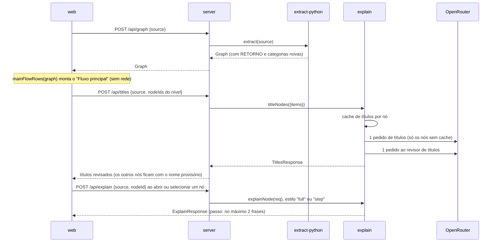

# Mapa do Vídeo Design

**Spec**: `.specs/features/05-mapa-do-video/spec.md` (VID-01..33)
**Status**: Draft

---

## Visão geral

A feature muda quatro coisas:

1. **Extrator.** O extrator cria o passo RETORNO e classifica as chamadas a nomes sem definição.
2. **Explicação.** O `explain` escreve títulos em lote e resume passos.
3. **Servidor.** O servidor ganha a rota `/api/titles` e explica qualquer nó com código.
4. **Web.** A web ganha a aparência do vídeo, o fluxo principal, o clique que abre, o "Voltar" e os cartões de sugestão.

O fluxo principal é calculado na web a partir do `Graph`, como manda a AD-010. Os títulos seguem o contrato `Claim` e a revisão em duas camadas da AD-008.



As setas entre pacotes não mudam: `model` ← `extract-python`/`explain` ← `server`. A web importa só `model` (AD-003, AD-005). Nenhum pacote novo.

---

## Decisões que esta feature registra no STATE

| AD | Decisão | Relação |
| -- | ------- | ------- |
| AD-017 | O LLM escreve resumos, sugestões e **títulos de nó**. Um título passa pela revisão em duas camadas e cai para um nome provisório determinístico. | Substitui a AD-001, que falava só de resumos e sugestões. A estrutura continua só do parsing. |
| AD-018 | O tema visual do vídeo é o padrão da interface. As cores e medidas são tokens CSS em `apps/web/src/styles.css`. As fontes vêm de pacotes `@fontsource` empacotados no build, sem rede. | Convenção para features futuras. |

A AD-010 vale sem mudança: o fluxo principal, as etiquetas, o nome provisório, a linha de código do cartão e os cartões de sugestão são funções puras da web sobre o `Graph`.

---

## Código do vídeo (fixture compartilhada)

O arquivo é `packages/extract-python/src/__tests__/fixtures/pedido_video.py`. O extrator, a web (fixtures de grafo) e o E2E usam o mesmo texto. O fixture usa `db.salvar` (a spec) no lugar de `salvar_pedido` (o vídeo). A chamada HTTP fica numa linha só, para que o passo HTTP contenha `cep` e `uf` (VID-28, Independent Test P2).

```python
import json

import requests


def processar_pedido(req):
    pedido = json.loads(req.body)
    validar_pedido(pedido)
    cliente = db.buscar_cliente(pedido["cliente_id"])
    frete = calcular_frete(pedido, cliente.cep)
    total = soma_itens(pedido) + frete
    db.salvar(pedido, total)
    enviar_email(cliente.email, total)
    return {"ok": True, "total": total}


def calcular_frete(pedido, cep):
    uf = requests.get("https://viacep.com.br/ws/" + cep).json()["uf"]
    peso = sum(item["peso"] for item in pedido["itens"])
    if peso > 30:
        return TABELA_PESADA[uf]
    else:
        return TABELA_PADRAO[uf]
```

O arquivo termina com uma quebra de linha depois da linha 23.

Grafo esperado depois das trilhas A e C:

| ID | Linhas | kind | Etiqueta | Nome provisório | Linha de código |
| -- | ------ | ---- | -------- | --------------- | --------------- |
| `fn:processar_pedido` | 6–14 | function | GATILHO (no fluxo principal) | Processar pedido | `processar_pedido()` |
| `fn:processar_pedido/s0` | 7 | external EXTERNO | EXTERNO | Loads | `json.loads()` |
| `fn:processar_pedido/s1` | 8 | external EXTERNO | EXTERNO | Validar pedido | `validar_pedido()` |
| `fn:processar_pedido/s2` | 9 | external BANCO | BANCO | Buscar cliente | `db.buscar_cliente()` |
| `fn:processar_pedido/s3` | 10 | call → `fn:calcular_frete` | FUNÇÃO | Calcular frete | `calcular_frete()` |
| `fn:processar_pedido/s4` | 11 | external EXTERNO | EXTERNO | Soma itens | `soma_itens()` |
| `fn:processar_pedido/s5` | 12 | external BANCO | BANCO | Salvar | `db.salvar()` |
| `fn:processar_pedido/s6` | 13 | external EMAIL | E-MAIL | Enviar email | `enviar_email()` |
| `fn:processar_pedido/s7` | 14 | return | RETORNO | Retorno | `return {"ok": True, "total": total}` cortado em 32 caracteres |
| `fn:calcular_frete` | 17–23 | function | FUNÇÃO | Calcular frete | `calcular_frete()` |
| `fn:calcular_frete/s0` | 18 | external HTTP | HTTP | Get | `requests.get()` |
| `fn:calcular_frete/s1` | 19 | external EXTERNO | EXTERNO | Sum | `sum()` |
| `fn:calcular_frete/s2` | 20–23 | condition | SE | peso > 30 | `if peso > 30` |
| `fn:calcular_frete/s2/b0/s0` | 21 | return | RETORNO | Retorno | `return TABELA_PESADA[uf]` |
| `fn:calcular_frete/s2/b1/s0` | 23 | return | RETORNO | Retorno | `return TABELA_PADRAO[uf]` |

O fluxo principal tem uma linha: `fn:processar_pedido` e os passos `s0..s6`, ligados por 7 arestas. O passo `s7` fica fora porque não tem chamada. As arestas dentro de `calcular_frete` são `s0→s1` e `s1→s2` (`next`), `s2→b0/s0` ("sim") e `s2→b1/s0` ("não"). Nenhuma aresta sai de um RETORNO.

---

## Code Reuse Analysis

| Existente | Local | Uso |
| --------- | ----- | --- |
| `resolveCall`, `resolveOne`, `chainedMethod` | `packages/extract-python/src/calls.ts` | Ganha a regra dos nomes sem definição (VID-13). O resto não muda. |
| `classify` e a tabela | `packages/extract-python/src/classify.ts` | Continua como passo (c) da VID-13. |
| `sequence` e `place` | `packages/extract-python/src/steps.ts` | Ganha o ramo do `return_statement` (VID-20). |
| `callsEdges` | `packages/extract-python/src/build-graph.ts` | Passa a aceitar qualquer passo com `target`. Assim o RETORNO com chamada mantém a aresta `calls`. |
| `reviewedDraft`, `layerOne`, `parseVerdicts`, `applyVerdicts` | `packages/explain/src/review.ts`, `checks.ts`, `reviewer.ts` | O resumo de passo usa o mesmo pipeline. Os títulos reusam a camada 1 e o veredicto do revisor. |
| `fingerprintOf`, `diffReasons`, `normalizeCode` | `packages/explain/src/fingerprint.ts` | Mesma impressão digital para títulos (VID-17). |
| Gravação atômica de `createDiskCache` | `packages/explain/src/cache.ts` | Mesmo padrão (temp + `rename`) no cache de títulos. |
| Rota `/api/explain` | `packages/server/src/app.ts` | O ramo projeto/trecho (AD-015) é extraído para uma função e reusado por `/api/titles`. |
| `projectLevel`, `lifted` | `apps/web/src/flow/project-level.ts` | O nível `null` de um trecho passa a ser o fluxo principal. Os níveis de projeto não mudam. |
| `layoutLR` (dagre) | `apps/web/src/flow/layout.ts` | Continua para níveis de passos e de projeto. Ganha o pós-passo dos ramos. |
| `navReducer`, `ancestry` | `apps/web/src/nav/navigation.ts` | O caminho guarda de onde se veio, para o "Voltar". |
| `DetailPanel`, `CodeView`, `formatLines`, `externalEffects` | `apps/web/src/panel/` | Ganham as seções do vídeo. Os itens com evidência (FID-12, FID-13) ficam. |
| LLM falso | `e2e/fake-llm.ts` | Ganha os papéis de título e os cenários do código do vídeo. |

---

## Contratos de dados (Fase 0, `packages/model`)

Todas as mudanças são aditivas, menos o alargamento de `ExplainRequest.nodeKind`.

### `graph.ts`

```ts
export type NodeKind =
  | "module" | "function" | "class" | "code" | "call" | "external"
  | "condition" | "loop" | "block" | "folder" | "file"
  | "return";                       // NOVO (VID-20)

export interface FlowNode {
  // campos atuais sem mudança
  /**
   * Regra de abertura (VID-24): true em folder, file, module, function,
   * class, loop, block e call (com target). false em code, condition,
   * external e return.
   */
  openable: boolean;
  /** call: a função chamada. return: a função chamada pela expressão, se houver. */
  target?: NodeId;
  /** external: o nome chamado. return: o nome externo chamado pela expressão, se houver. */
  callee?: string;
  category?: ExternalCategory;
}
```

`ExternalCategory` não muda (`HTTP | BANCO | ARQUIVO | EMAIL | EXTERNO`). A etiqueta exibida vem da web: `ARQUIVO` aparece como "DISCO" e `EMAIL` como "E-MAIL". Assim o termo "ARQUIVO" fica só para o nó de arquivo de projeto.

Um nó `return`:

- `label`: o texto da expressão retornada, sem `return`. Fica `""` num `return` sem valor.
- `range`: as linhas do comando.
- `openable: false`.
- Quando a expressão tem uma chamada, o nó recebe o resultado de `resolveCall`. Uma chamada ao trecho preenche `target`. Uma chamada externa preenche `callee` e `category`.

### `explanation.ts`

```ts
/** Os nós que o servidor explica: todos menos pasta e arquivo (VID-28). */
export type ExplainKind = Exclude<NodeKind, "folder" | "file">;

/** "full" = resumo de função, classe ou código solto; "step" = resumo de passo (VID-28, VID-29). */
export type ExplainStyle = "full" | "step";
export function explainStyle(kind: ExplainKind): ExplainStyle; // function|class|module → "full"; o resto → "step"
export const STEP_SENTENCE_LIMIT = 2;    // VID-28
export const TITLE_MAX_WORDS = 6;        // VID-14

export interface ExplainRequest {
  nodeId: NodeId;          // identidade no cache (AD-015)
  nodeName: string;
  nodeKind: ExplainKind;   // ALARGADO: era "function" | "class"
  code: string;
  range: LineRange;
  calls: string[];
  calledBy: string[];
}

/** Um nó a titular, montado pelo servidor a partir do próprio grafo (AD-007, AD-015). */
export interface TitleItem {
  /** ID do nó no grafo; volta na resposta. */
  nodeId: NodeId;
  /** Identidade no cache: o nodeId num trecho, `<raiz POSIX>|<nodeId>` num projeto. */
  cacheKey: string;
  kind: ExplainKind;
  name: string;            // FlowNode.label
  code: string;            // linhas exatas do nó
  range: LineRange;
  calls: string[];
  calledBy: string[];
}
export interface TitleRequest { items: TitleItem[] }

/** Um título revisado. Segue o contrato Claim da AD-008, com o nodeId no lugar do id. */
export interface NodeTitle {
  nodeId: NodeId;
  text: string;
  lines: number[];         // absolutas, evidência do revisor
  fromCache: boolean;
}

/** `titles` traz só os nós com título revisado; um nó ausente fica com o nome provisório. */
export type TitlesResponse =
  | { status: "ok"; titles: NodeTitle[] }
  | { status: "no-key"; titles: NodeTitle[] }               // só os acertos de cache
  | { status: "error"; message: string; titles: NodeTitle[] }; // só os acertos de cache
```

`index.ts` exporta `ExplainKind`, `ExplainStyle`, `TitleItem`, `TitleRequest`, `NodeTitle` e `TitlesResponse` como tipos. Também exporta `explainStyle`, `STEP_SENTENCE_LIMIT` e `TITLE_MAX_WORDS`, que são puros e não usam `node:*`.

### Ajustes de compilação na Fase 0

O alargamento quebra o typecheck em dois pontos. A Fase 0 corrige os dois para o repositório continuar verde antes das trilhas:

- `apps/web/src/flow/StepNode.tsx`: o `ICONS: Record<NodeKind, string>` ganha `return: "↩"`. A trilha C reescreve o arquivo depois.
- `packages/explain/src/explain.ts`: `KIND_LABEL` vira `Record<ExplainKind, string>` com os rótulos finais:

| kind | Rótulo no pedido ao LLM |
| ---- | ----------------------- |
| function | função |
| class | classe |
| module | código solto |
| code | passo de código |
| call | chamada de função |
| external | chamada externa |
| condition | condição |
| loop | laço |
| block | bloco |
| return | retorno |

---

## Trilha A: extrator (`packages/extract-python`)

### A1. Nomes ligados: `bound.ts` (VID-13)

- **Interface**: `boundNames(root: Node): Set<string>`.
- **Regra**: o conjunto reúne cada identificador que o arquivo liga em qualquer lugar, sem olhar escopo:
  - parâmetros de `def` e de `lambda`, em todas as formas (com padrão, com tipo, `*args`, `**kw`);
  - alvos de `=`, `+=` (e os outros operadores) e de anotação, inclusive dentro de tupla ou lista;
  - alvo de `for` e de `for ... in` numa compreensão;
  - nome depois de `as` em `with`, `except` e `import`;
  - nome de `:=`;
  - nome de `def` e de `class`;
  - nomes de `global` e `nonlocal`.
- **Por que o arquivo inteiro**: a regra é simples e determinística. O custo aparece em Riscos.

### A2. Classificação de nome sem definição: `classify.ts` (VID-13, L-003)

- **Interface nova**: `classifyUnknown(callee: string): ExternalCategory`. `classify` não muda.
- **Ordem e forma de comparação**:
  1. (a) O primeiro segmento de `callee`, separado por `.`, é **igual** (segmento inteiro, com maiúsculas) a `db`, `cursor`, `conn`, `connection` ou `session` → `BANCO`.
  2. (b) O último segmento **contém** `email`, sem diferenciar maiúsculas (`enviar_email`, `sendEmail`, `email`) → `EMAIL`.
  3. (c) `classify(callee)` quando o resultado não é `EXTERNO`.
  4. (d) `EXTERNO`.
- **Formas de receptor**: só nomes pontuados simples (`a`, `a.b`, `a.b.c`). Um receptor que não é nome pontuado (por exemplo, `x().y`) continua em `chainedMethod`, só com a tabela.

### A3. Resolução: `calls.ts` + ligação em `build-graph.ts` (VID-13)

- `CallContext` ganha `bound: Set<string>`. `buildGraph` preenche o campo com `boundNames(tree.rootNode)`.
- Em `resolveOne`, a ordem atual vale até o nome importado. Depois, para um nome **não importado**, a regra fica assim:

| Primeiro segmento | Resultado |
| ----------------- | --------- |
| Está em `ctx.bound` (por exemplo, `r.json`, `self.x`, `cursor.execute` com `cursor` local) | Regra atual: categoria da tabela, se não for `EXTERNO`; senão `null`, exceto o nome de projeto da PROJ-09. |
| Não está em `ctx.bound` (por exemplo, `validar_pedido`, `db.salvar`, `sum`, `print`) | `{ kind: "external", callee, category: classifyUnknown(callee) }` |

- Um nome definido no trecho continua resolvido antes, como `call` (CORE-02). Um nome importado não muda (CORE-12).
- Efeito esperado: chamadas a builtins (`print`, `len`, `sum`) viram passos EXTERNO. Os testes que esperavam "Código" nesses comandos mudam nesta task.

### A4. RETORNO: `steps.ts` + `callsEdges` em `build-graph.ts` (VID-20)

- Em `sequence`, um `return_statement` faz `flush()` e chama `place({ kind: "return", ... })` com os campos de "Contratos". Depois, `pending = []`. Assim nenhuma aresta sai do RETORNO, nem para o passo seguinte, nem para fora de um ramo.
- O `return` é avaliado antes de `resolveCall`. Por isso um `return f(x)` vira RETORNO com `target`, e não um passo `call`.
- `callsEdges` passa a usar `step.target !== undefined` em vez de `step.kind === "call"`. Assim `return calcular(x)` continua gerando `calls:<dono>-><alvo>`.
- Os IDs não mudam (`<pai>/s<i>`). Em `pedido_frete.py`, os passos `fn:calcular_frete/s2/b0/s0` e `b1/s0` passam de `code` para `return` com o mesmo ID.

### O que a trilha A não faz

- Não calcula o fluxo principal (AD-010: é da web).
- Não muda o rótulo "Módulo" do nó `mod`. A web mostra o nó `mod` como GATILHO, com o nome provisório "Código solto".

---

## Trilha B: explicação e servidor

### B1. Prompt de passo: `prompt.ts` (VID-28)

- `buildStepPrompt(ptsRules): { text; version }` segue o padrão de `buildSystemPrompt`, com a versão de 12 hex. O papel diz: "Você explica um passo de dentro de uma função Python". O formato JSON é o mesmo. O campo `"summary"` pede "uma ou duas frases". As regras de crases e de números valem.

### B2. Limite de frases: `review.ts` (VID-28)

- `ReviewDeps` ganha `maxSentences?: number`. Depois de `parseExplanation`, quando `maxSentences` existe, `draft.summary` vira as primeiras `maxSentences` frases de `splitSentences`, juntadas por espaço. O corte vem antes de `toClaims`, então o revisor nunca vê a 3ª frase. Um novo rascunho repete o corte.

### B3. Estilo na orquestração: `explain.ts` (VID-28)

- `ExplainDeps` ganha `stepPrompt: { text; version }`.
- `explainStyle(req.nodeKind)` escolhe o prompt (`prompt` ou `stepPrompt`) e `maxSentences` (`undefined` ou `STEP_SENTENCE_LIMIT`).
- A impressão digital usa a versão do prompt escolhido. Assim um passo e uma função nunca compartilham `promptVersion`.
- O cache, a identidade e o `toAbsolute` não mudam (AD-009).

### B4. Prompt e leitura dos títulos: `title-prompt.ts` (VID-14)

- `buildTitlePrompt(ptsRules): { text; version }`. A primeira linha do texto é exatamente `Você escreve títulos de nós de um fluxo de código Python.` (o LLM falso do E2E reconhece o papel por essa linha). O texto pede:
  - um título por nó, em PTS;
  - no máximo 6 palavras, sem ponto final;
  - a ação do nó com verbo no infinitivo (como "Calcular frete" ou "Buscar UF pelo CEP");
  - sem número ou unidade que não aparecem no código;
  - só JSON: `{"titles":[{"id":"n1","title":"..."}]}`.
- `titleMessage(items): string` monta um bloco por item, na ordem recebida, com IDs posicionais `n1..nk`:

```
[n1] Tipo: função | Nome: processar_pedido
Chama: calcular_frete
Chamado por: nenhum
Código:
1 | def processar_pedido(req):
...
```

- `parseTitles(raw): { id: string; title: string }[]` remove cercas, valida com zod (`{ titles: z.array(z.object({ id: z.string(), title: z.string() })) }`), apara espaços e descarta títulos vazios. Um JSON inválido lança erro.

### B5. Revisor de títulos: `title-reviewer.ts` (VID-14, VID-16)

- `buildTitleReviewerPrompt(): { text; version }`. A primeira linha é exatamente `Você revisa títulos de nós de um fluxo de código Python.`. A versão é `sha256(texto + JSON(UNITS) + TITLE_RULES_VERSION)[:12]`. A resposta usa o mesmo contrato `verdicts` da AD-008.
- `titleReviewerMessage(blocks): string` monta um bloco por título que passou na camada 1:

```
Nó n1:
Código:
1 | def processar_pedido(req):
...
Vizinhos: calcular_frete
- n1: Pedido recebido
```

- `titleLayerOne(title, ctx): string | null` (camada 1). Um título é reprovado nestes casos:
  - tem mais de `TITLE_MAX_WORDS` palavras (separação por espaço em branco);
  - falha em `checkNumbers`, `checkUnits` ou `checkIdentifiers` contra o código e os vizinhos do próprio nó.
- O veredicto de cada `nX` passa por `applyVerdicts` com o `lineCount` do próprio nó. Um item sem veredicto, sem evidência, com linha fora do nó ou com `supported: false` cai (VID-16). Não há novo rascunho: o nó fica com o nome provisório.

### B6. Cache de títulos: `title-cache.ts` (VID-17)

- `createTitleCache(dir): TitleCache`, com `get(cacheKey)` e `set(entry)`.
- Arquivo: `<dir>/titles/<sha256(cacheKey)>.json`, com gravação atômica.

```ts
interface TitleCacheEntry {
  schemaVersion: 1;
  cacheKey: string;
  fingerprint: Fingerprint;   // o mesmo tipo de fingerprint.ts
  createdAt: string;          // informativo
  title: { text: string; lines: number[] };  // linhas RELATIVAS ao nó
}
```

- A impressão digital é a da AD-009, com estes valores:
  - `code`: o código normalizado do nó;
  - `neighbours`: os vizinhos do nó;
  - `model`: o modelo do resumo;
  - `reviewModel`: o modelo do revisor;
  - `promptVersion`: `buildTitlePrompt().version`;
  - `reviewerVersion`: `buildTitleReviewerPrompt().version`.
- Um arquivo ilegível ou de outra versão conta como ausente. Só um título aprovado é gravado.

### B7. Orquestração dos títulos: `titles.ts` (VID-14, VID-16, VID-17)

- **Interface**: `titleNodes(req: TitleRequest, deps: TitleDeps): Promise<TitlesResponse>`.
- **Dependências**: `TitleDeps = { llm?, cache: TitleCache, model, reviewModel, prompt, reviewer }`.
- **Fluxo**:
  1. Para cada item, normaliza o código, ordena os vizinhos e calcula a impressão digital. Um item com entrada igual no cache vira `NodeTitle` com `fromCache: true`.
  2. Se não falta nenhum item, retorna `ok`.
  3. Sem `llm`, retorna `no-key` com os acertos.
  4. Faz **um** pedido de títulos com todos os itens que faltam (`titleMessage`).
  5. Um ID que não está entre os enviados é ignorado (caso de borda da VID-14).
  6. Roda a camada 1 em cada título.
  7. Se algum título passou, faz **um** pedido ao revisor com todos eles.
  8. Grava cada título aprovado e retorna `ok` com os acertos mais os aprovados, na ordem dos itens.
  9. Uma exceção (rede, JSON ou zod) vira `error` com os acertos e sem gravação.
- **Custo**: 0 chamadas com tudo em cache e no máximo 2 por nível (VID-14).
- **Linhas**: as linhas da resposta são absolutas (`+ range.start − 1`).
- **Exportação**: `index.ts` exporta `titleNodes`, `createTitleCache`, `buildTitlePrompt`, `buildTitleReviewerPrompt`, `buildStepPrompt` e os tipos `TitleDeps` e `TitleCache`.

### B8. Servidor: `app.ts` (VID-14, VID-28)

- **Origem do grafo**: uma função interna `loadOrigin(raw)` lê `{source}` ou `{root}`. Ela retorna `graph`, `codeOf`, `nameOf` e `idPrefix`. Hoje esse ramo está escrito dentro de `/api/explain`. Uma pasta ausente retorna 404.
- **`neighboursOf(graph, node, nameOf)`** monta duas listas de nomes:
  - `calls`: os alvos das arestas `calls` que saem do nó, mais `node.target` quando existe, sem repetição;
  - `calledBy`: as origens das arestas `calls` que chegam ao nó.
  - Para função e classe o resultado é igual ao de hoje, então as entradas de cache da feature 04 continuam válidas.
- **`/api/explain`**: aceita todo nó cujo `kind` não é `folder` nem `file`. Para pasta ou arquivo, responde 400 com `{ error: "node has no explanation" }`. O resto não muda (200/502/404/400).
- **`POST /api/titles`** (novo):
  - Corpo: `{ source: string, nodeIds: string[] }` ou `{ root: string (≥1), nodeIds: string[] }`. Vale o limite de 200 IDs. Um corpo inválido responde 400. A rota só aceita JSON (AD-016) e a guarda de `Host` vale (AD-007).
  - O servidor reextrai o grafo e não usa código do cliente (AD-015).
  - Cada ID aparece uma vez, na ordem recebida. Um ID desconhecido, de pasta ou de arquivo é descartado sem erro.
  - Sem item: responde 200 com `{ status: "ok", titles: [] }`, sem chamar `deps.titles`.
  - Com itens: responde **200** com o `TitlesResponse` de `deps.titles({ items })` nos três status. Um título é melhor esforço: a web sempre tem o nome provisório.
- **`AppDeps`** ganha `titles: (req: TitleRequest) => Promise<TitlesResponse>`.

### B9. Composição: `main.ts`

- `composeExplain` passa `stepPrompt: buildStepPrompt(ptsRules)`.
- `composeTitles(env, deps)` usa as mesmas regras de chave, `OPENROUTER_BASE_URL`, modelos e `APP8N8_CACHE_DIR` de `composeExplain`. O cache de títulos fica em `<pasta do cache>/titles`. `main()` passa `titles` ao `createApp`.

---

## Trilha C: web (`apps/web`)

### C1. Fontes (VID-02)

- **Dependências** em `apps/web/package.json`: `@fontsource/archivo-black@5.3.0`, `@fontsource/space-grotesk@5.3.0` e `@fontsource/dm-mono@5.3.0`.
- **Pesos** importados em `main.tsx`: Archivo Black 400, Space Grotesk 400/500/700 e DM Mono 400/500.
- **Build**: o Vite copia os `.woff2` para `dist/assets`, então o app não pede fonte a outro host.

### C2. Tokens e estilos: `styles.css` (VID-01, 03, 05, 08, 22, 32)

Os valores vêm de `base.css` do vídeo, no palco de 1920×1080. O CSS atual é substituído.

```css
:root {
  --ground: #121110;  --main: #D4FF3F;  --second: #F5F2EC;  --accent: #A8A399;
  --card-bg: color-mix(in srgb, var(--ground) 90%, var(--second));
  --card-border: color-mix(in srgb, var(--second) 22%, var(--ground));
  --panel-bg: color-mix(in srgb, var(--ground) 93%, var(--second));
  --panel-border: color-mix(in srgb, var(--second) 14%, var(--ground));
  --code: color-mix(in srgb, var(--second) 80%, var(--ground));
  --dim: color-mix(in srgb, var(--second) 45%, var(--ground));
  --font-display: "Archivo Black", sans-serif;
  --font-sans: "Space Grotesk", system-ui, sans-serif;
  --font-mono: "DM Mono", ui-monospace, monospace;
}
body { margin: 0; background: var(--ground); color: var(--second); font-family: var(--font-sans); }
```

| Elemento | Classe | Valores exatos |
| -------- | ------ | -------------- |
| Canvas | `.canvas` | `background-color: var(--ground)`; `background-image: radial-gradient(color-mix(in srgb, var(--second) 16%, transparent) 2px, transparent 2.6px)`; `background-size: 40px 40px`. A grade é do contêiner e não escala com o zoom. O fundo do React Flow fica transparente. |
| Cartão | `.node` | `box-sizing: border-box`; `width: 320px`; `height: 140px`; `display: flex`; `flex-direction: column`; `gap: 8px`; `padding: 20px 24px`; `background: var(--card-bg)`; `border: 2px solid var(--card-border)`; `border-radius: 6px`; `box-shadow: 0 14px 30px rgba(0,0,0,.25)` |
| Etiqueta | `.node .tag` | `font-size: 16px`; `font-weight: 500`; `letter-spacing: .18em`; `color: var(--accent)`. O texto já vem em maiúsculas. |
| Título | `.node .name` | `font-size: 27px`; `font-weight: 700`; `line-height: 1.1`; `white-space: nowrap`; `overflow: hidden`; `text-overflow: ellipsis`; `color: var(--second)` |
| Sinal de abrir | `.node .open-mark` | texto `›`, `margin-left: .25em`, `color: var(--main)` |
| Linha de código | `.node .fn` | `font-family: var(--font-mono)`; `font-size: 20px`; `color: var(--accent)`; `white-space: nowrap`; `overflow: hidden`; `text-overflow: ellipsis` |
| Selecionado / com sugestão | `.node.on` | `border-color: var(--main)` |
| Esmaecido | `.node.dim` | `opacity: .55` |
| Porta | `.port` (Handle) | `width: 16px`; `height: 16px`; `border-radius: 50%`; `background: var(--main)`; `border: 0`; `top: 50%`; `margin-top: -8px`. A entrada usa `left: -9px` e a saída `right: -9px`. Um lado sem aresta usa `visibility: hidden`. |
| Aresta | `.wire` | `fill: none`; `stroke: var(--main)`; `stroke-width: 4`; `stroke-linecap: round` |
| Ponto | `.pulse` | `fill: var(--main)`; `r = 9` |
| Rótulo de ramo | `.branch-label` | `font-size: 22px`; `font-weight: 500`; `letter-spacing: .18em`; `text-transform: uppercase`; `white-space: nowrap`. "sim" em `var(--main)`; "não" e os rótulos de `elif` em `var(--accent)`. |
| Cartão de sugestão | `.alert` | `display: flex`; `gap: 14px`; `align-items: center`; `padding: 14px 22px`; `border-radius: 6px`; `background: var(--second)`; `color: var(--ground)`; `font-size: 24px`; `font-weight: 700`; `white-space: nowrap`; `box-shadow: 0 12px 26px rgba(0,0,0,.3)`. `.alert .dot`: `14px` por `14px`, `border-radius: 50%`, `background: var(--ground)`. |
| Botão principal | `.btn` | `padding: 16px 30px`; `border-radius: 6px`; `border: 0`; `background: var(--main)`; `color: var(--ground)`; `font: 700 26px var(--font-sans)` |
| Botão secundário | `.btn-ghost` ("Abrir pasta", "Novo código", "Voltar") | `padding: 12px 22px`; `border-radius: 6px`; `background: transparent`; `border: 2px solid var(--panel-border)`; `color: var(--second)`; `font: 500 22px var(--font-sans)`. Desabilitado: `opacity: .4`. |
| Rótulo pequeno | `.eyebrow` | `font-size: 22px`; `font-weight: 500`; `letter-spacing: .18em`; `text-transform: uppercase`; `margin: 0` |
| Painel | `.panel` | `background: var(--panel-bg)`; `border: 2px solid var(--panel-border)`; `border-radius: 6px`; `box-shadow: 0 18px 40px rgba(0,0,0,.25)` |
| Moldura | `.level-frame`, `.open-frame` | `border: 2px solid var(--main)`; `border-radius: 6px` |
| Código | `.code` | `font-family: var(--font-mono)`; `line-height: 1.6`; `white-space: pre`; `color: var(--code)`; os números de linha em `var(--dim)` |

`prefers-reduced-motion: reduce` desliga toda `animation` e `transition` da tela do mapa (VID-07).

### C3. Telas e geometria (VID-08, VID-09)

**Editor** (`view: "editor"`, sem mapa):

- O contêiner fica em `margin: min(170px, 19vh) 0 0 140px`, com `width: 1020px` e a altura do resto da janela. Numa janela baixa, o painel sobe e encolhe, e a linha de botões continua visível (1600x900 e 1366x768).
- Dentro dele, um `.panel` com `height: 620px` e `<section aria-label="Editor">`. A seção tem:
  - o cabeçalho com `<span class="eyebrow">trecho.py</span>` em `var(--main)`, em `padding: 20px 28px` e com `border-bottom: 2px solid color-mix(in srgb, var(--second) 12%, var(--ground))`;
  - o `textarea` com `aria-label="Trecho Python"`, que mantém o seletor do E2E. Ele usa `padding: 28px 32px`, `font: 400 25px/1.6 var(--font-mono)` e `color: var(--code)`, sem borda e com fundo transparente. Ele não quebra linhas (`wrap="off"`, `white-space: pre`): uma linha longa rola na horizontal.
- Abaixo do painel, a `margin-top: 40px`, fica uma linha com:
  - o botão `.btn` "Gerar mapa";
  - o campo `aria-label="Caminho da pasta"`, com o placeholder "Caminho de uma pasta Python";
  - o botão `.btn-ghost` "Abrir pasta".
- Os avisos "Não foi possível gerar o mapa.", "Pasta não encontrada: …", "Nenhuma função ou instrução encontrada." e "Nenhum arquivo .py encontrado na pasta." ficam no editor. Um grafo vazio não troca de tela.

**Mapa** (`view: "map"`):

- O mapa ocupa `100vw × 100vh`, com `display: grid`. A grade usa `grid-template-columns: 1fr` sem nó selecionado e `1fr clamp(400px, 31vw, 520px)` com painel. O painel do vídeo tem 1060 de 1920 px, ao lado de um cartão só. Aqui ele fica ao lado do nível inteiro e é reduzido: em 1600 px a coluna tem 496 px, e em 1366 px, 423 px. Assim o canvas mostra o nível todo com o título dos cartões acima de 16 px.
- O canvas fica na coluna 1. Na mesma área, em `position: absolute`, ficam:
  - o botão "Voltar" (`.btn-ghost`), em `left: 24px; top: 24px` (VID-27);
  - a trilha de navegação, em `left: 160px; top: 34px`, com `font: 400 22px var(--font-mono)` e `color: var(--accent)` (VID-19);
  - o botão "Novo código" (`.btn-ghost`), em `right: 24px; top: 24px` (VID-09).
- O painel de detalhe é um `.panel` na coluna 2, com `margin: 24px`, `padding: 28px 30px`, `display: flex`, `flex-direction: column`, `gap: 16px` e `overflow: auto`. As letras seguem a redução: título 30 px, resumo 24 px, regras 15 px, entrada e saída 20 px, listas 17 px. O `.eyebrow` do painel tem 14 px, `letter-spacing: .14em` e `line-height: 1.5`, e quebra em duas linhas limpas quando é longo.
- "Novo código" volta ao editor, mantém o texto do `textarea` e o campo de pasta, e limpa o mapa, os títulos e as explicações.
- "Arquivos ignorados" (PROJ-06) continua no mapa de projeto, abaixo da trilha.

### C4. Cartão: `flow/card.ts` (VID-03, VID-04, VID-15, VID-24, VID-26)

- **`tagOf(node, isTrigger)`** retorna a etiqueta do cartão:

| Caso | Etiqueta |
| ---- | -------- |
| `isTrigger` | GATILHO |
| `function`, `class`, `call` | FUNÇÃO |
| `external` | HTTP, BANCO, DISCO (`ARQUIVO`), E-MAIL (`EMAIL`) ou EXTERNO, conforme `category` |
| `condition` | SE |
| `loop` | LAÇO |
| `block` | BLOCO |
| `code` | CÓDIGO |
| `return` | RETORNO |
| `folder` | PASTA |
| `file` | ARQUIVO |
| `module` (fora do fluxo principal, por exemplo num arquivo de projeto) | GATILHO |

- `categoryTag(category)` faz a mesma troca e serve também para a lista "Efeitos externos" do painel. Assim um termo nomeia um conceito só.
- **`provisionalLabel(node)`** retorna o nome provisório (VID-15):
  - `function`, `class`, `call`, `external`: pega o último segmento de `label` depois de `.`, troca `_` por espaço e põe a primeira letra em maiúscula (`calcular_frete` vira "Calcular frete");
  - `condition`: `label`;
  - `code`: "Código";
  - `return`: "Retorno";
  - `module`: "Código solto";
  - `loop`, `block`, `folder`, `file`: `label`.
- **`codeLineOf(node, source)`** retorna a linha de código do cartão:
  - `function`, `class`, `call`: `<label>()`;
  - `external`: `<callee>()`;
  - `condition`: `if <label>`;
  - `loop`, `block`: `label`;
  - `code`, `return`, `module`: a primeira linha do nó em `source`, sem espaços nas pontas, cortada em 32 caracteres com `…`;
  - `folder`: `<path>/`;
  - `file`: `path`.
- **`isOpenable(node) = node.openable`**: a regra da VID-24 vem do extrator.

### C5. Fluxo principal: `flow/main-flow.ts` (VID-10, VID-11, VID-12)

```ts
export interface MainRow { trigger: NodeId; steps: NodeId[] }
export function mainFlowRows(graph: Graph): MainRow[];
```

Regras, em ordem:

1. **Passos diretos** de um nó E são os nós com `parentId === E.id` e ID `E.id + "/s" + <número>`. Os passos de ramo (`/b<j>/`) ficam de fora.
2. **"Comando com chamada"** é um passo direto que atende a uma destas condições:
   - é `call` ou `external`;
   - é `return` com `target` ou `callee`;
   - é `loop`, `block` ou `condition` com um descendente (ID que começa com `<id>/`) de um dos tipos acima.
3. **Entradas** (VID-11):
   - (a) Um nó de topo `module` com ao menos um "comando com chamada" (regra 2) é entrada. Um `module` só com constantes ou atribuições sem chamada não é entrada.
   - (b) Também são entradas as funções de topo (`kind === "function"`, `parentId === null`) sem aresta `calls` vindo de outro nó, seja o `module` ou outra função. A aresta de uma função para ela mesma não conta. (a) e (b) se somam.
   - (c) Se (a) e (b) não acham nada, cada função e classe de topo é uma entrada.
4. Um nó de topo com `syntaxError` que não é entrada ganha uma linha só com ele. Assim um erro fora das funções continua visível (CORE-06).
5. Uma linha tem a forma `{ trigger, steps: comandos com chamada da entrada, na ordem do código }`. As linhas seguem a ordem de `range.start`.

O nó `mod` aparece como GATILHO "Código solto". Nenhum cartão do primeiro nível mostra "Módulo" (VID-12).

### C6. Nível visível: `flow/project-level.ts` (modificado)

- `Level` ganha dois campos: `rows?: NodeId[][]` (só no fluxo principal) e `triggers: ReadonlySet<NodeId>`.
- `projectLevel(graph, null)` num **trecho** (`!graph.project`) retorna o fluxo principal:
  - `nodes`: as entradas e os passos, na ordem das linhas;
  - `edges`: arestas `next` sintéticos entre vizinhos de cada linha, com ID `main:<a>-><b>`;
  - `rows`: as linhas;
  - `triggers`: as entradas.
- Os outros níveis não mudam, com `triggers` vazio. Isso vale para o nível de dentro de um nó e para todo nível de projeto.

### C7. Posições: `flow/layout.ts` (VID-03, VID-10, VID-11, VID-21)

- `NODE_WIDTH = 320`, `NODE_HEIGHT = 140`, `NODE_GAP = 60` e `ROW_GAP = 80`.
- `layoutRows(rows)`: o nó `i` da linha `r` fica em `x = i * (320 + 60)` e `y = r * (140 + 90 + 80) − (i % 2) * 90`. Os nós ímpares sobem 90 px (`ZIGZAG`), como o 470/380 do vídeo.
- `wrapRows(rows, perRow)` corta cada linha em linhas de no máximo `perRow` nós, na ordem. O fluxo segue da esquerda para a direita, linha após linha, como um texto. Uma entrada nova sempre começa uma linha nova.
- `wrapColumns(posições, perBand)` corta um nível de dentro (dagre) em faixas de no máximo `perBand` colunas. Cada faixa começa na esquerda, `BAND_GAP = 120` px abaixo da faixa de cima, e mantém o próprio desenho (o "sim" continua acima do "não"). `rowBands(rows)` dá a mesma forma às linhas do fluxo principal. As duas retornam `positions`, a faixa de cada nó e `gapAbove`, o `y` do meio do vão acima de cada faixa.
- `chooseWrap(maisLonga, layoutFor, largura, altura)` (`flow/viewport.ts`) decide o corte, nesta ordem:
  1. um nível que cabe inteiro com zoom ≥ `LEGIBLE_ZOOM` (0,6) não é cortado;
  2. senão, vale a linha mais longa que cabe com zoom ≥ 0,8;
  3. senão, vale a linha com o maior zoom, se ele for ≥ 0,6;
  4. senão, o nível fica sem corte e começa em 0,8 na esquerda (`startViewport`).
- Exemplos com o vídeo: em 1600x900 o fluxo principal de 8 cartões vira 5 + 3, como os 5 cartões por linha do vídeo; em 1366x768, 4 + 4. Os 8 passos de `processar_pedido`, ao lado do painel, viram faixas de 3, 3 e 2. `calcular_frete` cabe inteiro ao lado do painel e não é cortado.
- A ordem de entrada (`schedule`) usa o desenho sem corte. Assim a animação segue o fluxo.
- `layoutLR` (dagre) continua com `nodesep: 60` e `ranksep: 60`. Depois do dagre roda `orderBranches(positions, nodes, containerId)`. Em cada coluna (mesmo `x`), os nós recebem de novo as posições `y` da própria coluna, em ordem crescente de uma chave:
  - a chave é a lista de índices `j` dos segmentos `/b<j>/` do ID, depois do prefixo do nível;
  - a comparação é elemento a elemento, e um elemento ausente vale `0.5`;
  - num empate, vale a ordem do dagre.
- Assim o ramo "sim" (`b0`) fica sempre acima do "não" (`b1`).

### C8. Movimento: `flow/motion.ts` (VID-06, VID-07)

```ts
export interface Schedule {
  enterAt: Map<NodeId, number>;  // ms
  drawAt: Map<string, number>;   // por aresta
  pulseAt: Map<string, number>;  // por aresta
}
export function schedule(nodes, edges, positions, reduced: boolean): Schedule;
```

- **Ordem de entrada**: os nós são ordenados por `x` e, no empate, por `y`. O nó de ordem `k` entra em `enterAt = k * 350`, com 500 ms de duração. Os valores vêm do vídeo.
- **Desenho da aresta**: começa em `drawAt = enterAt(origem) + 400`, com 500 ms de duração.
- **Ponto**: as arestas ficam na ordem do fluxo (por `enterAt` da origem, depois do destino). O primeiro ponto sai em `T0 = max(drawAt) + 500 + 300`. A aresta de ordem `k` recebe `pulseAt = T0 + k * 750`, com 750 ms de duração. Cada aresta tem um ponto, uma vez.
- **`reduced = true`**: todos os valores são `0`, e a web não desenha os pontos.

### C9. Cartões de sugestão: `flow/suggestion-cards.ts` (VID-31, VID-32)

```ts
export interface SuggestionCardModel {
  key: string;                  // `${explicadoId}:${suggestion.id}`
  explainedId: NodeId;          // nó cujo painel abre ao clicar
  anchorId: NodeId | null;      // null = preso à moldura do nó aberto
  text: string;                 // suggestion.command
  line: number;                 // suggestion.line (absoluta)
}
export function suggestionCards(level, explanations, containerId, panelNodeOf): SuggestionCardModel[];
```

- **Explicações consideradas**: a do `panelNodeOf(v)` de cada nó visível `v` e a do nó do nível (`containerId`), sem repetição.
- **Âncora**: o nó visível de menor intervalo de linhas que contém `line`. No empate, vale o primeiro na ordem do nível.
- **Sem âncora**: o cartão fica preso ao nó visível `v` dono da explicação. Se a explicação é do `containerId`, `anchorId = null`, e o cartão fica no canto superior esquerdo da moldura.
- **Destaque (VID-32)**: `highlighted = { anchorId }`. Com ao menos um cartão, os nós fora de `highlighted` recebem `.dim`, e os de `highlighted` recebem `.on`.

### C10. Navegação: `nav/navigation.ts` (VID-23, VID-24, VID-25, VID-27)

```ts
export interface Opened { id: NodeId; via: NodeId }   // via = o cartão clicado no nível de cima
export interface NavState { path: Opened[]; selected: NodeId | null }
export type NavAction =
  | { type: "click"; node: FlowNode }      // abre se openTarget ≠ null; senão só seleciona
  | { type: "back" }                       // volta um nível; no topo não faz nada
  | { type: "goTo"; index: number }        // trilha: mantém path[0..index)
  | { type: "select"; id: NodeId }         // cartão de sugestão (VID-33)
  | { type: "jump"; path: NodeId[]; via: NodeId };
```

- **`openTarget`**: igual ao de hoje, com `return` resultando em `null`.
- **`click` que abre**: empilha `{ id: openTarget(node), via: node.id }` e seleciona `node.id`. Uma função recursiva empilha o mesmo ID de novo (caso de borda da VID-24).
- **`click` numa folha**: só seleciona `node.id` (VID-25).
- **`back`**: é `goTo(path.length - 1)`.
- **`goTo(i)`**: corta o caminho e seleciona `path[i].via`, o nó de onde se veio. Com `i ≥ path.length`, não faz nada.
- **`jump`** (PROJ-04): monta o caminho com `via = id` em cada ancestral e o último `via` igual ao cartão clicado, e seleciona o cartão.
- **`panelNodeOf(node)`**: o nó cujo painel aparece. Uma `call` mostra o painel do `target`, e os outros nós mostram o próprio painel.

### C11. Componentes do canvas

- **`StepNode.tsx`** (VID-03, VID-22, VID-26, VID-32). O cartão é um `div.node` com estes filhos e atributos:
  - `<span class="tag">` com a etiqueta;
  - `<b class="name">` com o título, `title` igual ao texto completo e, quando abre, `<span class="open-mark" aria-hidden="true">›</span>`;
  - `<code class="fn">` com a linha de código;
  - o selo de sugestões (CORE-23) e o erro de sintaxe (CORE-06), que continuam;
  - `data-tag`;
  - `data-enter-at` em ms, com `style="animation-delay: <enterAt>ms"`;
  - as classes `on` (selecionado ou destacado) e `dim`;
  - Handles `.port` com `visibility` conforme `hasIn` e `hasOut`.
- **`WireEdge.tsx`** (VID-05, VID-06, VID-21), tipo de aresta `wire`:
  - path `M x1 y1 C x1+60 y1, x2-60 y2, x2 y2` com `pathLength=1` e `class="wire"`;
  - a aresta que vai para uma faixa de baixo tem `data.turnY` (o `gapAbove` da faixa do destino) e usa `turnPath`: sai 24 px à direita, desce até `turnY`, corre até 24 px antes do cartão de destino e desce até a porta dele, com cantos de raio 20;
  - animação CSS de `stroke-dashoffset` de 1 a 0, com `data-draw-at` e `animation-delay`;
  - o ponto é `<circle class="pulse" r="9" data-pulse-at>` com `<animateMotion begin="<pulseAt>ms" dur="750ms" path=… fill="remove">` e visibilidade só durante o movimento. O ponto não é renderizado com movimento reduzido;
  - o rótulo de ramo (`.branch-label`, via `EdgeLabelRenderer`) fica junto ao cartão de destino, alinhado à borda esquerda dele e a 8 px do cartão: acima quando a aresta sobe ("sim"), abaixo quando a aresta desce ou segue reto ("não"). Assim ele não toca aresta nem cartão. Ele tem `data-branch-label` igual ao texto e aparece em maiúsculas, como o `.eyebrow` do vídeo.
- **`SuggestionCard.tsx`** (VID-31, VID-33): um `button.alert` com `<i class="dot">`, o texto e `data-anchor-id` (ou `"frame"`).
  - Os cartões entram no `ViewportPortal` do React Flow. O de ordem `k` na mesma âncora fica em `x = âncora.x + 20` e `y = âncora.y − 64 − k * 64`.
  - Um cartão preso à moldura fica fora do viewport, em `left: 24px; top: 96px`, empilhado.
  - O clique chama `onSuggestion(explainedId, line)`.
- **`FlowCanvas.tsx`** (VID-06, VID-18, VID-23, VID-25, VID-27):
  - `onNodeClick` chama `onClick(node)` uma vez. Não existe duplo clique.
  - Quando o nó abre e o movimento não é reduzido, a fase vai para `"expanding"`. Uma `div.open-frame` sai do retângulo do cartão (`getBoundingClientRect`) e cresce até cobrir o canvas em 1100 ms, com `ease-in-out`.
  - No fim da transição, o canvas chama `onOpen(node)` e volta a `"open"`. Com movimento reduzido, chama `onOpen` na hora.
  - O contêiner tem `data-phase` e `data-level="top" | "inner"`. Um nível de dentro ganha `.level-frame`.
  - A `key` do React Flow é `${path.length}:${levelId}`, para que a recursão anime de novo.
  - O canvas guarda o tamanho medido pelo React Flow (`MeasureCanvas`), por nível: um nível que acabou de abrir espera o próprio tamanho. O nível é cortado (`chooseWrap`) para esse tamanho. Um nível cortado deixa `WRAP_PAD = 48` px nas laterais, porque as arestas que descem saem 24 px dos cartões.
  - A primeira vista vem de `levelViewport` (`flow/viewport.ts`), quando o canvas já tem tamanho:
    - se o nível todo cabe com zoom ≥ `LEGIBLE_ZOOM` (0,6, o título de 27 px fica acima de 16 px), o zoom é `min(1, ajuste)`, com 24 px (`FIT_PAD`) nas laterais e embaixo e 140 px (`TOP_PAD`) em cima (`fitViewport`). O nível fica no meio da área livre. Com `focusId` (vindo do "Voltar"), o nível se move para pôr esse cartão o mais perto possível do centro, sem tirar nenhum cartão da vista;
    - senão, com `focusId`, o cartão fica no centro da área livre (abaixo dos 140 px de `TOP_PAD`, acima dos 24 px de `FIT_PAD`) com zoom 1;
    - senão, vale `startViewport`: o nível começa em 0,8 no primeiro cartão da esquerda, e o resto fica a um arrasto de distância.
  - Quando o canvas estreita ou alarga porque o painel abriu ou fechou, o nível é cortado de novo e volta a aparecer inteiro (`fitViewport`), com o cartão selecionado o mais perto possível do centro.
  - Quando só a seleção muda, ou quando o nível não cabe legível, um cartão selecionado fora da vista volta para o centro do canvas, com o mesmo zoom (`revealViewport`). O cartão conta como visível a 24 px (`FIT_PAD`) das laterais.

### C12. Trilha: `nav/Breadcrumb.tsx` (VID-19)

- O primeiro item é "Fluxo principal" num trecho. Num projeto, continua o nome do projeto (PROJ-04).
- Depois vem um item por `Opened`, com o título do cartão `via`: o título revisado ou, sem ele, o nome provisório.
- O separador é `›`. Cada item continua sendo um botão de `goTo`.
- A trilha fica numa linha só (`display: flex`, `white-space: nowrap`, `overflow: hidden`). Quando falta espaço, os itens do meio encolhem primeiro (`flex-shrink: 1000`) e terminam em "…" (`text-overflow: ellipsis`), até `min-width: 4ch`. Depois encolhe o primeiro item. O último item nunca encolhe. Cada botão tem `title` com o nome completo, e o texto completo continua no DOM.

### C13. Painel: `panel/DetailPanel.tsx` (VID-28, VID-29, VID-30, VID-33)

- O painel mostra o nó `panelNodeOf(selected)`. Ele pede a explicação para todo `kind` que não é `folder` nem `file`. A pasta mantém o painel de hoje.
- A ordem dos elementos é esta:
  1. `<h2>` com o título, em `font-family: var(--font-display)` e `font-size: 40px`.
  2. `<p class="eyebrow">` com o texto exato `O QUE FAZ · PORTUGUÊS TÉCNICO SIMPLIFICADO`, em `var(--accent)`.
  3. O selo "Revisado" ou "Revisado com cortes" e o aviso "Resumo atualizado" (FID-11, CACHE-04).
  4. `<ol aria-label="Resumo">` com um `li[data-claim-id]` por frase e o botão de evidência (FID-12), em `font-size: 38px` e `line-height: 1.35`. Antes do resultado aparecem os estados atuais ("Gerando resumo…", "Configure OPENROUTER_API_KEY para ver resumos", "Resumo indisponível", "Não foi possível gerar um resumo fiel.").
  5. Só no estilo `step`: `<p class="rules">2 frases · voz ativa · um termo por conceito</p>`, com `22px`, peso 500, `letter-spacing: .06em` e `var(--main)`.
  6. `<h3 class="eyebrow">` com `CÓDIGO · <arquivo>, linhas X a Y`. O arquivo é `trecho.py` num trecho e `filePath` num projeto. Com uma linha só, o texto fica `linha X`. Depois vem o `CodeView`, com fundo `var(--ground)`, `padding: 22px 26px` e `26px` em DM Mono.
  7. Quando há entradas ou saídas, vem `<h3 class="eyebrow">ENTRADA E SAÍDA</h3>` e `<p class="io" aria-label="Entrada e saída">`. O parágrafo tem cada entrada como `<span data-claim-id>` (texto sem crases, mais o botão de evidência), separadas por `, `, depois `<span class="arrow">→</span>` em `var(--main)`, depois as saídas no mesmo formato. Os textos usam `28px` em DM Mono e `var(--second)`. Sem entradas nem saídas, a seção não aparece.
  8. Para `function`, `class` e `module`: "Efeitos externos" (FID-14), com `categoryTag` no texto (`requests.get (HTTP, linha 18)`).
  9. "Sugestões", a lista de hoje (CORE-24).
- A prop nova `mark?: { line: number; nonce: number }` marca a linha no `CodeView` quando muda (VID-33). Assim um segundo clique no mesmo cartão marca de novo.

### C14. Títulos na web: `api.ts` + `flow/use-titles.ts` (VID-14, VID-15)

- `fetchTitles(origin, nodeIds): Promise<NodeTitle[]>` faz um POST em `/api/titles`. Qualquer status diferente de 200, ou `no-key`/`error` sem títulos, resulta em `[]`. Uma falha de rede também resulta em `[]`.
- `useTitles(origin, mapVersion, levelIds): ReadonlyMap<NodeId, string>`:
  - Quando `levelIds` muda, a web pede os IDs ainda sem título, sem pasta e sem arquivo, num pedido só.
  - Sem ID pendente, não há pedido.
  - A web guarda só os títulos cujo `nodeId` estava no pedido. Os outros são ignorados (caso de borda da VID-14).
  - Uma resposta de uma versão de mapa antiga é descartada.
  - `mapVersion` muda a cada "Gerar mapa", "Abrir pasta" e "Novo código".

### C15. `App.tsx` (VID-08, VID-09, VID-23, VID-27, VID-33)

- **Estado**: `view`, `text`, `folder`, `mapped`, `nav`, `explanations: Map<NodeId, Explanation>`, `mark` e `focusId`.
- **Gerar mapa**: um grafo não vazio leva a `view = "map"`, limpa o estado de navegação e incrementa `mapVersion`.
- **Esc** (`keydown` em `window`): com `view === "map"` e foco fora de campo editável, despacha `back` e define `focusId` como o `via` que saiu. "Voltar" faz o mesmo. Os dois ficam desabilitados ou sem efeito com `path` vazio.
- **Cartão de sugestão**: despacha `select(explainedId)` e define `mark`.
- **Repasses**: o `FlowCanvas` recebe `titles`, `codeLineOf` (com a fonte do trecho ou do arquivo do nó), `explanations` e `selected`.

---

## Trilha D: E2E

### D1. LLM falso: `e2e/fake-llm.ts`

O papel vem da mensagem `system`, nesta ordem:

| Papel | Regra |
| ----- | ----- |
| `title-review` | `system` começa com `Você revisa títulos de nós` |
| `title` | `system` começa com `Você escreve títulos de nós` |
| `review` | `system` contém `"verdicts"` (regra atual) |
| `draft` | o resto (resumo de função ou de passo) |

**Títulos** (papel `title`). A mensagem é dividida em blocos `[nX]`. Para cada bloco, o falso escolhe o título do **primeiro** marcador da tabela que o bloco contém. Um bloco sem marcador fica sem título. Um bloco com `def falha_titulo` faz o pedido inteiro responder 500.

| Ordem | Marcador | Título |
| ----- | -------- | ------ |
| 1 | `def processar_pedido` | Pedido recebido |
| 2 | `if peso > 30` | Peso acima de 30? |
| 3 | `json.loads` | Ler o pedido |
| 4 | `validar_pedido(pedido)` | Validar pedido |
| 5 | `db.buscar_cliente` | Buscar o cliente |
| 6 | `calcular_frete(pedido, cliente.cep)` | Calcular frete |
| 7 | `soma_itens(pedido)` | Somar os itens |
| 8 | `db.salvar` | Salvar no banco |
| 9 | `enviar_email` | Enviar e-mail |
| 10 | `viacep` | Buscar UF pelo CEP |
| 11 | `sum(item` | Somar peso |
| 12 | `return TABELA_PESADA` | Tabela pesada |
| 13 | `return TABELA_PADRAO` | Tabela padrão |
| 14 | `def aplicar_desconto` | Aplicar desconto no total |
| 15 | `def registrar_log` | Registrar a mensagem no log do sistema |
| 16 | `def contar` | Contar até zero |

**Revisão de títulos** (papel `title-review`). Cada linha `- nX: texto` recebe `supported: true` e `evidence: [1]`. A exceção é "Aplicar desconto no total", que recebe `supported: false` e `problem: "o código não mostra o total com desconto"` (VID-16). O título 15 tem 7 palavras e cai na camada 1, sem chegar ao revisor (VID-14).

**Resumos novos** (papel `draft`). Os cenários entram **antes** dos atuais, porque o marcador antigo `def calcular_frete` também aparece no código do vídeo:

| Marcador | Rascunho | Evidência (relativa) |
| -------- | -------- | -------------------- |
| `def processar_pedido` | summary "A função lê o pedido e calcula o frete. A função grava o pedido e envia um e-mail."; inputs ["`req`"]; outputs ["total do pedido"]; suggestions: "Grave o pedido numa transação" (reason "A chamada `db.salvar` grava sem transação.", line 7, alta) e "Envie o e-mail por uma fila" (reason "A chamada `enviar_email` bloqueia o pedido.", line 8, media) | frases [2, 5] e [7, 8]; `req` [1]; total [9]; sugestões [7] e [8] |
| `def calcular_frete(pedido, cep)` | summary "A função busca a UF com `requests.get`. A função escolhe a tabela pelo `peso`."; inputs ["`pedido`", "`cep`"]; outputs ["valor do frete"]; suggestion "Trate o erro da chamada HTTP" (reason "A chamada `requests.get` falha sem resposta da API.", line 2, alta) | [2], [4, 5]; [1], [1]; [5, 7]; [2] |
| `viacep` (passo HTTP) | summary "A função consulta uma API externa com o CEP. A função retorna a UF."; inputs ["`cep`"]; outputs ["`uf`"]; suggestions [] | [1] em tudo |
| `sum(item` (passo EXTERNO) | summary "Soma o peso dos itens. Guarda a soma em `peso`. Usa a função `sum`."; inputs ["`pedido`"]; outputs ["`peso`"] | [1] em tudo. A 3ª frase nunca chega ao revisor (VID-28). |
| `return TABELA_PESADA` (passo RETORNO) | summary "Retorna o valor da tabela pesada para a `uf`."; inputs []; outputs [] | [1] |

Na revisão de resumos, o texto de cada item é procurado primeiro nos cenários novos.

### D2. Contagens de chamadas nos E2E existentes

As asserções de contagem de `fidelidade.e2e.ts` e `cache.e2e.ts` passam a filtrar `role ∈ {draft, review}`. A intenção (FID-08, FID-10, CACHE-02) não muda. Os pedidos de título acontecem ao mostrar cada nível e não fazem parte dessas ACs.

### D3. Estratégia das imagens de referência

- **Configuração**: `playwright.config.ts` ganha `snapshotPathTemplate: "{testDir}/__baselines__/{platform}/{arg}{ext}"` e `expect: { toHaveScreenshot: { animations: "disabled", caret: "hide", maxDiffPixelRatio: 0.002 } }`. A pasta `e2e/__baselines__/` entra no Git, e `e2e/__screenshots__/` continua ignorada.
- **Asserção**: `expect(alvo).toHaveScreenshot("<arquivo>.png")`.
- **Arquivo**: `e2e/visual.e2e.ts` usa o servidor com o LLM falso (porta 4319), `viewport: 1920×1080` (o palco do vídeo) e `reducedMotion: "reduce"`. O cache de cada teste é limpo antes, como em `fidelidade.e2e.ts`.
- **As 5 telas**:

| Arquivo | Alvo do print | Tela | Quadro do vídeo |
| ------- | ------------- | ---- | --------------- |
| `01-cole-o-codigo.png` | página | Editor com o código do vídeo | "Cole o código", t = 3,6 s |
| `02-o-mapa.png` | página | Fluxo principal com os títulos, sem seleção | "O mapa", t = 7,5 s |
| `03-dentro-do-no.png` | só `.canvas` | Dentro de "Calcular frete", depois do clique no FUNÇÃO | "Dentro do nó", t = 7,5 s |
| `04-o-detalhe.png` | página | Passo HTTP selecionado, com o painel cheio | "O detalhe", t = 6,5 s |
| `05-sugestoes.png` | só `.canvas` | Fluxo principal depois de abrir o GATILHO e voltar, com os cartões de sugestão | "Sugestões", t = 7,5 s |

O clique que abre também seleciona e mostra o painel. Por isso os prints 03 e 05 pegam só o canvas, como nos quadros do vídeo, que não têm painel.

- **Ciclo**:
  1. A task cria os testes.
  2. `pnpm exec playwright test e2e/visual.e2e.ts --update-snapshots` gera as **candidatas**.
  3. Uma segunda rodada sem `--update-snapshots` passa. Isso prova o determinismo.
  4. As candidatas entram num commit.
  5. O orquestrador monta uma página lado a lado (quadro do vídeo e print) para o usuário.
  6. O usuário aprova ou pede ajustes. Um ajuste vira task de correção e regera as candidatas.
  7. Só com a aprovação o critério de sucesso da spec é marcado.

---

## Error Handling Strategy

| Cenário | Tratamento | O que o usuário vê |
| ------- | ---------- | ------------------ |
| Sem chave do OpenRouter | `/api/titles` → `no-key` com os acertos de cache; `/api/explain` → `no-key` | Nomes provisórios e "Configure OPENROUTER_API_KEY para ver resumos" |
| Pedido de títulos falha (rede, 500, JSON ou zod) | `error`, HTTP 200, nada gravado | Nomes provisórios. O mapa funciona. |
| Título com mais de 6 palavras ou reprovado na camada 1 | O título cai e não vai ao revisor | Nome provisório |
| Revisor reprova ou omite um título | O título cai e não é gravado | Nome provisório (VID-16) |
| LLM devolve um ID de título que não foi pedido | O servidor ignora o ID. A web ignora `nodeId` fora do pedido. | Nada |
| `/api/titles` com corpo inválido ou com mais de 200 IDs | 400 | Nomes provisórios |
| Pasta do projeto sumiu entre o mapa e os títulos | 404 | Nomes provisórios |
| Explicação de pasta ou arquivo | 400 `node has no explanation` | A web nunca pede |
| Resumo de passo com mais de 2 frases | Corte determinístico antes da revisão | No máximo 2 frases |
| Entrada de cache de título corrompida ou de outra versão | Conta como ausente | Novo pedido |

---

## Risks & Concerns

| Concern | Location (file:line) | Impact | Mitigation |
| ------- | -------------------- | ------ | ---------- |
| VID-13 transforma builtins (`print`, `len`, `sum`) em passos EXTERNO | `packages/extract-python/src/calls.ts:58` | Mais nós e menos passos "Código" | É a leitura literal da spec ("nome que o trecho não define nem importa"). Os testes do extrator que mudam ficam listados em `tasks.md`. |
| `boundNames` ignora escopo: um nome ligado numa função conta como ligado no arquivo todo | `bound.ts` (novo) | Uma chamada `x.y()` com `x` global e sem definição pode virar "Código" | Aceito pela simplicidade. O caso aparece num teste de unidade. |
| A lista de nós vem do grafo, mas a etiqueta GATILHO depende do nível | `card.ts` | A mesma função aparece como GATILHO no topo e FUNÇÃO num arquivo de projeto | É o comportamento pedido (VID-04: GATILHO = entrada do fluxo). |
| Um título reprovado não é gravado e é pedido de novo a cada vez que o nível aparece | `titles.ts` | Custo repetido | Adiado como na spec ("Custo"). No máximo 2 chamadas por nível. |
| `orderBranches` só reordena dentro de cada coluna | `layout.ts` | Num `if` aninhado com ramos de tamanhos diferentes, uma aresta pode cruzar outro | VID-21 exige só a ordem do primeiro passo de cada ramo. Há um teste com `elif` e um com `if` aninhado. |
| O selo de contagem de sugestões (CORE-23) não existe no vídeo | `StepNode.tsx` | Diferença no print "Sugestões" | A spec não remove a CORE-23. O selo fica, e o usuário decide na aprovação das imagens. |
| Imagens de referência dependem do sistema e das fontes | `playwright.config.ts` | Uma imagem gerada no Windows falha em outro sistema | O caminho inclui `{platform}`. As fontes são locais (`@fontsource`). As animações ficam desligadas. |
| A janela do E2E fica vermelha entre o fim das trilhas e a Fase 7 | todos os `e2e/*.e2e.ts` | Uma trilha não consegue rodar o E2E sozinha | O gate das trilhas é unit + typecheck + check. O E2E inteiro volta na Fase 7, depois da mescla. |
| Testes do servidor usam o extrator real | `packages/server/src/__tests__/explain-route.test.ts:15` | Uma mudança da trilha A pode quebrar um teste da trilha B depois da mescla | Os testes novos da trilha B usam `pedido_frete.py` com os IDs `fn:calcular_frete/s0` (HTTP) e `/s1` (código), que a trilha A não muda. |
| O painel com `clamp(400px, 31vw, 520px)` encolhe o canvas | `styles.css` | Em 1366x768, `calcular_frete` fica com zoom 0,61 (título de 16,5 px) | O nível corta em faixas quando passa do limite legível. O canvas tem pan e zoom do React Flow. |

---

## Tech Decisions

| Decision | Choice | Rationale |
| -------- | ------ | --------- |
| Onde calcular o fluxo principal | Na web (`main-flow.ts`), sobre o `Graph` | AD-010. Os IDs `<pai>/s<i>` e `/b<j>/` já são contrato (AD-006). Nenhum campo novo no `Graph`. |
| "Comando com chamada" | Um passo direto `call`/`external`, um `return` com chamada, ou um laço, bloco ou condição com chamada dentro | Torna determinística a frase da VID-10 e não esconde um laço que chama funções. |
| "Nome que o trecho define" | O primeiro segmento está ligado no arquivo (`boundNames`) | `r.json()` com `r` local continua "Código"; `db.salvar` e `sum` viram passos. |
| Sem entrada pela regra (b) | Toda função e classe de topo vira entrada | Evita um primeiro nível vazio (só classes, ou ciclo de chamadas). |
| Erro de sintaxe fora das funções | Linha própria com o nó marcado | Mantém a CORE-06 visível no primeiro nível. |
| Títulos em lote | 1 pedido de rascunho + 1 de revisão por nível, cache por nó | VID-14 pede um pedido por nível, e a VID-17 pede cache por nó. |
| Título reprovado | Sem novo rascunho | VID-16: descartar e manter o nome provisório. |
| Status HTTP de `/api/titles` | 200 em `ok`, `no-key` e `error` | O título é melhor esforço, e a web sempre tem o nome provisório. |
| Painel de um FUNÇÃO (chamada) | O painel da função chamada | VID-24: o fluxo interno é o da função chamada. O resumo útil é o dela. |
| Etiquetas DISCO e E-MAIL | Só na web (`categoryTag`); `ExternalCategory` não muda | A mudança fica fora do contrato e dos testes da 04. Um termo nomeia um conceito só. |
| Cartão | 320×140, título de 27 px numa linha com reticências | São as medidas da cena "Dentro do nó". O texto completo fica no `title` e no painel. |
| Raiz da trilha num projeto | Continua o nome do projeto | O fluxo principal só existe num trecho (VID-10). Isso preserva a PROJ-04. |
| Cabeçalho do código com uma linha | `CÓDIGO · trecho.py, linha 18` | Evita "linhas 18 a 18". |
| Grade de pontos | CSS no contêiner, 40 px fixos | VID-01 pede 40 px. O `Background` do React Flow escala com o zoom. |
