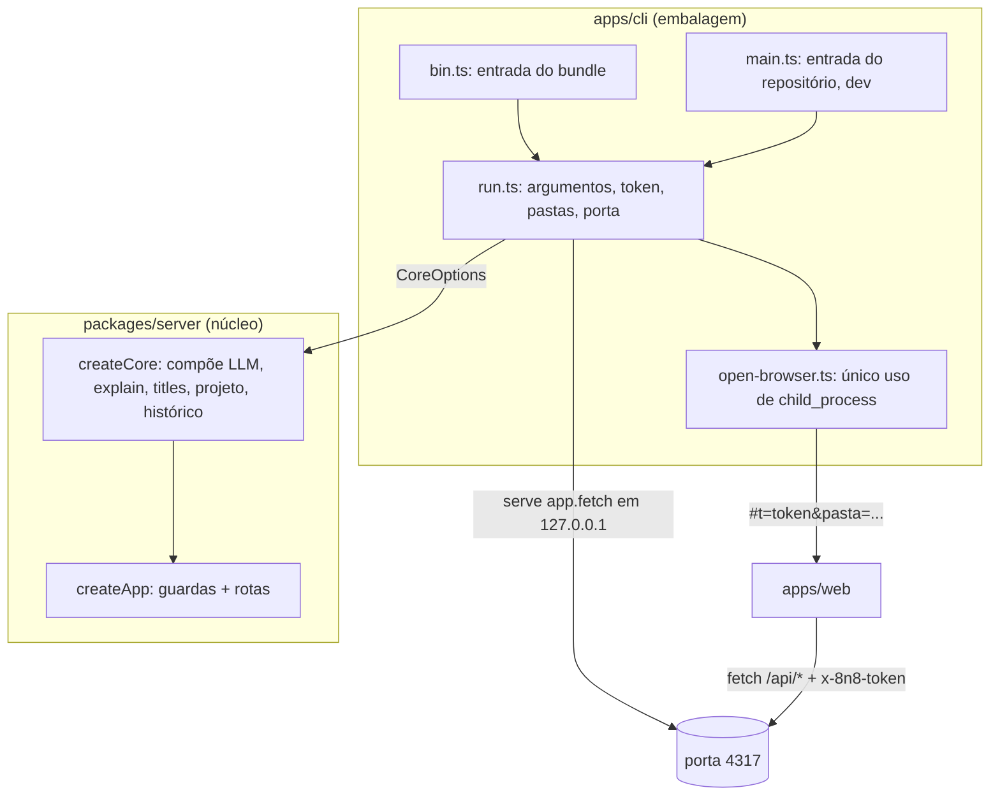

# CLI Design

**Spec**: `.specs/features/07-cli/spec.md`
**Status**: Draft

---

## Architecture Overview

O `server` vira o núcleo: uma função `createCore` monta o app Hono a partir de opções recebidas por parâmetro. A embalagem nova, `apps/cli`, decide o resto: lê o ambiente, escolhe as pastas de dados, gera o token, abre a porta e abre o navegador. O build da CLI gera um bundle ESM só, com as gramáticas, a tela e as regras de PTS ao lado. O `pnpm start` e o E2E rodam esse bundle, então os testes de ponta a ponta cobrem o que é instalado.



**Fluxo de `8n8 <pasta>`:** `run` resolve a pasta → confere se ela existe (DIST-05) → gera o token → sobe o servidor → escreve a URL → abre o navegador em `http://127.0.0.1:4317/#t=<token>&pasta=<pasta codificada>`. A tela lê o fragmento, guarda o token, limpa a barra de endereço e abre o mapa da pasta.

**Abordagem escolhida (aprovada):** bundle com esbuild + pasta de assets. Um protótipo juntou os dois plugins, o SQLite e o Hono num arquivo só e rodou fora do repositório, sem `node_modules`, no Node 24.14 do sistema e no Node 24.21 do VS Code. Descartadas: publicar `.ts` (o Node não remove tipos dentro de `node_modules`), `tsc` + `dependencies` (viola o DIST-16) e Node SEA (complexo demais para quem já tem Node).

---

## Code Reuse Analysis

### Existing Components to Leverage

| Component | Location | How to Use |
| --------- | -------- | ---------- |
| `createApp` e guardas de Host e JSON | `packages/server/src/app.ts:164` | Ganha a guarda de token. As rotas não mudam. |
| `composeLlm`, `composeExplain`, `composeTitles`, `composeReadProject`, `languagePlugins`, `resolvePort`, `listenOptions` | `packages/server/src/main.ts` | Vão para `packages/server/src/core.ts` sem mudar a lógica. `main.ts` deixa de existir no `server`. |
| Abertura do histórico com aviso | `packages/server/src/main.ts` (`openHistoryOrWarn`) | Vai para `core.ts`. |
| `resolveLlmConfig(env)` | `packages/llm/src/config.ts:14` | Já recebe o ambiente por parâmetro. A CLI passa `process.env`. |
| `readSourceFolder` | `packages/input` | Sem mudança. |
| Fixture `projeto-loja` | `packages/languages/*/src/__tests__/fixtures/projeto-loja` | Pasta de teste do E2E da CLI. |
| Servidor de LLM falso | `e2e/fake-llm.ts` | Continua servindo os E2E. |

### Integration Points

| System | Integration Method |
| ------ | ------------------ |
| `apps/web` | Um wrapper `apiFetch` em `api.ts` põe o cabeçalho `x-8n8-token` em toda chamada. Um módulo `session.ts` lê `#t=` e `pasta=` do fragmento. |
| Vite (dev) | O proxy de `/api` acrescenta `x-8n8-token` a partir de `APP8N8_TOKEN`. |
| Playwright | Os servidores de teste rodam o bundle com `APP8N8_TOKEN` fixo. `use.extraHTTPHeaders` manda o token em toda requisição. Um spec próprio testa o caminho do fragmento sem esse cabeçalho. |

---

## Components

### `createCore` (núcleo)

- **Purpose**: Montar o app completo a partir de opções explícitas, sem ler o ambiente nem abrir porta (DIST-13).
- **Location**: `packages/server/src/core.ts`, exportado por `packages/server/src/index.ts` (o `exports` do pacote passa de `app.ts` para `index.ts`).
- **Interfaces**:
  - `createCore(options: CoreOptions): Hono`
  - `languagePlugins: LanguagePlugin[]` (continua exportado)
- **Dependencies**: `explain`, `llm`, `input`, `project`, `links`, plugins de linguagem.
- **Reuses**: todas as funções `compose*` de hoje.

### Guarda de token

- **Purpose**: Recusar com 401 toda chamada a `/api/*` sem o token certo, antes de qualquer trabalho (DIST-20).
- **Location**: `packages/server/src/app.ts` (middleware), `packages/server/src/token.ts` (comparação).
- **Interfaces**:
  - `sameToken(expected: string, received: string | undefined): boolean`: `timingSafeEqual` sobre os dois hashes SHA-256, para comparar em tempo constante mesmo com tamanhos diferentes.
- **Ordem das guardas**: Host (403) → token (401, só em `/api/*`) → JSON (415, só em POST de `/api/*`) → rota. Os arquivos estáticos da tela não pedem token, porque não têm dado do usuário.

### `run` (CLI)

- **Purpose**: Interpretar argumentos e ambiente, preparar pastas e token, subir o servidor e abrir o navegador.
- **Location**: `apps/cli/src/run.ts`
- **Interfaces**:
  - `run(argv: string[], deps: RunDeps): Promise<number>`: devolve o código de saída. `RunDeps` traz `env`, `cwd`, `home`, `paths` (tela e PTS), `out` e `err` (escritores), `serve`, `openBrowser` e `randomToken`, todos injetáveis nos testes.
- **Argumentos** (`util.parseArgs`): `[pasta]`, `--no-open`, `--help`.
- **Token**: `APP8N8_TOKEN` quando definido e com 32 caracteres ou mais. Senão, `randomBytes(32).toString("hex")`. Um `APP8N8_TOKEN` curto encerra com erro.
- **Pastas**: `APP8N8_CACHE_DIR` ou `~/.8n8/cache`. `APP8N8_HISTORY_DIR` ou `~/.8n8` para o `historico.db`.
- **Saída**: `8n8 em http://127.0.0.1:<porta>/#t=<token>`, com a pasta no fragmento quando houver. O endereço leva o token, senão a pessoa não consegue abrir à mão (ajuste no DIST-07).

### Entradas da CLI

- **Purpose**: Dizer onde estão a tela e as regras de PTS em cada forma de rodar, sem ramificar o `run`.
- **Location**: `apps/cli/src/bin.ts` (bundle: assets ao lado do arquivo) e `apps/cli/src/main.ts` (repositório: `apps/web/dist` e `docs/`).
- **Interfaces**: cada uma chama `run(process.argv.slice(2), {...})` e faz `process.exitCode = código`.
- O `bin.ts` também filtra o aviso "SQLite is an experimental feature" e repassa os outros avisos.

### `openBrowser`

- **Purpose**: Abrir a URL no navegador padrão, sem shell.
- **Location**: `apps/cli/src/open-browser.ts`, o único arquivo do projeto que pode importar `node:child_process` nesta feature (DIST-23).
- **Interfaces**: `openBrowser(url: string, spawn = childProcess.spawn, platform = process.platform): void`
- **Comandos**: Windows `rundll32 url.dll,FileProtocolHandler <url>`; macOS `open <url>`; Linux `xdg-open <url>`. Os argumentos vão como lista, nunca por shell. Isso importa porque o `&` do fragmento seria um separador de comando no `cmd`.

### `session.ts` (tela)

- **Purpose**: Ler `t` e `pasta` do fragmento, guardar o token em `sessionStorage` e limpar a barra (DIST-19).
- **Location**: `apps/web/src/session.ts`
- **Interfaces**: `readLaunch(location, storage, history): { token: string | null; folder: string | null }`
- O `App` abre o mapa de `folder` com o mesmo caminho do formulário de pasta da tela inicial.

### Build da CLI

- **Purpose**: Gerar `apps/cli/dist/` com `8n8.mjs`, `web-tree-sitter.wasm`, `grammars/*.wasm`, `web/` (tela construída) e `pts.md`.
- **Location**: `apps/cli/build.mjs`, chamado por `pnpm --filter @8n8/cli build` (que antes constrói a tela).
- **Técnica das gramáticas**: um plugin do esbuild troca o `node:module` importado pelos arquivos de `packages/languages/` por um módulo cujo `createRequire().resolve("<pacote>/<arquivo>.wasm")` aponta para `grammars/<arquivo>.wasm` ao lado do bundle. Os plugins de linguagem não mudam. Um plugin novo funciona empacotado se usar o mesmo padrão de hoje. O guia `docs/adicionar-linguagem.md` passa a dizer isso.
- **Pacote**: o `package.json` de `apps/cli` publica só `dist/`, com `bin: { "8n8": "dist/8n8.mjs" }`, `engines.node >= 22.13.0`, nenhuma `dependencies` (tudo vai em `devDependencies`) e nenhum script de instalação (DIST-16).

### Suíte de segurança

- **Purpose**: Provar as defesas e falhar quando alguém as remove (DIST-21, DIST-22, DIST-23).
- **Location**: `packages/server/src/__tests__/security.test.ts` e `apps/cli/src/__tests__/security.test.ts`.
- **Ataque por rota**: lê `app.routes` (Hono), filtra `/api/*` e, para cada rota, manda Host estranho, POST sem JSON, sem token e token errado. Os dublês de `explain`, `titles`, `readProject` e `history` contam chamadas, e a contagem precisa ficar em zero. Uma rota nova entra no ataque sozinha. Uma rota com parâmetro (`:id`) recebe um valor de exemplo.
- **Chave sentinela**: `createCore` com `OPENROUTER_API_KEY=<sentinela>` e um LLM falso. Toda rota é chamada com o token certo, e o corpo e os cabeçalhos não podem conter a sentinela. No `apps/cli`, o `run` roda com a sentinela no ambiente, e o `out` e o `err` não podem contê-la.
- **Proibições**: um teste roda o `cruise` do dependency-cruiser (API, sem processo filho) sobre uma fixture com `import "node:child_process"` e espera a violação. Outro teste lê o `biome.json` e exige `noGlobalEval`, `noDangerouslySetInnerHtml` e a restrição do global `Function` como `"error"` explícito.

---

## Data Models

```typescript
/** Tudo o que o núcleo precisa; nada vem do ambiente do processo. */
interface CoreOptions {
  /** Variáveis de LLM (resolveLlmConfig); a CLI passa process.env. */
  llmEnv: Record<string, string | undefined>;
  ptsRules: string;
  cacheDir: string;
  /** Caminho do historico.db; undefined desliga o histórico. */
  historyFile: string | undefined;
  /** Para a guarda de Host. */
  port: number;
  token: string;
}
```

O `AppDeps` de hoje ganha `token: string`.

---

## Error Handling Strategy

| Error Scenario | Handling | User Impact |
| -------------- | -------- | ----------- |
| Pasta inexistente (DIST-05) | `run` confere antes de subir o servidor | "Pasta não encontrada: <caminho>", código 1, navegador fechado |
| Porta em uso (DIST-06) | evento `error` do servidor, `EADDRINUSE` | mensagem atual, código 1 |
| `APP8N8_TOKEN` com menos de 32 caracteres | `run` recusa antes de subir | "APP8N8_TOKEN precisa de 32 caracteres ou mais.", código 1 |
| Navegador não abre | `openBrowser` engole o erro do `spawn` | a URL já está no terminal (DIST-07) |
| Histórico não abre | aviso e app sem histórico (como hoje) | o mapa funciona |
| Requisição sem token | 401 | só um processo de fora vê isso |

---

## Risks & Concerns

| Concern | Location (file:line) | Impact | Mitigation |
| ------- | -------------------- | ------ | ---------- |
| Qualquer processo local chama a API e gasta a chave do usuário | `packages/server/src/app.ts:164` | Uso da chave por terceiros | Token de sessão (DIST-18..20) e suíte de ataque (DIST-21). |
| A API lê qualquer pasta do disco | `packages/server/src/app.ts:224` (`/api/project`) e `/api/explain` com `root` | Um processo de fora leria arquivos pelo 8n8 | Com o token, só quem abriu o 8n8 chama. O risco aceito na spec 02 fica restrito ao dono da sessão. |
| Os plugins carregam o `.wasm` no import, por `createRequire` | `packages/languages/python/src/parse.ts:5`, `packages/languages/typescript/src/parse.ts:9` | Um plugin novo que carregue a gramática de outro jeito quebra no bundle | Teste de fumaça do bundle: extrai Python e TypeScript a partir de `dist/`. O guia de linguagem documenta o padrão. |
| O E2E hoje roda `tsx packages/server/src/main.ts` | `playwright.config.ts` (webServer) | Os servidores de teste mudam de comando | `pnpm e2e` constrói a CLI antes, e os webServers rodam `node apps/cli/dist/8n8.mjs --no-open`. |
| O `node:sqlite` escreve um aviso de experimental no terminal | `packages/server/src/history.ts:4` | Ruído na CLI | O `bin.ts` filtra só esse aviso. Não tenho certeza de que o filtro pega o aviso antes de ele ser impresso, porque o import do `node:sqlite` é avaliado antes do corpo do módulo. Isso é conferido na tarefa, e o plano B é importar o histórico de forma dinâmica depois de ligar o filtro. |
| O `rundll32` pode perder o fragmento `#` da URL | `apps/cli/src/open-browser.ts` | O navegador abriria sem token | É conferido na tarefa, abrindo o navegador real nesta máquina. O plano B é passar `pasta` e `t` na query e limpar a URL do mesmo jeito. |
| `CODEOWNERS` sem proteção de branch só aponta o revisor | `.github/CODEOWNERS` | Um PR poderia remover uma guarda sem bloqueio | Feature de segurança do repositório, antes da abertura (fora do escopo). |

---

## Tech Decisions (only non-obvious ones)

| Decision | Choice | Rationale |
| -------- | ------ | --------- |
| Bundler | esbuild (já no lockfile, via `tsx`) | Provado no protótipo. Um arquivo, sem dependências no pacote. |
| Token no fragmento, não na query | `#t=` | O navegador não manda o fragmento ao servidor, então o token não aparece em log nem em `Referer`. |
| Token via `APP8N8_TOKEN` | aceito com 32 caracteres ou mais | O E2E e o dev precisam de um token conhecido. Um valor curto seria fácil de adivinhar. |
| Comparação de token | `timingSafeEqual` dos hashes SHA-256 | Tempo constante mesmo quando os tamanhos diferem. |
| `pnpm start` e E2E rodam o bundle | `node apps/cli/dist/8n8.mjs --no-open` | O E2E testa o artefato instalado, não o código-fonte. |
| `pnpm dev` | `scripts/dev.mjs` gera o token e sobe `dev:server` e `dev:web` com ele no ambiente | O token chega ao servidor e ao proxy do Vite sem modo "sem token". |
| Duas entradas finas (`bin.ts`, `main.ts`) | cada uma só monta os caminhos | O `run` não ramifica por modo, e as duas são triviais de ler. |
