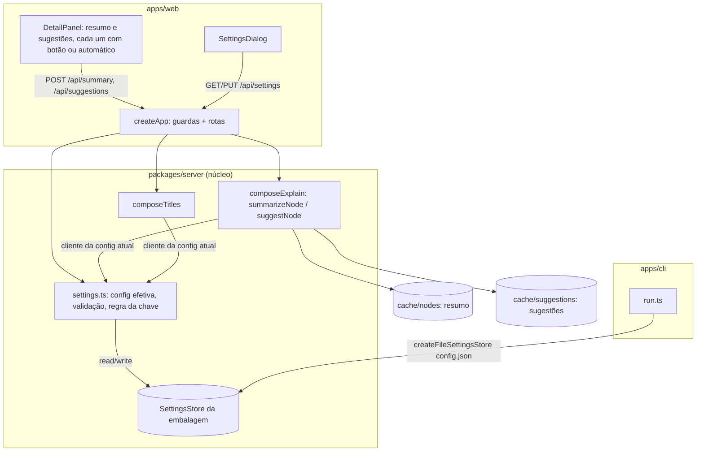

# Configurações e LLM sob demanda Design

**Spec**: `.specs/features/08-config-llm-sob-demanda/spec.md`
**Status**: Approved (o usuário dispensou as aprovações em 2026-10-15)

---

## Architecture Overview

O pedido único de explicação vira dois pedidos, resumo e sugestões, sobre o mesmo pipeline de revisão. A config do LLM deixa de ser fixa na subida do servidor: um serviço de config no núcleo junta o ambiente com o que o armazenamento da embalagem guarda e monta o cliente de LLM de novo quando a config muda.

**Pedido de um nó:** a tela seleciona o nó → para cada parte (resumo, sugestões), se o modo automático está ligado, pede sem `cachedOnly`; senão pede com `cachedOnly: true` → o servidor monta o pedido a partir do grafo (AD-015) → `explainPart` confere o cache → sem acerto, `cachedOnly` devolve `not-cached`; sem cliente, `no-key`; senão rascunho, camada 1, revisor, até 3 rodadas, e grava o cache da parte.

---

## Code Reuse Analysis

| Component | Location | How to Use |
| --------- | -------- | ---------- |
| `reviewedDraft` (rascunho → camada 1 → revisor, 3 rodadas) | `packages/explain/src/review.ts` | Ganha `part`. O parser e a regra "sem frase do resumo = unfaithful" dependem da parte. O resto não muda. |
| `toClaims`, `layerOne`, `applyVerdicts`, `buildReviewerPrompt` | `packages/explain/src` | Sem mudança: o rascunho de cada parte vira um `Draft` com as outras listas vazias. |
| `createDiskCache` | `packages/explain/src/cache.ts` | Vira `createPartCache(dir, folder, schema)`. O resumo fica em `nodes/`, as sugestões em `suggestions/`. `schemaVersion` sobe para 4. |
| `fingerprintOf`, `diffReasons` | `packages/explain/src/fingerprint.ts` | Sem mudança. O resumo passa `docstring: undefined`. |
| `resolveLlmConfig(env)` | `packages/llm/src/config.ts` | Ganha o segundo parâmetro `stored`. |
| `withoutKey` | `packages/server/src/core.ts` | Embrulha cada cliente novo com a chave efetiva. |
| `loadOrigin`, `neighboursOf` | `packages/server/src/app.ts` | As duas rotas novas usam o mesmo handler da rota antiga. |
| `suggestionCards` | `apps/web/src/flow/suggestion-cards.ts` | Recebe `Map<NodeId, Suggestion[]>` no lugar de `Map<NodeId, Explanation>`. |
| Escrita atômica | `packages/explain/src/cache.ts` | O arquivo de config usa o mesmo padrão (temporário + `rename`). |
| Suíte de segurança | `packages/server/src/__tests__/security.test.ts` | Já lista as rotas e ataca cada uma. Ganha a chave sentinela gravada pelo `PUT`. |

---

## Components

### `model`: tipos

- `Summary { summary, sentences, inputs, outputs }` substitui `Explanation`.
- `ExplainResponse<T>`: `ok { result: T, fromCache, review, update? }`, `not-cached`, `unfaithful`, `no-key`, `error { message }`. `SummaryResponse = ExplainResponse
`, `SuggestionsResponse = ExplainResponse<Suggestion[]>`.
- `StoredSettings { provider?, apiKey?, baseURL?, model?, autoSummary?, autoSuggestions? }`.
- `SettingsResponse { provider, baseURL, model, autoSummary, autoSuggestions, hasKey, providers: {id, defaultModel}[], env: Partial<Record<campo, nomeDaVariável>> }`.
- `SettingsPatch`: os campos de `StoredSettings`, com `null` para apagar `apiKey`, `baseURL` e `model`.

### `explain`: duas partes

- `buildSummaryPrompt`, `buildStepSummaryPrompt`, `buildSuggestionsPrompt` (`prompt.ts`): o formato JSON de cada parte. A versão continua sendo o hash do texto.
- `parseSummary(raw)`, `parseSuggestions(raw, lineCount)` (`schema.ts`): devolvem o `Draft` com as listas da outra parte vazias.
- `summarizeNode(req, deps, { cachedOnly })` e `suggestNode(req, deps, { cachedOnly })` (`explain.ts`), sobre um `explainPart` interno. A mensagem do resumo vai sem docstring, e a impressão digital do resumo também.
- `ExplainDeps`: `llm`, `summaryCache`, `suggestionsCache`, `provider`, `model`, `reviewModel`, `prompts { summary, stepSummary, suggestions }`, `reviewer`.

### `llm`: config com valor guardado

- `resolveLlmConfig(env, stored = {})`: campo a campo, ambiente → guardado → padrão. Chave, URL e modelo guardados valem só quando `stored.provider` (ou o padrão, sem provedor guardado) é o provedor efetivo (CFG-16).
- `envNames(env)`: o nome da variável que define cada campo, só para os campos definidos (CFG-12, CFG-22).

### `server`: serviço de config, rotas e armazenamento em arquivo

- `SettingsStore { read(): Promise<StoredSettings>; write(s): Promise<void> }` (`settings.ts`), parâmetro `settings` de `CoreOptions` (CFG-18).
- `createSettingsService(env, store)`: guarda a config lida uma vez em memória. `view()` monta `SettingsResponse`. `update(patch)` valida com zod `strict` (CFG-14), aplica a regra da chave (CFG-15) e grava. `llm()` devolve `{ client, config, auto }` da config atual e só monta um cliente novo quando a config muda (CFG-17).
- `createFileSettingsStore(path)` (`settings-file.ts`): lê com zod (ilegível = vazio) e grava com arquivo temporário `0o600` + `rename` (CFG-19).
- Rotas: `POST /api/summary` e `POST /api/suggestions` (um handler com a parte como parâmetro, corpo com `cachedOnly?: boolean`), `GET /api/settings`, `PUT /api/settings`. A rota `POST /api/explain` sai.

### `apps/cli`

- `APP8N8_CONFIG_DIR` (padrão `~/.8n8`) e `createFileSettingsStore(<dir>/config.json)` passado a `createCore`. O `--help` lista as variáveis novas.

### `apps/web`

- `api.ts`: `fetchSummary`, `fetchSuggestions` (com `cachedOnly`), `fetchSettings`, `saveSettings`.
- `DetailPanel`: duas seções independentes, cada uma com estado `idle | loading | resultado`. O cache da tela usa a chave `<parte>:<nodeId>`. Props novas: `auto { summary, suggestions }`, `onOpenSettings`, `onSuggestions(id, suggestions)` no lugar de `onExplained`.
- `SettingsDialog` (`apps/web/src/settings/SettingsDialog.tsx`): `<dialog>` com os campos do CFG-20, envia só o que mudou (CFG-21).
- `App`: lê `GET /api/settings` ao abrir, guarda em estado, mostra o botão "Configurações" em todas as vistas e passa `auto` ao painel.

---

## Error Handling Strategy

| Error Scenario | Handling | User Impact |
| -------------- | -------- | ----------- |
| `config.json` ilegível | Conta como vazio | O mapa abre, o LLM fica sem config até salvar |
| `PUT` inválido | 400 com `{error: "invalid settings"}`, nada gravado | "Não foi possível salvar. Confira a URL e a chave." |
| Falha ao gravar o arquivo | 500 com `{error: "save failed"}` | Mesma mensagem do 400 |
| `GET /api/settings` falha na tela | A tela usa o modo por clique | Botões aparecem, nada é gasto |

---

## Tech Decisions

| Decision | Choice | Rationale |
| -------- | ------ | --------- |
| Rascunho de uma parte | `Draft` completo, com as listas da outra parte vazias | Reaproveita `toClaims`, a camada 1 e o revisor sem mudança. |
| Nome do campo de resultado | `result` (genérico) no lugar de `explanation` | O mesmo tipo de resposta serve às duas partes. |
| Testes E2E antigos | Os servidores com chave ganham `APP8N8_AUTO_SUMMARY=1` e `APP8N8_AUTO_SUGGESTIONS=1` | Eles testam o pipeline, não o modo de pedir. Um spec novo cobre o modo por clique. |
| Config dos servidores E2E | `APP8N8_CONFIG_DIR` numa pasta de teste para cada servidor | Nenhum teste toca no `~/.8n8` do usuário. |
| LLM falso | Papel novo `suggest` (prompt das sugestões) ao lado de `draft` | Os testes contam os pedidos de cada parte. |
