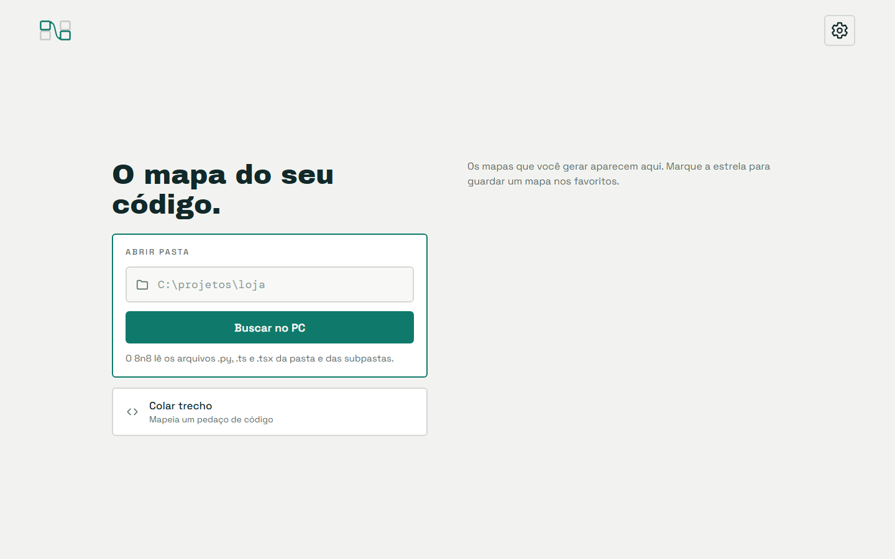
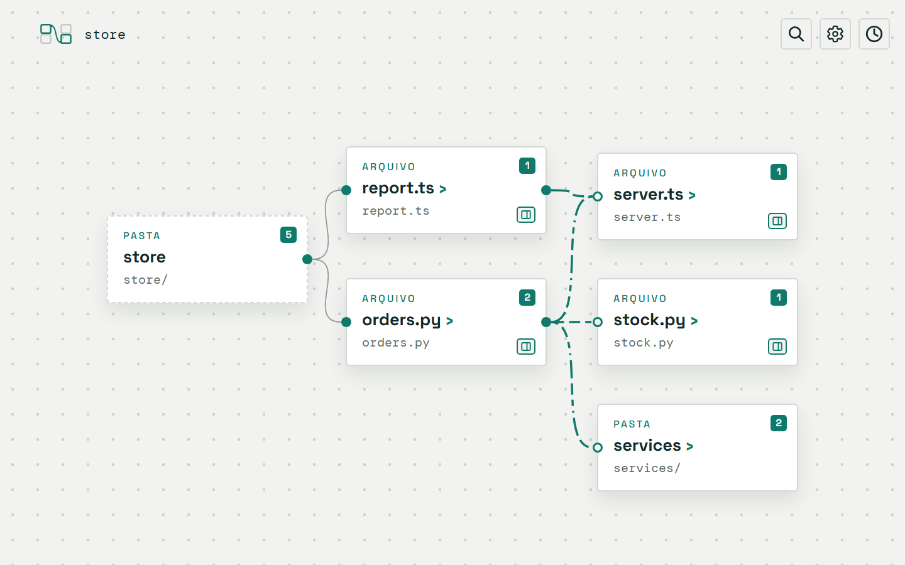
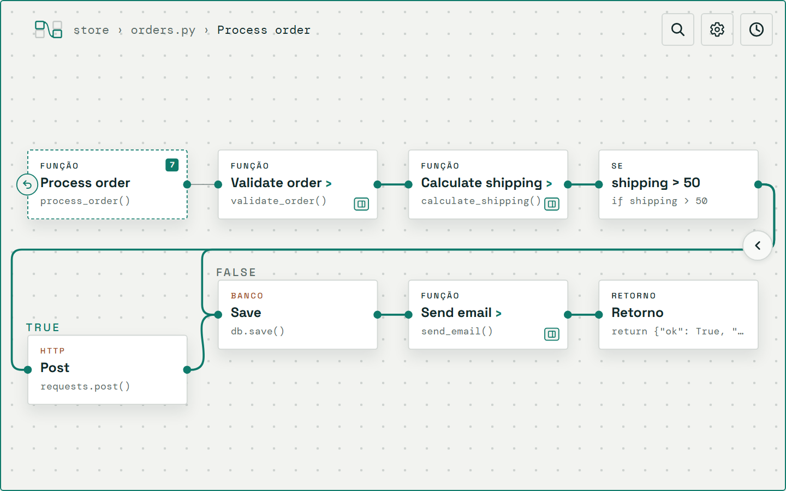
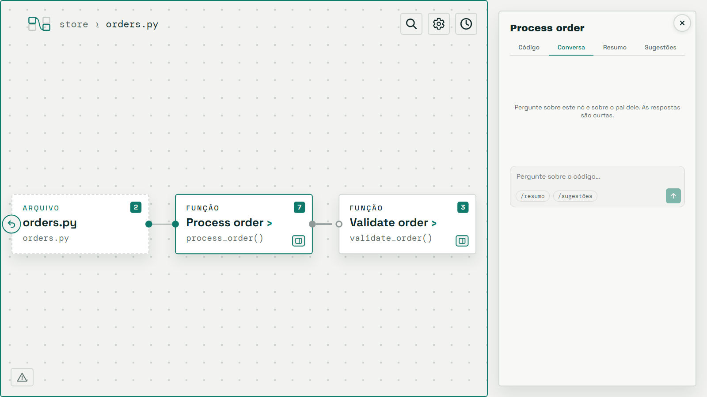

# 8n8

[](https://github.com/Ferreira-Jefferson/8n8/actions/workflows/ci.yml)
[](https://github.com/Ferreira-Jefferson/8n8/actions/workflows/codeql.yml)
[](LICENSE)
[](https://github.com/Ferreira-Jefferson/8n8/graphs/contributors)
[](https://github.com/Ferreira-Jefferson/8n8/commits)
[](https://github.com/Ferreira-Jefferson/8n8/issues)
[](https://github.com/Ferreira-Jefferson/8n8/stargazers)
[](https://nodejs.org)
[](CONTRIBUTING.md)

O 8n8 é um mapa visual de código. Você aponta um arquivo, uma pasta ou um trecho, e ele mostra como as partes se conectam, como nós ligados por arestas.

O mapa começa amplo. Você abre um nó para ver o fluxo interno dele e vai descendo, até as linhas reais de código. Cada arquivo, função e passo pode trazer um resumo e sugestões de melhoria.

## Por que o 8n8 existe

Com a IA, o código muda e cresce rápido demais para ler linha por linha. Eu perdia tempo para entender o que tinha mudado e como as partes se ligavam. Procurei uma ferramenta visual que mostrasse o fluxo de forma rápida e intuitiva, e não achei nenhuma. Lembrei do [n8n](https://n8n.io), me inspirei nele e criei o 8n8. O nome é uma brincadeira com ele. Particularmente, acho que "eight-en-eight" soa melhor que "oito-ene-oito", mas cada um pronuncia como preferir. Fora o desenho de nós e arestas, os dois projetos não têm relação nenhuma.

## Como fica

**1. Você aponta uma pasta ou cola um trecho.**

<picture>
  <source media="(prefers-color-scheme: dark)" srcset="docs/images/inicio-dark.png">
  
</picture>

**2. O mapa começa amplo:** a pasta, os arquivos (de linguagens diferentes) e como eles se ligam.

<picture>
  <source media="(prefers-color-scheme: dark)" srcset="docs/images/pasta-dark.png">
  
</picture>

**3. Você abre um nó e vê o fluxo por dentro:** funções, um `if`, uma chamada HTTP, o banco e o retorno.

<picture>
  <source media="(prefers-color-scheme: dark)" srcset="docs/images/fluxo-dark.png">
  
</picture>

**4. O painel do nó** tem quatro abas: Código, Conversa, Resumo e Sugestões. A imagem mostra a aba Conversa, ainda vazia: sem chave de LLM, ela só tem os dois atalhos.

<picture>
  <source media="(prefers-color-scheme: dark)" srcset="docs/images/conversa-dark.png">
  
</picture>

O código de exemplo está em [docs/sample-project](docs/sample-project). Para refazer as imagens: `pnpm prints`.

### O que o mapa oferece

- **Busca de nó:** a lupa expande e procura por título ou por nome técnico.
- **Card que abre:** o card mostra quantos nós tem dentro. O botão **Ver detalhes** abre o painel do nó, minimizado ou não, sem entrar nele. Num arquivo, você vê o código e pode pedir o resumo e as sugestões do arquivo inteiro sem abrir as funções. Uma pasta não tem o botão nem painel: ela não tem código para mostrar.
- **Painel em abas:** Código, Conversa, Resumo e Sugestões, nesta ordem. O código vem primeiro porque é a única parte que sempre existe. O painel abre no Código, e a aba escolhida fica ao trocar de nó. Em cada aba de resumo ou de sugestões há um só botão de gerar: ele fica desabilitado enquanto o texto é gerado e, se falhar, volta com a mensagem de erro.
- **Conversa:** você pergunta sobre o nó aberto e sobre o pai dele (o `if` e a função que o contém, a função e o arquivo). O modelo não vê mais nada do projeto. A resposta é curta (até 600 caracteres) e segue o idioma do 8n8, com as regras do Português Técnico Simplificado ou do Simplified Technical English. Uma marca como `L18` na resposta é um botão que marca a linha no código. Os atalhos `/resumo` e `/sugestões` mostram o que já foi gerado, sem chamar o LLM de novo.
- **Sugestões:** um selo no nó mostra quantas sugestões ele tem. O clique abre um balão com a lista. Na aba Sugestões, cada cartão tem um **×** para remover, e a remoção fica guardada. Uma sugestão que o modelo achar na conversa já entra na lista, sob "Da conversa". Você também guarda qualquer resposta com o ícone de marcador, que liga e desliga.
- **Ramos do `if`:** cada ramo traz o rótulo `true` ou `false`.
- **Histórico e favoritos:** os mapas gerados ficam no histórico. A estrela guarda um mapa nos favoritos.
- **Tema e idioma:** o tema claro ou escuro e o idioma (português ou inglês) mudam nas Configurações.

## Como funciona

1. **O 8n8 lê o código.** Ele aceita um arquivo, uma pasta ou um trecho colado.
2. **Um parser monta a estrutura.** O Tree-sitter lê cada arquivo e o 8n8 monta um grafo em níveis: repositório, módulo, arquivo, função e bloco. O resultado é sempre o mesmo para o mesmo código.
3. **A tela desenha o grafo.** Cada nível é um fluxo de nós e arestas. Você abre um nó para descer ao nível seguinte.
4. **O LLM escreve os textos.** Ele cria o resumo e as sugestões de cada nó. Ele nunca decide a estrutura, e cada texto aponta para um nó e uma linha.

Todo nó leva de volta ao código real, com o arquivo e as linhas. **Sem chave de LLM, o mapa funciona.** Só os resumos e as sugestões ficam de fora.

Em `apps/` há três pastas. Uma é a tela e duas são as formas de rodar o 8n8, sobre o mesmo núcleo:

- **Tela (`apps/ui`):** a interface, em React com React Flow. A CLI e a extensão servem o mesmo build. Não há backend hospedado: o núcleo roda localmente.
- **CLI (`apps/cli`):** você roda o comando `8n8` no terminal (PowerShell ou Bash), e o mapa abre no navegador.
- **Editores (`apps/editors`):** a extensão do VS Code abre o mapa num painel ao lado do código. Outros editores entram na mesma pasta.

A tela e o terminal falam português (pt-BR) ou inglês. O botão **BR/EN** nas Configurações troca o idioma, e a LLM responde no mesmo idioma.

Os textos usam Português Técnico Simplificado: frases curtas, voz ativa, um termo por conceito. As regras estão em [docs/writing-rules/portugues-tecnico-simplificado.md](docs/writing-rules/portugues-tecnico-simplificado.md). Em inglês, valem as regras de [docs/writing-rules/ingles-tecnico-simplificado.md](docs/writing-rules/ingles-tecnico-simplificado.md).

## Linguagens suportadas

| Linguagem | Extensões | Pacote |
|---|---|---|
| Python | `.py` | `packages/languages/python` |
| TypeScript | `.ts`, `.tsx` | `packages/languages/typescript` |

Uma pasta com as duas linguagens vira um mapa só. Os arquivos se ligam por rota HTTP, por processo e por nome.

Para acoplar outra linguagem, siga o guia [docs/guides/adicionar-linguagem.md](docs/guides/adicionar-linguagem.md).

## Instalar

O 8n8 precisa de Node 22.13 ou mais novo. Há duas formas de usar: a CLI e a extensão do VS Code. A CLI está no [npm](https://www.npmjs.com/package/8-n-8). A extensão ainda parte do repositório, e isso pede o pnpm.

Para gerar as duas a partir do repositório de uma vez, rode `pnpm build:all`. Ele instala as dependências e cria os pacotes na pasta `release/`.

### A CLI

A CLI roda no terminal (PowerShell ou Bash) e abre o mapa de qualquer pasta no navegador.

**Pelo npm (recomendado).** O pacote se chama `8-n-8`, porque o npm recusou `8n8` por ser parecido com outros nomes. O comando que ele instala continua sendo `8n8`.

```bash
npx 8-n-8 .          # abre o mapa da pasta atual, sem instalar
npm install -g 8-n-8 # ou instala o comando 8n8
```

**Pelo repositório.** Útil para testar uma mudança sua:

```bash
pnpm install
pnpm install:cli:global
```

O `pnpm install:cli:global` gera o pacote (`release/8-n-8-0.0.2.tgz`) e o instala com `npm install -g`. O pacote não tem dependências nem scripts de instalação: todo o código vai dentro dele. Depois, use o comando `8n8`:

```bash
8n8 .              # abre o mapa da pasta atual, numa janela própria (Chrome ou Edge)
8n8 C:\projeto     # ou de qualquer pasta
8n8                # abre a tela inicial
8n8 --no-open      # sobe o servidor sem abrir o navegador
8n8 --no-app       # abre numa aba do navegador padrão, em vez da janela própria
8n8 --help         # mostra o uso e as variáveis
```

Na primeira abertura de uma pasta grande, o 8n8 cria um cache de análise no disco, com trechos do seu código. Ele vem ligado e dá para desligar: veja [Cache de análise em disco](#cache-de-análise-em-disco).

### A extensão do VS Code

A extensão abre o mesmo mapa num painel ao lado do código. Ela precisa do VS Code 1.138 ou mais novo. Como ela ainda não está no Marketplace, você gera o arquivo de instalação (`.vsix`) e instala a partir dele.

**1. Gerar o arquivo.** Na pasta do repositório, rode:

```bash
pnpm install
pnpm build:ext
```

O comando constrói a tela e empacota a extensão. O arquivo sai em `release/8n8-vscode-0.0.1.vsix` (uns 1,5 MB). Se mudar o código, rode `pnpm build:ext` de novo.

**2. Instalar o arquivo.** Daqui o caminho se divide em dois. Escolha um, e os dois levam ao mesmo resultado:

- **Pela interface:**
  1. Abra a aba **Extensions** (`Ctrl+Shift+X`).
  2. Clique em **⋯** (**Views and More Actions**), no canto superior direito da aba.
  3. Escolha **Install from VSIX…**.
- **Pela paleta de comandos:**
  1. Abra a paleta (`Ctrl+Shift+P`).
  2. Digite **Extensions: Install from VSIX…** e tecle Enter.

Nos dois caminhos, a janela de arquivos abre em seguida. Selecione `release/8n8-vscode-0.0.1.vsix` e confirme. (No terminal, o equivalente é `code --install-extension release/8n8-vscode-0.0.1.vsix`.)

**3. Recarregar a janela.** Abra a paleta de comandos (`Ctrl+Shift+P`) e rode **Developer: Reload Window**. A extensão é nova, então o VS Code só mostra o ícone depois do recarregamento.

**4. Achar o ícone.** Abra um arquivo qualquer. O ícone do 8n8 aparece na barra de título do editor, no canto superior direito, ao lado dos outros botões. Ele só aparece com um arquivo aberto. Se a barra estiver cheia, o ícone fica no menu **⋯** da mesma barra. Um clique nele abre o mapa.

**5. Usar.** Você também pode rodar **8n8: Abrir mapa** na paleta de comandos. Ele abre a tela inicial, sem mapa: lá você digita a pasta ou cola um trecho. Para mapear uma pasta direto, clique nela com o botão direito no Explorer e escolha **8n8: Abrir mapa desta pasta**. No mapa de uma pasta, o botão **Início** volta à tela inicial.

**Atualizar ou remover.** Para atualizar, gere o `.vsix` de novo e repita o passo 2: o VS Code troca a versão instalada. Para remover, abra a aba **Extensions**, clique na engrenagem do **8n8** e escolha **Uninstall**.

Para acrescentar outro editor, veja [docs/guides/adicionar-editor.md](docs/guides/adicionar-editor.md).

### Como app (PWA)

A tela é um PWA: o navegador pode instalá-la como um app, com ícone e janela própria. Rode o 8n8 (`8n8 .` ou `pnpm open .`) e use a opção **Instalar** do Chrome ou do Edge. O ícone do app segue o [manual da marca](docs/design/manual-marca.html).

O app instalado é só a janela. O núcleo continua local: o 8n8 precisa estar rodando para o app funcionar.

## Configurar o LLM

Os resumos e as sugestões pedem um provedor de LLM. O 8n8 escolhe o provedor nesta ordem:

1. A variável de ambiente `APP8N8_LLM_PROVIDER`, se existe.
2. O provedor que você escolheu nas Configurações.
3. Sem escolha, o 8n8 procura o Claude Code na sua máquina. Se acha, usa o `claude-code`, que aproveita a sua assinatura e não pede chave. Se não acha, usa o `openrouter`, que pede uma chave.

Para usar a sua própria chave, escolha um provedor nas Configurações e cole a chave. Falta o seu provedor? Acrescente um: o guia [docs/guides/adicionar-provedor-llm.md](docs/guides/adicionar-provedor-llm.md) mostra como, e o projeto aceita contribuições.

O jeito mais simples de configurar é pela tela: clique no botão **Configurações** (no canto de cima, em todas as telas) e preencha:

- **Provedor**: `claude-code` (a sua assinatura do Claude Code, sem chave; é o padrão quando o 8n8 acha o Claude Code), `openrouter` (o padrão sem ele), `openai`, `anthropic` (os três pedem uma chave de API) ou `openai-compatible` (Ollama, LM Studio ou um servidor seu, com a URL pela variável de ambiente). Com `claude-code`, a tela diz se achou o Claude Code e tem o botão **Escolher…**, que abre a janela de arquivo do sistema.
- **Chave de API**: o campo só recebe a chave. Ela nunca volta para a tela: o diálogo diz só "Chave guardada".
- **Modelo**: escreva o nome exato do modelo, como o provedor o conhece. Vazio usa o padrão do provedor, que aparece como dica no campo.
- **Resumo automático** e **Sugestão automática**: ligados, o resumo e as sugestões são pedidos ao selecionar um nó. Desligados, o resumo e as sugestões só são pedidos quando você clica em "Gerar resumo" ou "Pedir sugestões" (ou usa `/resumo` e `/sugestões` na conversa). Assim nada é gasto enquanto você só navega. O que já está no cache aparece sem clique.

Trocar o provedor apaga a chave e o modelo guardados, para a chave nunca ir a um serviço que você não escolheu.

### Variáveis de ambiente

Uma variável de ambiente ganha da tela, e o campo dela aparece travado no diálogo. No repositório, `pnpm dev` e `pnpm start` leem o `.env` da raiz. Copie `.env.example` para `.env` e preencha:

```bash
cp .env.example .env
```

- `APP8N8_LLM_PROVIDER`: `claude-code` (o padrão quando o Claude Code está instalado), `openrouter` (o padrão sem ele), `openai`, `anthropic` ou `openai-compatible` (Ollama, LM Studio, servidor próprio).
- `APP8N8_CLAUDE_PATH`: o caminho do executável do Claude Code. É opcional: o 8n8 procura sozinho, e a tela também escolhe. Um caminho errado aqui desliga a busca automática, e a tela avisa.
- `OPENROUTER_API_KEY`, `OPENAI_API_KEY` e `ANTHROPIC_API_KEY`: a chave de cada provedor. Esses três usam o endereço oficial. Só o `openrouter` aceita trocar a URL, por `OPENROUTER_BASE_URL`.
- `APP8N8_LLM_BASE_URL` e `APP8N8_LLM_API_KEY`: a URL e a chave do provedor `openai-compatible`. A URL só vem desta variável: a tela não tem campo de URL. Em servidor local, a chave é opcional.
- `APP8N8_MODEL` e `APP8N8_REVIEW_MODEL`: o modelo do resumo e o do revisor. Vazio usa o padrão do provedor.
- `APP8N8_AUTO_SUMMARY` e `APP8N8_AUTO_SUGGESTIONS`: `1` pede o resumo ou as sugestões ao selecionar um nó; `0` espera o clique.

A CLI instalada nunca lê um `.env`.

### O provedor `claude-code`

Você só precisa do Claude Code instalado e com login. O 8n8 acha o executável, abre o Claude Code e pede cada resumo ou sugestão. Você não digita nenhuma opção.

**O que o 8n8 executa.** Para cada pedido, o 8n8 roda o `claude` com estas opções:

```text
claude -p --input-format stream-json --output-format stream-json --verbose
       --model <modelo> --effort low --system-prompt <regras>
       --tools "" --no-session-persistence --setting-sources ""
       --strict-mcp-config --disable-slash-commands
```

- `-p` roda o Claude Code em modo não interativo: ele responde um pedido e sai.
- `--input-format` e `--output-format stream-json` trocam mensagens em JSON, uma por linha.
- `--tools ""` desliga todas as ferramentas. O Claude Code só escreve texto.
- `--setting-sources ""`, `--strict-mcp-config` e `--disable-slash-commands` desligam os arquivos de configuração, o MCP e os comandos `/`. Assim os seus hooks e plugins de usuário não rodam, e o início é mais rápido. O login continua valendo.
- `--no-session-persistence` não guarda a conversa no histórico do Claude Code.
- `--effort low` reduz o raciocínio escondido e deixa a resposta mais rápida.

O 8n8 roda o processo numa pasta vazia própria (`8n8-claude`, dentro da pasta temporária do sistema), nunca na pasta analisada. Por isso os hooks e o `CLAUDE.md` do seu projeto não são carregados. O código do nó entra pelo stdin, nunca como argumento. O processo herda as variáveis de ambiente, menos `OPENROUTER_API_KEY` e `APP8N8_LLM_API_KEY`. Cada pedido tem limite de 180 segundos e de 5 MB de resposta.

**Versão do Claude Code.** O 8n8 precisa de um Claude Code que aceite todas as opções acima. Elas existem na versão 2.1.145, a que está na máquina de desenvolvimento. A versão mínima exata ainda não foi medida. Se uma opção faltar, o pedido falha e a tela mostra o código de saída.

**Como o 8n8 acha o Claude Code.** A busca segue esta ordem:

1. `APP8N8_CLAUDE_PATH`, se a variável aponta para um arquivo. Se aponta para um arquivo que não existe, a busca para: o 8n8 não tenta outro caminho, e a tela avisa.
2. O arquivo escolhido em Configurações.
3. Os lugares de instalação conhecidos:
   - **Windows:** o npm global (`%APPDATA%\npm`), o instalador oficial (`~/.local/bin/claude.exe`) e cada pasta do `PATH`, inclusive o npm do nvm e do volta.
   - **macOS e Linux:** cada pasta do `PATH`, `~/.local/bin/claude` e `~/.claude/local/claude`. O arquivo escolhido na tela vem só da janela de arquivo do sistema e precisa se chamar `claude` ou `claude.exe`. A API local nunca recebe um caminho.

O modelo padrão é o `claude-sonnet-5-5`, com esforço baixo. Para não esperar a abertura do Claude Code a cada pedido, o 8n8 deixa até 2 processos já abertos (cerca de 300 MB cada). Cada processo responde um pedido só. Um processo sem uso fecha depois de 10 minutos, e todos fecham junto com o 8n8.

Para acrescentar um provedor, veja [docs/guides/adicionar-provedor-llm.md](docs/guides/adicionar-provedor-llm.md).

## Dados e segurança

Achou uma falha de segurança? Avise em privado, como explica o [SECURITY.md](SECURITY.md).

- **Token por execução.** Cada execução da CLI gera um token novo, que só a aba aberta por ela conhece. Outro programa da máquina não consegue usar a API nem a sua chave de LLM. Sem o token, a API responde 401.
- **Pasta de dados.** Tudo fica em `~/.8n8` (no Windows, `C:\Users\<nome>\.8n8`): o cache em `cache/`, o histórico em `historico.db` e as configurações em `config.json`, só com permissão do dono. As variáveis `APP8N8_CACHE_DIR`, `APP8N8_HISTORY_DIR` e `APP8N8_CONFIG_DIR` mudam essas pastas.
- **O que a conversa envia.** Uma pergunta leva ao LLM o código do nó e o do pai dele inteiro (no máximo 8000 caracteres do pai), os nomes dos nós vizinhos e as últimas mensagens da conversa. A conversa fica só na memória da tela: ela não é gravada.
- **Notas das sugestões.** As sugestões que você guardou da conversa e as que você removeu ficam em `cache/notes/`, uma por nó. Se o código do nó muda, as notas dele caem, porque as linhas passariam a apontar para outro lugar.
- O histórico guarda só o caminho de cada pasta, nunca o código. Abrir uma pasta pelo histórico lê a pasta de novo. De um trecho colado, o histórico guarda o texto e a linguagem.
- **Cache de análise.** Ligado por padrão. Para abrir de novo uma pasta grande sem analisar tudo, o 8n8 guarda em disco dado derivado do seu código, **inclusive trechos dele** (condições, valores de `return`, rotas, URLs). O banco não é cifrado. Leia a seção [Cache de análise em disco](#cache-de-análise-em-disco) abaixo. Para desligar, defina `APP8N8_NO_ANALYSIS_CACHE=1`.
- **Na extensão do VS Code**, não há porta aberta: a página do painel fala com o núcleo por mensagens do próprio VS Code. A chave de API fica no cofre do VS Code (`SecretStorage`). O cache e o histórico ficam na pasta de dados da extensão.

### Cache de análise em disco

**Ele vem ligado por padrão.** Serve para abrir de novo uma pasta grande sem analisar todos os arquivos. Numa pasta de 3 mil arquivos, a reabertura cai de 15 a 30 segundos para cerca de 3.

**O que ele guarda.** Dado derivado do seu código:

- nomes de funções, classes e variáveis;
- a estrutura do fluxo (como os nós se ligam);
- as linhas dos comentários de documentação;
- os rótulos dos nós. Eles levam **trechos reais do código**: condições (`if`), valores de `return`, cabeçalhos de laço, chamadas, rotas e URLs.

**O que ele não guarda.** O texto inteiro de um arquivo (o 8n8 o lê da pasta a cada abertura), a chave de API e a conversa.

**Os riscos, em palavras simples.**

- Se um segredo estiver escrito num desses trechos (por exemplo, `if token == "abc123"`), ele vai para o banco.
- O banco não é cifrado.
- Ele continua no disco depois que você apaga o projeto.
- Qualquer programa que rode com o seu usuário pode lê-lo. No Windows, a permissão "só o dono" não vale.
- Ele pode entrar em backup ou em sincronização da sua pasta de usuário.

**Onde fica.** Em `cache/analysis/cache.db`, um banco SQLite dentro da pasta de dados do 8n8 (veja "Pasta de dados", acima). O SQLite cria também os arquivos `cache.db-wal` e `cache.db-shm` ao lado dele. O CLI e a extensão do VS Code usam o mesmo arquivo quando apontam para a mesma pasta de cache. A extensão guarda o dela na pasta de dados da extensão.

**Quando ele atua.** Só em pasta com 150 arquivos ou mais, e quando há worker (no CLI e na extensão; não no `pnpm dev:server`). O limite é de 500 MB: acima disso, os dados menos usados saem na próxima abertura. O 8n8 refaz o cache sozinho quando ele falta ou está danificado.

**Para desligar,** defina `APP8N8_NO_ANALYSIS_CACHE=1` no ambiente que inicia o 8n8:

```bash
APP8N8_NO_ANALYSIS_CACHE=1 8n8 .          # Bash
$env:APP8N8_NO_ANALYSIS_CACHE = "1"; 8n8 .   # PowerShell
```

Na extensão do VS Code, defina a variável no ambiente que abre o VS Code.

**Para apagar,** feche o 8n8 e apague a pasta `cache/analysis`.

**Quando desligar.** Se você guarda segredos dentro do código, usa uma máquina compartilhada ou trabalha com código sob confidencialidade, desligue o cache.

## O que o 8n8 lê de uma pasta

O 8n8 respeita o `.gitignore` da pasta. Ele lê o `.gitignore` da raiz e o de cada subpasta, com as regras do git (padrões, `!`, `/` e `**`). Um arquivo que o `.gitignore` ignora não entra no mapa nem aparece na lista de arquivos ignorados. O `.gitignore` global da máquina e o `.git/info/exclude` não contam: o mapa da mesma pasta é igual em qualquer máquina.

O 8n8 também pula, por padrão:

- as pastas `.git` e `node_modules`;
- as pastas de saída `build`, `dist`, `coverage` e `out`, só na raiz da pasta aberta ou ao lado de um `package.json` ou `pyproject.toml`. Mais fundo, uma pasta `src/commands/build` entra no mapa;
- as pastas de cada linguagem: `.venv`, `venv`, `__pycache__`, `site-packages`, `.tox`, `.mypy_cache` e `.pytest_cache` (Python), `.next`, `.turbo` e `bower_components` (TypeScript);
- arquivos de extensão que nenhuma linguagem lê.

Abrir uma dessas pastas direto (por exemplo, o próprio `node_modules`) também não funciona: o 8n8 avisa que é pasta de dependência. Em Configurações, a opção "Ignorar o que está no .gitignore e as pastas de dependência" desliga o `.gitignore` e essa lista, depois de uma confirmação. Só o `.git` continua de fora.

Alguns arquivos de código ficam fora do mapa por outro motivo: maior que 1 MB, fora do UTF-8, ilegível ou link simbólico. Nesse caso, um ícone de aviso aparece no canto do mapa. O hover diz quantos arquivos ficaram fora, e o clique mostra a lista com o motivo de cada um. Um arquivo maior que 1 MB, e de até 20 MB, tem o botão "Adicionar ao mapa". A mesma lista mostra as pastas de saída puladas e quantos arquivos de código de outra linguagem (`.js`, `.go`, `.java`…) ficaram fora.

## Desenvolver

Você precisa de Node 22.13 ou mais novo e do pnpm.

```bash
pnpm install
pnpm dev
```

O `pnpm dev` recarrega sozinho. Ele sobe o servidor (`pnpm dev:server`, porta 8148) e a tela (`pnpm dev:ui`, com o Vite). Abra o endereço que o Vite mostrar no terminal.

Para usar sem recarga, construa a tela e suba tudo em um servidor só:

```bash
pnpm start
```

Abra o endereço que o terminal mostrar (`http://8n8.localhost:8148/#t=...`). O `#t=` é o token da sessão. A porta muda com a variável `APP8N8_PORT`.

Para abrir uma pasta direto, sem instalar nada:

```bash
pnpm open <pasta>
```

O `pnpm open` constrói o CLI e abre a pasta. Uma pasta relativa vale a partir de onde você digitou o comando. As opções do CLI passam direto (`pnpm open . --no-open`).

### Comandos

Todos os comandos rodam na raiz do repositório.

| Comando | O que faz |
|---|---|
| `pnpm install` | Instala as dependências de todos os pacotes. Também liga a pasta `.githooks`. |
| `pnpm dev` | Inicia o servidor (porta 8148) e a tela (Vite). Os dois recarregam quando você muda o código. |
| `pnpm dev:server` | Inicia só o servidor, sem abrir o navegador. |
| `pnpm dev:ui` | Inicia só a tela, com o Vite. |
| `pnpm start` | Constrói a tela e inicia o servidor e a tela juntos, sem recarga. Não abre o navegador. |
| `pnpm open <pasta>` | Constrói o CLI e abre o mapa da pasta. Uma pasta relativa vale a partir de onde você digitou o comando. |
| `pnpm build:cli` | Gera o pacote do CLI em `release/8-n-8-0.0.2.tgz`. |
| `pnpm build:ext` | Gera o pacote da extensão em `release/8n8-vscode-0.0.1.vsix`. |
| `pnpm build:all` | Instala as dependências e gera o CLI e a extensão. |
| `pnpm install:cli:global` | Gera o CLI e instala o comando `8n8` no terminal. |
| `pnpm prints` | Constrói o CLI e refaz as imagens do README em `docs/images`. |
| `pnpm test` | Roda os testes unitários (Vitest) de todos os pacotes. |
| `pnpm typecheck` | Roda o TypeScript em todos os pacotes e em `e2e`. |
| `pnpm check` | Roda o Biome (estilo) e o dependency-cruiser (fronteiras). |
| `pnpm e2e` | Constrói o CLI e roda os testes de ponta a ponta (Playwright). |
| `pnpm --filter 8n8-vscode test:integration` | Constrói a extensão e roda o teste dela num VS Code de verdade. Usa o VS Code instalado ou baixa um. |

### Estrutura do repositório

| Pasta | O que tem |
|---|---|
| `apps/ui` | A tela: React com React Flow. |
| `apps/cli` | A CLI `8n8`, que abre a tela no navegador. |
| `apps/editors/vscode` | A extensão do VS Code, que abre a tela num painel. |
| `packages/model` | Os tipos e contratos: `Graph`, `LanguagePlugin`, `LlmClient`. |
| `packages/languages/*` | Um plugin por linguagem, mais `testkit` (suíte de conformidade) e `treesitter` (auxiliar de gramática). |
| `packages/project` | Monta o grafo do projeto e detecta a linguagem do trecho. |
| `packages/links` | Ligações entre linguagens por rota HTTP, processo e nome. |
| `packages/input` | Leitura de pasta. |
| `packages/explain` | Resumos, sugestões e a conversa do nó, com cache. |
| `packages/llm` | Provedores de LLM. |
| `packages/server` | O núcleo: as rotas da API, montadas por `createCore`. |
| `e2e` | Testes de ponta a ponta com Playwright. |
| `scripts` | `dev.mjs` (o `pnpm dev`), `open.mjs` (o `pnpm open`) e `prints-readme.mjs` (o `pnpm prints`). |
| `docs` | Guias (`guides`), regras de texto (`writing-rules`), manual da marca e guia visual (`design`), todas as imagens (`images`) e o projeto de exemplo (`sample-project`). |
| `release` | Os pacotes gerados (`.tgz` e `.vsix`). O git ignora o conteúdo. |

### Como contribuir

Veja [CONTRIBUTING.md](CONTRIBUTING.md): ambiente, segredos (o hook do gitleaks), comandos de verificação, regras de fronteira entre pacotes e estilo de commit.

## Licença

O 8n8 é software livre, sob a GNU General Public License versão 3 (GPL-3.0). O texto completo está em [LICENSE](LICENSE).

---

## Pix do Café

O 8n8 é livre e gratuito. Se ele ajuda você, uma doação por Pix mantém o projeto vivo. Ela é opcional e não libera nada a mais.


<details>
<summary>Pix copia e cola</summary>

```
00020126580014br.gov.bcb.pix013667f4532c-acee-4994-9724-19923f3dbab65204000053039865802BR5911CRJE89778416009Sao Paulo610901227-20062230519daqr22034254699182663041B30
```

</details>
