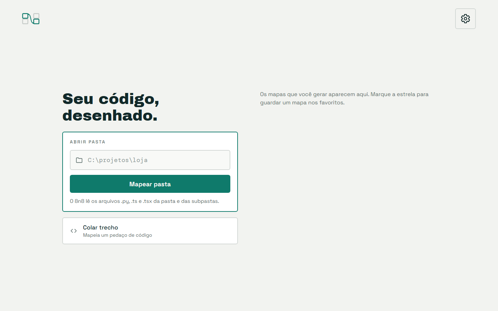
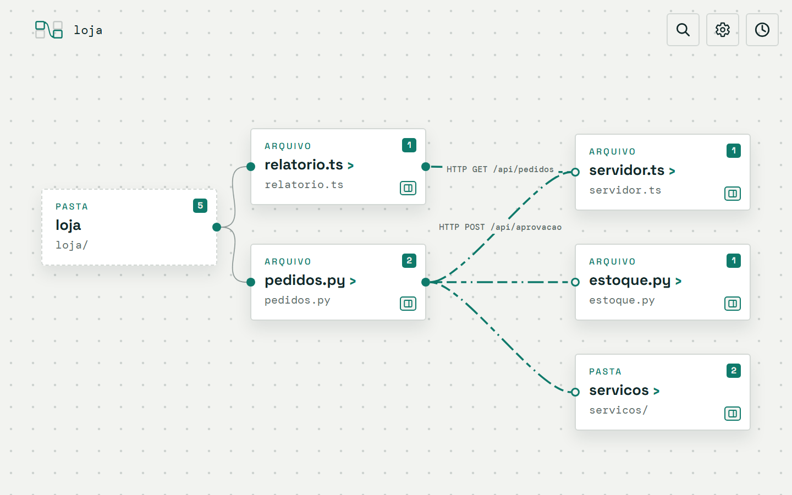
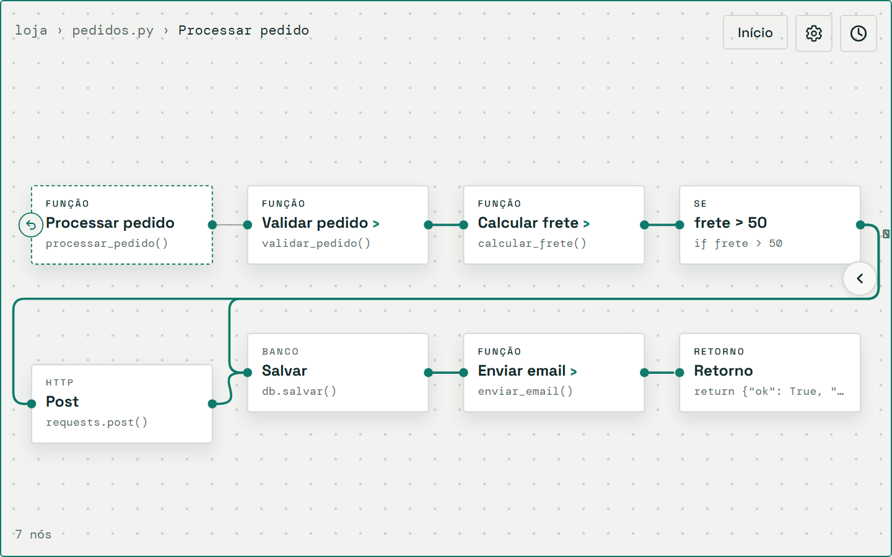

# 8n8

[](https://github.com/Ferreira-Jefferson/8n8/actions/workflows/ci.yml)
[](https://github.com/Ferreira-Jefferson/8n8/actions/workflows/codeql.yml)
[](LICENSE)
[](https://github.com/Ferreira-Jefferson/8n8/graphs/contributors)
[](https://github.com/Ferreira-Jefferson/8n8/commits)
[](https://github.com/Ferreira-Jefferson/8n8/issues)
[](https://github.com/Ferreira-Jefferson/8n8/stargazers)
[](https://nodejs.org)
[](CONTRIBUTING.md)

O 8n8 é um mapa visual de código. Você aponta um arquivo, uma pasta ou um trecho, e ele mostra como as partes se conectam, como nós ligados por arestas.

O mapa começa amplo. Você abre um nó para ver o fluxo interno dele e vai descendo, até as linhas reais de código. Cada nó traz um resumo e sugestões de melhoria.

## Por que o 8n8 existe

Com a IA, o código muda e cresce rápido demais para ler linha por linha. Eu perdia tempo para entender o que tinha mudado e como as partes se ligavam. Procurei uma ferramenta visual que mostrasse o fluxo de forma rápida e intuitiva, e não achei nenhuma. Lembrei do [n8n](https://n8n.io), me inspirei nele e criei o 8n8. O nome é uma brincadeira com ele. Fora o desenho de nós e arestas, os dois projetos não têm relação nenhuma.

## Como fica

**1. Você aponta uma pasta ou cola um trecho.**

<picture>
  <source media="(prefers-color-scheme: dark)" srcset="docs/imagens/inicio-dark.png">
  
</picture>

**2. O mapa começa amplo:** a pasta, os arquivos (de linguagens diferentes) e como eles se ligam.

<picture>
  <source media="(prefers-color-scheme: dark)" srcset="docs/imagens/pasta-dark.png">
  
</picture>

**3. Você abre um nó e vê o fluxo por dentro:** funções, um `if`, uma chamada HTTP, o banco e o retorno.

<picture>
  <source media="(prefers-color-scheme: dark)" srcset="docs/imagens/fluxo-dark.png">
  
</picture>

O código de exemplo está em [docs/imagens/exemplo](docs/imagens/exemplo). Para refazer as imagens: `pnpm prints`.

## Como funciona

1. **O 8n8 lê o código.** Ele aceita um arquivo, uma pasta ou um trecho colado.
2. **Um parser monta a estrutura.** O Tree-sitter lê cada arquivo e o 8n8 monta um grafo em níveis: repositório, módulo, arquivo, função e bloco. O resultado é sempre o mesmo para o mesmo código.
3. **A tela desenha o grafo.** Cada nível é um fluxo de nós e arestas. Você abre um nó para descer ao nível seguinte.
4. **O LLM escreve os textos.** Ele cria o resumo e as sugestões de cada nó. Ele nunca decide a estrutura, e cada texto aponta para um nó e uma linha.

Todo nó leva de volta ao código real, com o arquivo e as linhas. **Sem chave de LLM, o mapa funciona.** Só os resumos e as sugestões ficam de fora.

Em `apps/` há três pastas. Uma é a tela e duas são as formas de rodar o 8n8, sobre o mesmo núcleo:

- **Tela (`apps/ui`):** a interface, em React com React Flow. A CLI e a extensão servem o mesmo build. Não há backend hospedado: o núcleo roda localmente.
- **CLI (`apps/cli`):** você roda o comando `8n8` no terminal (PowerShell ou Bash), e o mapa abre no navegador.
- **Editores (`apps/editors`):** a extensão do VS Code abre o mapa num painel ao lado do código. Outros editores entram na mesma pasta.

Os textos usam Português Técnico Simplificado: frases curtas, voz ativa, um termo por conceito. As regras estão em [docs/portugues-tecnico-simplificado.md](docs/portugues-tecnico-simplificado.md).

## Linguagens suportadas

| Linguagem | Extensões | Pacote |
|---|---|---|
| Python | `.py` | `packages/languages/python` |
| TypeScript | `.ts`, `.tsx` | `packages/languages/typescript` |

Uma pasta com as duas linguagens vira um mapa só. Os arquivos se ligam por rota HTTP, por processo e por nome.

Para acoplar outra linguagem, siga o guia [docs/adicionar-linguagem.md](docs/adicionar-linguagem.md).

## Instalar

O 8n8 precisa de Node 22.13 ou mais novo. Hoje a instalação parte do repositório. Há duas formas de usar: a CLI e a extensão do VS Code.

### A CLI

A CLI roda no terminal (PowerShell ou Bash) e abre o mapa de qualquer pasta no navegador.

```bash
pnpm install
pnpm --filter @8n8/cli package
npm install -g ./release/8n8-cli-0.0.1.tgz
```

O pacote não tem dependências nem scripts de instalação: todo o código vai dentro dele. Depois, use o comando `8n8`:

```bash
8n8 .              # abre o mapa da pasta atual no navegador
8n8 C:\projeto     # ou de qualquer pasta
8n8                # abre a tela inicial
8n8 --no-open      # sobe o servidor sem abrir o navegador
8n8 --help         # mostra o uso e as variáveis
```

### A extensão do VS Code

A extensão abre o mesmo mapa num painel ao lado do código. Ela precisa do VS Code 1.138 ou mais novo.

```bash
pnpm install
pnpm --filter 8n8-vscode package
code --install-extension release/8n8-vscode-0.0.1.vsix
```

Depois, rode **8n8: Abrir mapa** na paleta de comandos. Ele abre a tela inicial, sem mapa: lá você digita a pasta ou cola um trecho. Para mapear uma pasta direto, clique nela com o botão direito no Explorer e escolha **8n8: Abrir mapa desta pasta**. No mapa de uma pasta, o botão **Início** volta à tela inicial.

Para acrescentar outro editor, veja [docs/adicionar-editor.md](docs/adicionar-editor.md).

## Configurar o LLM

Os resumos e as sugestões pedem um provedor de LLM. O jeito mais simples é pela tela: clique no botão **Configurações** (no canto de cima, em todas as telas) e preencha:

- **Provedor**: `openrouter` (o padrão), `openai`, `anthropic` (os três pedem uma chave de API), `openai-compatible` (Ollama, LM Studio ou um servidor seu, com a URL pela variável de ambiente) ou `claude-code` (a sua assinatura do Claude Code, sem chave).
- **Chave de API**: o campo só recebe a chave. Ela nunca volta para a tela: o diálogo diz só "Chave guardada".
- **Modelo**: escreva o nome exato do modelo, como o provedor o conhece. Vazio usa o padrão do provedor, que aparece como dica no campo.
- **Gerar o resumo ao selecionar um nó** e **Pedir as sugestões ao selecionar um nó**: desligados, o resumo e as sugestões só são pedidos quando você clica em "Gerar resumo" ou "Pedir sugestões". Assim nada é gasto enquanto você só navega. O que já está no cache aparece sem clique.

Trocar o provedor apaga a chave e o modelo guardados, para a chave nunca ir a um serviço que você não escolheu.

### Variáveis de ambiente

Uma variável de ambiente ganha da tela, e o campo dela aparece travado no diálogo. No repositório, `pnpm dev` e `pnpm start` leem o `.env` da raiz. Copie `.env.example` para `.env` e preencha:

```bash
cp .env.example .env
```

- `APP8N8_LLM_PROVIDER`: `openrouter` (o padrão), `openai`, `anthropic`, `openai-compatible` (Ollama, LM Studio, servidor próprio) ou `claude-code`.
- `APP8N8_CLAUDE_PATH`: o caminho do executável do Claude Code, quando ele não está no lugar de instalação padrão. O caminho só vem desta variável, nunca da tela.
- `OPENROUTER_API_KEY`, `OPENAI_API_KEY` e `ANTHROPIC_API_KEY`: a chave de cada provedor. Esses três usam o endereço oficial. Só o `openrouter` aceita trocar a URL, por `OPENROUTER_BASE_URL`.
- `APP8N8_LLM_BASE_URL` e `APP8N8_LLM_API_KEY`: a URL e a chave do provedor `openai-compatible`. A URL só vem desta variável: a tela não tem campo de URL. Em servidor local, a chave é opcional.
- `APP8N8_MODEL` e `APP8N8_REVIEW_MODEL`: o modelo do resumo e o do revisor. Vazio usa o padrão do provedor.
- `APP8N8_AUTO_SUMMARY` e `APP8N8_AUTO_SUGGESTIONS`: `1` pede o resumo ou as sugestões ao selecionar um nó; `0` espera o clique.

A CLI instalada nunca lê um `.env`.

### O provedor `claude-code`

Com o `claude-code`, o 8n8 roda o seu Claude Code em modo não interativo, numa pasta vazia própria, sem ferramentas, sem MCP e só com as suas configurações de usuário. O código do nó vai pelo stdin. Ele nunca roda dentro da pasta analisada, então os hooks e o `CLAUDE.md` dela não são carregados.

Para acrescentar um provedor, veja [docs/adicionar-provedor-llm.md](docs/adicionar-provedor-llm.md).

## Dados e segurança

Achou uma falha de segurança? Avise em privado, como explica o [SECURITY.md](SECURITY.md).

- **Token por execução.** Cada execução da CLI gera um token novo, que só a aba aberta por ela conhece. Outro programa da máquina não consegue usar a API nem a sua chave de LLM. Sem o token, a API responde 401.
- **Pasta de dados.** Tudo fica em `~/.8n8` (no Windows, `C:\Users\<nome>\.8n8`): o cache em `cache/`, o histórico em `historico.db` e as configurações em `config.json`, só com permissão do dono. As variáveis `APP8N8_CACHE_DIR`, `APP8N8_HISTORY_DIR` e `APP8N8_CONFIG_DIR` mudam essas pastas.
- O histórico guarda só o caminho de cada pasta, nunca o código. Abrir uma pasta pelo histórico lê a pasta de novo. De um trecho colado, o histórico guarda o texto e a linguagem.
- **Na extensão do VS Code**, não há porta aberta: a página do painel fala com o núcleo por mensagens do próprio VS Code. A chave de API fica no cofre do VS Code (`SecretStorage`). O cache e o histórico ficam na pasta de dados da extensão.

## O que o 8n8 lê de uma pasta

O 8n8 respeita o `.gitignore` da pasta. Ele lê o `.gitignore` da raiz e o de cada subpasta, com as regras do git (padrões, `!`, `/` e `**`). Um arquivo que o `.gitignore` ignora não entra no mapa nem aparece na lista de arquivos ignorados. O `.gitignore` global da máquina e o `.git/info/exclude` não contam: o mapa da mesma pasta é igual em qualquer máquina.

O 8n8 também pula, sempre:

- as pastas `.git`, `node_modules`, `build` e `dist`;
- as pastas de cada linguagem: `.venv`, `venv`, `__pycache__` e `site-packages` (Python), `.next` e `coverage` (TypeScript);
- arquivos de extensão que nenhuma linguagem lê.

Alguns arquivos de código ficam fora do mapa por outro motivo: maior que 1 MB, fora do UTF-8, ilegível ou link simbólico. Nesse caso, um ícone de aviso aparece no canto do mapa. O hover diz quantos arquivos ficaram fora, e o clique mostra a lista com o motivo de cada um. Um arquivo maior que 1 MB, e de até 20 MB, tem o botão "Adicionar ao mapa".

## Desenvolver

Você precisa de Node 22.13 ou mais novo e do pnpm.

```bash
pnpm install
pnpm dev
```

O `pnpm dev` recarrega sozinho. Ele sobe o servidor (`pnpm dev:server`, porta 4317) e a tela (`pnpm dev:ui`, com o Vite). Abra o endereço que o Vite mostrar no terminal.

Para usar sem recarga, construa a tela e suba tudo em um servidor só:

```bash
pnpm start
```

Abra o endereço que o terminal mostrar (`http://127.0.0.1:4317/#t=...`). O `#t=` é o token da sessão. A porta muda com a variável `APP8N8_PORT`.

### Estrutura do repositório

| Pasta | O que tem |
|---|---|
| `apps/ui` | A tela: React com React Flow. |
| `apps/cli` | A CLI `8n8`, que abre a tela no navegador. |
| `apps/editors/vscode` | A extensão do VS Code, que abre a tela num painel. |
| `packages/model` | Os tipos e contratos: `Graph`, `LanguagePlugin`, `LlmClient`. |
| `packages/languages/*` | Um plugin por linguagem, mais `testkit` (suíte de conformidade) e `treesitter` (auxiliar de gramática). |
| `packages/project` | Monta o grafo do projeto e detecta a linguagem do trecho. |
| `packages/links` | Ligações entre linguagens por rota HTTP, processo e nome. |
| `packages/input` | Leitura de pasta. |
| `packages/explain` | Resumos e sugestões, com cache. |
| `packages/llm` | Provedores de LLM. |
| `packages/server` | O núcleo: as rotas da API, montadas por `createCore`. |
| `e2e` | Testes de ponta a ponta com Playwright. |
| `scripts` | `dev.mjs` (o `pnpm dev`) e `prints-readme.mjs` (o `pnpm prints`). |
| `docs` | Guias, o manual da marca e as imagens do README (`docs/imagens`). |
| `release` | Os pacotes gerados (`.tgz` e `.vsix`). O git ignora o conteúdo. |

### Como contribuir

Veja [CONTRIBUTING.md](CONTRIBUTING.md): ambiente, segredos (o hook do gitleaks), comandos de verificação, regras de fronteira entre pacotes e estilo de commit.

## Pix do Café

O 8n8 é livre e gratuito. Se ele ajuda você, uma doação por Pix mantém o projeto vivo. Ela é opcional e não libera nada a mais. A tela também mostra o QR em **Configurações → Pix do Café**.


<details>
<summary>Pix copia e cola</summary>

```
00020126580014br.gov.bcb.pix013667f4532c-acee-4994-9724-19923f3dbab65204000053039865802BR5911CRJE89778416009Sao Paulo610901227-20062230519daqr22034254699182663041B30
```

</details>

## Licença

O 8n8 é software livre, sob a GNU General Public License versão 3 (GPL-3.0). O texto completo está em [LICENSE](LICENSE).
